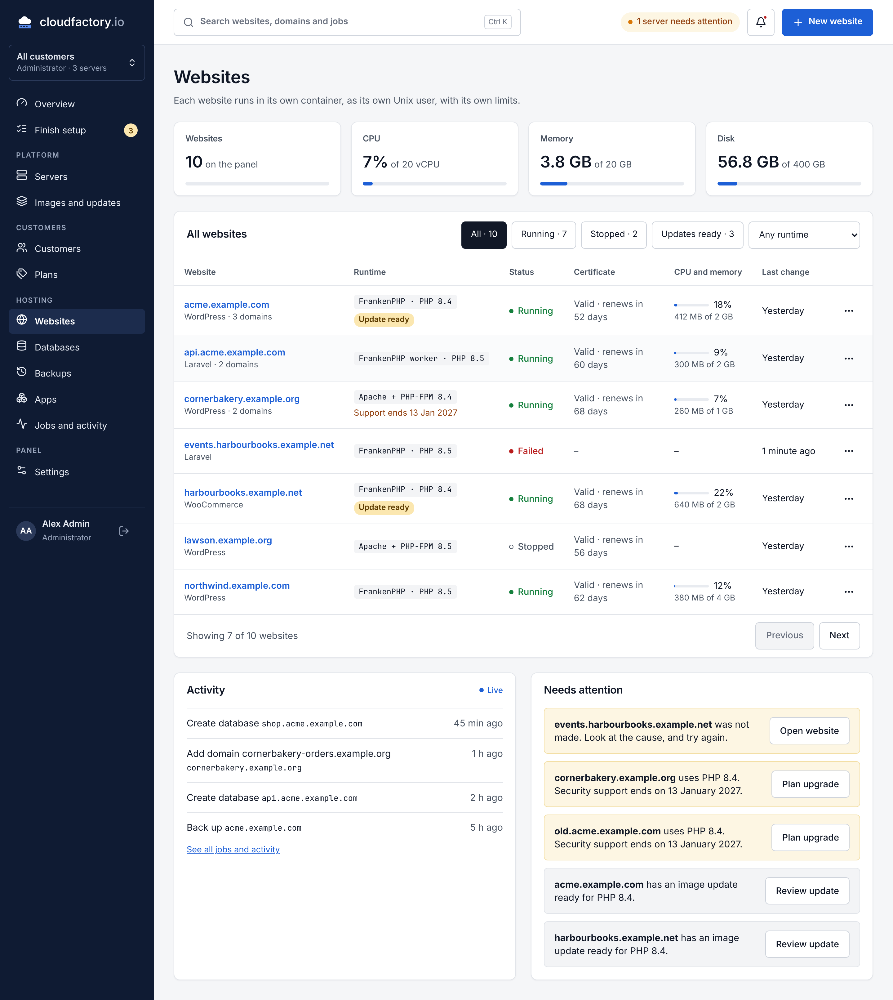
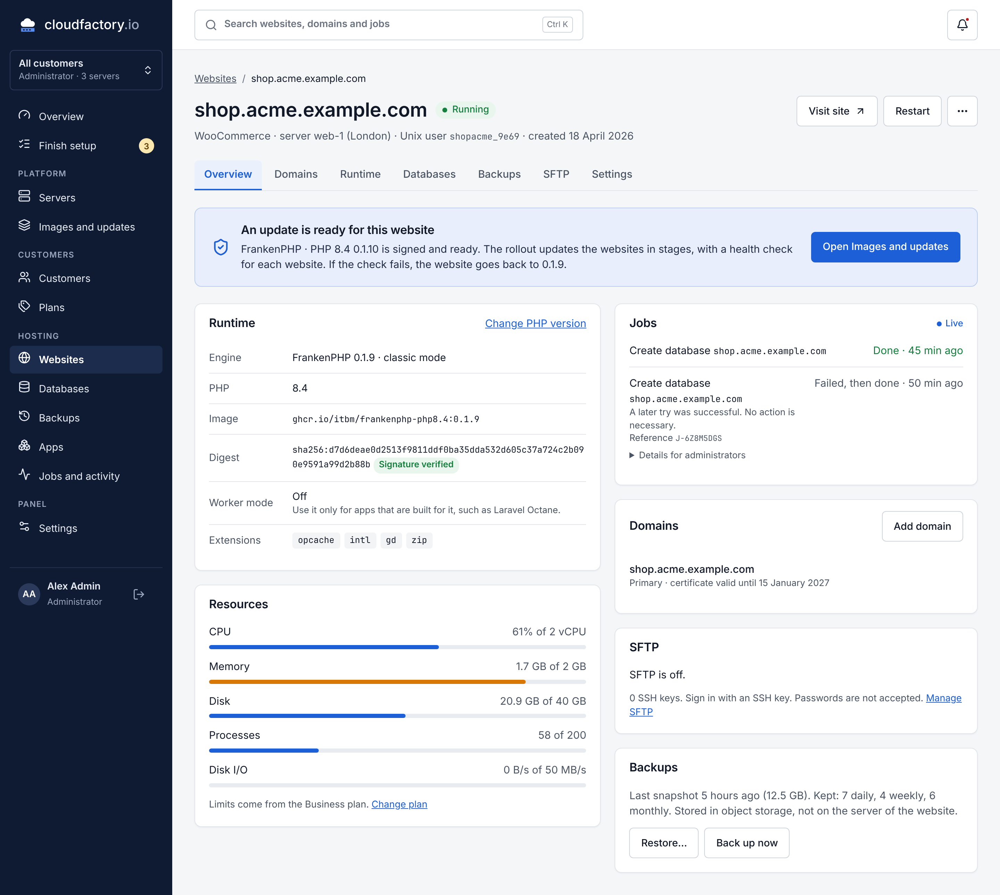
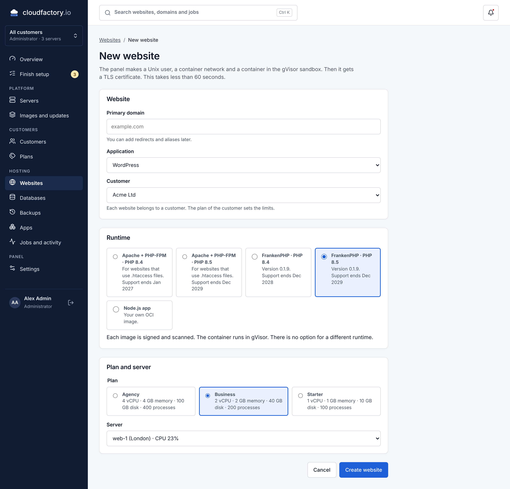
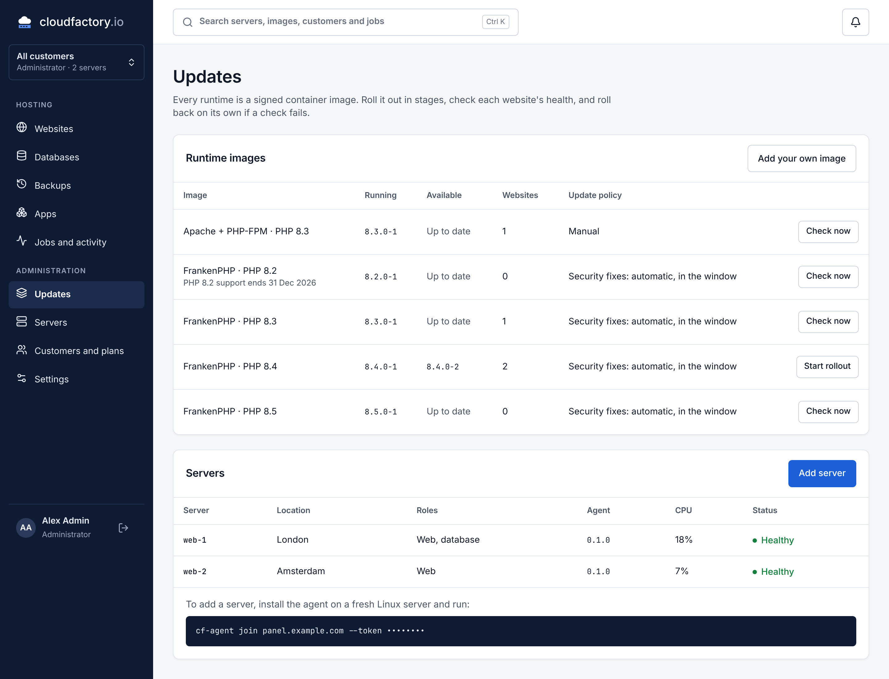
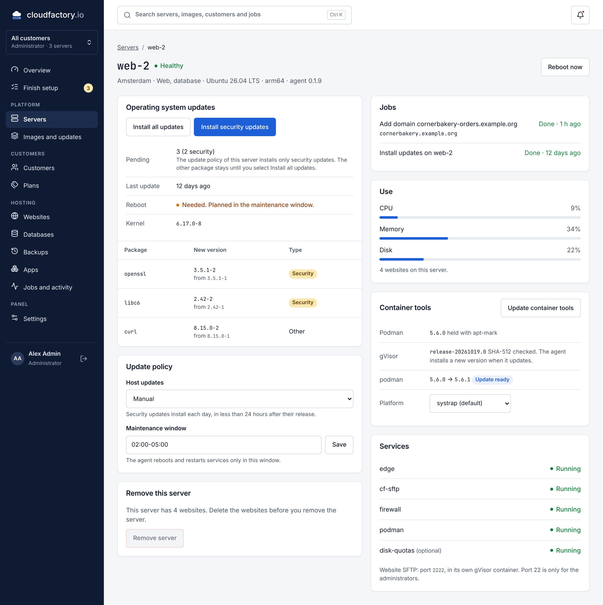

# Cloudfactory

Cloudfactory is an open source control panel for web hosting. Each website runs in its own
rootless Podman container in a gVisor sandbox. The panel sends typed jobs to an agent on each
server. All updates are signed, and each update has a health check and an automatic rollback.

This repository holds release 0.1 (Foundation). Refer to [docs/status.md](docs/status.md) for the
items that are complete and the items that are not complete.



## Screenshots

These screenshots show the web panel of release 0.1 on the panel API, with sample data. Click a
screenshot to see it at full size.

<table>
  <tr>
    <td width="50%" valign="top">
      <a href="docs/screenshots/readme/website-overview.png"></a>
      <p>Each website has a page with its runtime, resource limits, domains, SFTP access and backups.</p>
    </td>
    <td width="50%" valign="top">
      <a href="docs/screenshots/readme/new-website.png"></a>
      <p>To make a website, select the domain, the application, the runtime and the plan.</p>
    </td>
  </tr>
  <tr>
    <td width="50%" valign="top">
      <a href="docs/screenshots/readme/updates.png"></a>
      <p>Each runtime is a signed container image. A rollout updates the websites in stages and rolls back a website if its health check fails.</p>
    </td>
    <td width="50%" valign="top">
      <a href="docs/screenshots/readme/server.png"></a>
      <p>Each server has a page with its operating system updates, update policy, resource use and container tools.</p>
    </td>
  </tr>
</table>

Refer to [docs/screenshots](docs/screenshots/README.md) for screenshots of all pages.

## Components

| Directory              | Component                                                                 |
| ---------------------- | ------------------------------------------------------------------------- |
| [`web/`](web)          | The web panel. React 19, TypeScript and Vite.                             |
| [`api/`](api)          | The panel API. Laravel 13 and PHP 8.4 or later.                           |
| [`openapi/`](openapi)  | The OpenAPI 3.1 document of the panel API.                                |
| [`agent/`](agent)      | The agent `cf-agent`. Go. It runs as root on each server.                 |
| [`cli/`](cli)          | The command line tool `cf`. Go. It uses only the public API.              |
| [`install/`](install)  | The installation script and its tests.                                    |
| [`images/`](images)    | The Containerfiles of the runtime, edge, panel and database images.       |
| [`.github/workflows/`](.github/workflows) | CI, image scans, releases and the daily image rebuild. |
| [`docs/`](docs)        | The documentation.                                                        |

## Install

Use a new server with Debian 13 or Ubuntu 26.04. Run this command as root:

```sh
curl -fsSL https://github.com/itbm/cloudfactory/releases/latest/download/install.sh | sh -s -- --domain panel.example.com
```

GitHub has the address `releases/latest` only for a release that is not a pre-release. If the
command gives `error: 404`, each release is a pre-release. Then put the version of the release in
the address, for example
`https://github.com/itbm/cloudfactory/releases/download/v0.1.9/install.sh`.

The script does all checks before it changes the system. The panel gets a TLS certificate from
its own certificate authority, so any domain works, also `panel.localhost`. Add the root
certificate to your browser, or change to Let's Encrypt in **Settings > Panel certificate** when
the domain is public.

To add a second server, copy the join command in the panel (**Servers > Add server**). The
command uses the installation script of the release of the panel. It looks like this:

```sh
curl -fsSL https://github.com/itbm/cloudfactory/releases/download/v0.1.9/install.sh | sh -s -- --join TOKEN --panel https://panel.example.com --panel-ca-sha256 FINGERPRINT
```

The new server must be able to connect to the panel. Thus a panel on `panel.localhost` cannot
have a second server.

Refer to [docs/installation.md](docs/installation.md) for all options and for the steps to verify
the script before you run it.

## Documentation

- [Architecture](docs/architecture.md)
- [Security model](docs/security.md)
- [Installation](docs/installation.md)
- [Development](docs/development.md)
- [Releases and signing keys](docs/releasing.md)
- [Decisions about the open questions](docs/decisions.md)
- [Status of release 0.1](docs/status.md)

## Licence

The panel, the agent, the CLI and the image build files use the
[GNU Affero General Public License 3.0](LICENSE).
