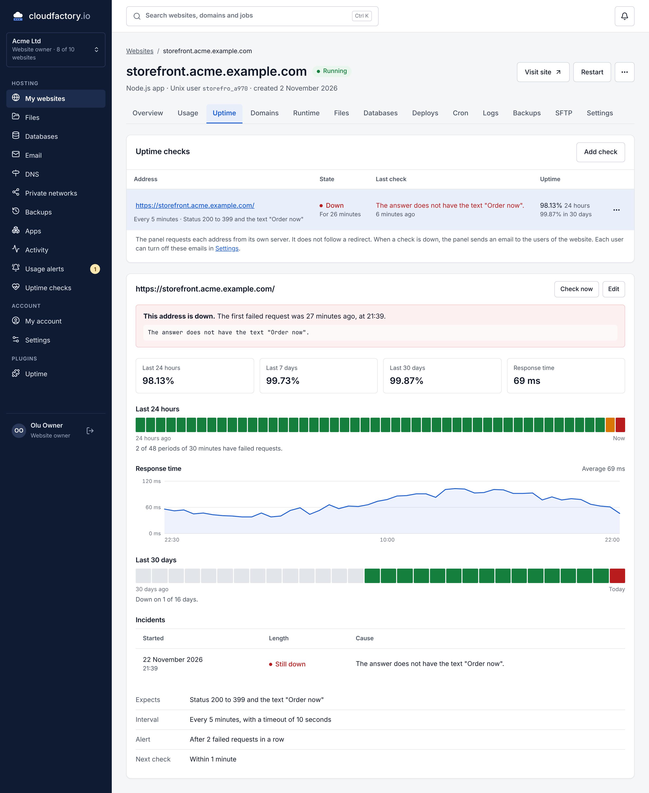
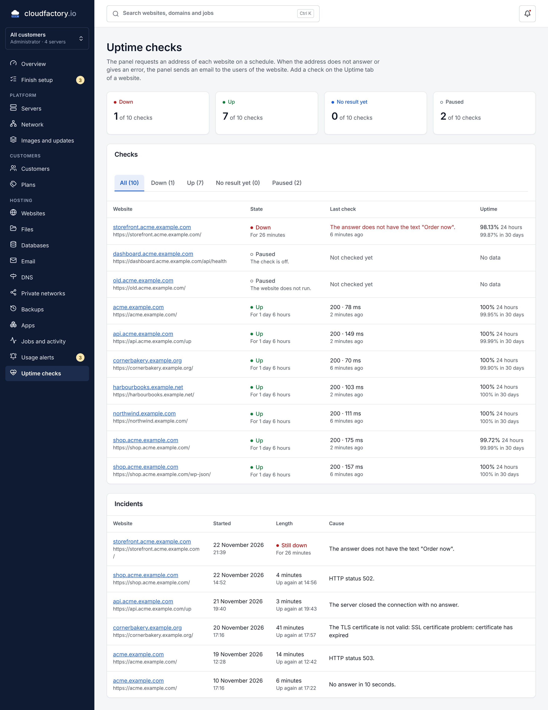
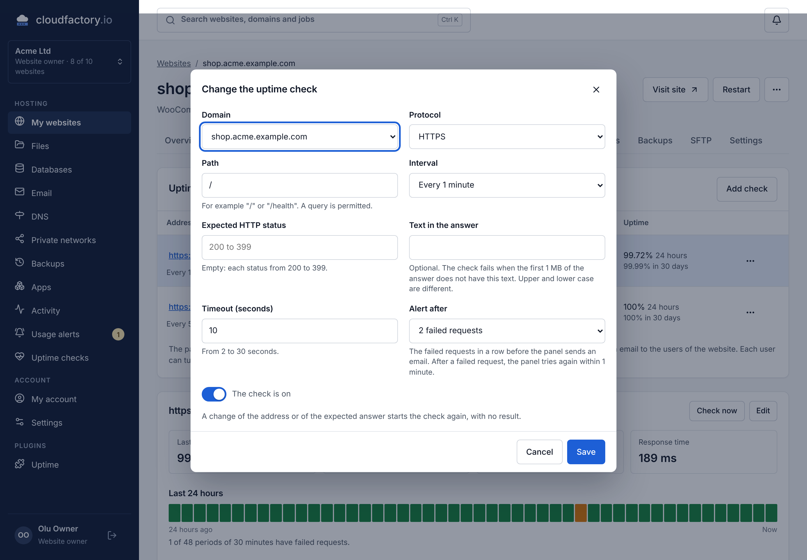

# Architecture

This document describes the components of Cloudfactory release 0.1 and how they operate
together. The product specification, section 6, gives the requirements.

## Overview

```text
 Browser ──► web panel ─┐
                        ├─► panel API (Laravel) ──► queue worker ──► cf-agent on each server
 cf CLI ────────────────┘        ▲                    (Connect over mutual TLS, port 7443)
                                 │                                 │
                                 └──── job events and host reports ◄┘
```

- The **web panel** and the **`cf` CLI** use only the public API. The API has no private
  routes for the panel.
- The **panel API** keeps the desired state in its database. It does not change a server
  directly. It sends a typed job to the agent.
- The **agent** (`cf-agent`) runs on each server. It accepts only the actions in
  [`agent.proto`](../agent/proto/cloudfactory/agent/v1/agent.proto). It has no action that runs
  a shell command that the panel gives. The agent has two processes: a worker with the user
  `cf-agent`, and a root helper (refer to [The processes of the agent](#the-processes-of-the-agent)).

## Flow of a change

1. The client sends a request, for example "change the runtime of a website".
2. The API checks the request and the token scope. It records the desired state.
3. The API makes a job and sends status 202 with the job.
4. A queue worker sends the job to the agent. The worker uses the Connect protocol (JSON over
   HTTP/2) and mutual TLS.
5. The agent accepts the job and does the steps in the background.
6. The agent sends an event after each step to `/api/agent/v1/jobs/{id}/events`.
7. The API changes the state of the website, server or rollout to agree with the result.

The agent keeps each job in its data directory. If the agent stops during a job, it continues
the job when it starts again. A reboot job uses this method: the agent writes a marker, starts
the reboot and waits for the shutdown. After the reboot, the agent starts the containers,
checks the websites and only then sends the result.

Time limits make sure that a job always gets a result:

- The agent stops a job after 30 minutes. A backup, a restore, a host update and the weekly
  removal of backup data have a limit of 170 minutes.
- If a job has no event for 10 minutes, the panel sends the job again. The agent knows the job
  ID. It reports the result of a complete job again, and does not run the job a second time.
- If a job has no result after 3 hours, the panel sets the job to "failed".
- A server that does not report for 5 minutes is "offline". The panel does not call an offline
  server. The jobs of that server wait, and the panel sends them when the server reports again.
- The panel reads a job with a lock before each change of its state. Thus a late event does
  not open a complete job again.

## The processes of the agent

```text
 panel ──► port 7443 ──► worker (user cf-agent)
                           │  jobs, state, reports, connection to the panel
                           │
                           │  /run/cloudfactory-agent/gate.sock
                           ▼
                         root helper (root)
                           commands · operations · connections
```

systemd starts `cf-agent serve` as root. This process is the root helper. It makes the Unix
socket `/run/cloudfactory-agent/gate.sock`, starts the worker (`cf-agent work`) as the user
`cf-agent`, and waits. When the worker stops, the root helper stops with the same result,
and systemd starts the two processes again. Thus the service has one unit, and an update, a
restart and a rollback of the agent operate as with one process.

The worker has the agent port, the jobs, the state of the websites and the connection to
the panel. For each step that needs root, it sends a request through the socket. The root
helper has three lists, and it refuses a request that is not in a list:

- **Commands.** The worker gives the arguments of a command. The policy
  (`agent/internal/actions/policy.go`) accepts a program as the Unix user of a website, a
  command of a fixed form as a service user, and some root commands with fixed arguments.
- **Operations.** An operation is root work with a name and typed values, for example
  `user.ensure`, `unit.write` and `db.prepare` (`agent/internal/actions/root.go`). The worker
  gives names, for example a Unix user or the ID of a database server. The root helper makes
  each path from its own settings.
- **Connections.** The root helper opens a connection for the worker and gives the data
  through the socket (`agent/internal/actions/dial.go`): the admin socket of the edge proxy,
  some ports on the private service address, and the Valkey database servers.

The code of an action is the same for the two sides. A function that needs root starts with
a check: in the worker, it sends the operation to the root helper. In the root helper, it
does the work. If the root helper cannot start the worker, it does the work of the worker
itself, as one root process.

[security.md](security.md#the-root-helper-of-the-agent) gives what the boundary protects and
what it does not protect.

## Input rules of the panel and the agent

The panel checks each value before it makes a job. The agent checks each value again before it
uses the value in a file path, a unit name or a command. The two checks must agree. If the
panel accepts a value that the agent refuses, the user sees an error only after the job fails.

Thus the rules are in one file, [`schema/input-rules.json`](../schema/input-rules.json). A
generator writes the Go checks of the agent and the PHP rules of the panel from this file. The
tests of the two components run the same examples
([`schema/input-vectors.json`](../schema/input-vectors.json)). CI makes sure that the generated
files are current. Refer to [development.md](development.md#input-rules).

A pattern in the rules file uses only the syntax that Go and PHP read in the same way. Lengths
are in bytes in the two languages.

## Jobs that the agent refuses

The agent answers a request that it refuses with an HTTP status from 400 to 499 and a message,
for example `the PHP extension "x" is not valid`. A second attempt gets the same answer. Thus
the panel does not try again: the job fails immediately, and the job shows the message of the
agent.

These errors are temporary, and the panel tries again 4 times in approximately 6 minutes: no
connection, a status from 500 to 599, status 408 and status 429.

## States of websites, jobs and rollouts

A website, a job and a rollout each have a state. Each state has a table of the changes that
are permitted. The tables are in the enums `WebsiteStatus`, `JobState` and `RolloutState` in
[`api/app/Enums`](../api/app/Enums).

| Record  | State         | Can change to                           |
| ------- | ------------- | --------------------------------------- |
| Website | `starting`    | `running`, `stopping`, `stopped`, `failed` |
| Website | `running`     | `stopping`, `stopped`, `starting`, `failed` |
| Website | `stopping`    | `stopped`, `running`, `starting`, `failed` |
| Website | `stopped`     | `starting`, `running`, `failed`         |
| Website | `failed`      | `starting`                              |
| Job     | `queued`      | `running`, `succeeded`, `failed`        |
| Job     | `running`     | `queued`, `succeeded`, `failed`         |
| Job     | `succeeded`   | No change                               |
| Job     | `failed`      | No change                               |
| Rollout | `running`     | `paused`, `done`, `rolled_back`         |
| Rollout | `paused`      | `running`, `rolled_back`                |
| Rollout | `done`        | No change                               |
| Rollout | `rolled_back` | No change                               |

The model checks each change of the state against the table when it saves the record
(`App\Models\Concerns\GuardsState`). The check reads the state in the database, because a
different request can change the record at the same time. There are three results:

- A request of a user that the table does not permit gets HTTP status 409 with a message, for
  example "The rollout is rolled back already."
- A late result from a server that the table does not permit changes nothing. The panel writes
  a warning to its log. For example, the result of an old power job does not change a website
  with the state `failed`.
- The actions "pause", "resume" and "roll back" of a rollout lock the row of the rollout first.
  Thus two requests at the same time cannot do one action two times.

A test makes each change between each two states of each table
(`api/tests/Feature/SchemaAndStatesTest.php`). If you change a table, change the test and this
section too.

## A website on a server

Each website has:

- One Unix user, with a UID and a GID from 20000 to 59999. The user owns the files of the
  website in `/srv/cloudfactory/sites/<user>`. The firewall limits the connections of the
  users in this range (refer to [security.md](security.md#firewall)).
- One rootless Podman container. A Quadlet unit in `/etc/containers/systemd/users/<uid>/`
  starts it. The container uses the gVisor runtime `runsc`.
- The `pasta` network mode. Each container has its own network namespace.
- One port on the private service address `169.254.77.1` from the range 20000 to 29999. The
  agent takes and records a port in one locked step, so two websites never get the same port.

### The private service address

The installer adds `169.254.77.1/32` to the loopback interface (`cloudfactory-address.service`).
This address never leaves the server. The website ports, the database ports and the panel
ports are open only on it.

The ports are not on `127.0.0.1`, because of gVisor. pasta sends a connection from
`127.0.0.1` to `127.0.0.1` in the network namespace of the container, and gVisor
(`network=sandbox`) does not listen there. A connection to `169.254.77.1` comes from a
different address, so pasta sends it through its network device into gVisor. Rootless Podman
bridge networks have the same problem for all connections, so websites do not use them.

An nftables rule refuses a new connection to a website port on `169.254.77.1` unless it comes
from root or from the user `cf-edge`. pasta opens each connection as the Unix user of the
container, so a website cannot connect to a different website.

The database servers are not on this address. Each customer has its own database servers on
an address of the database network. Refer to [Databases](#databases).

### Shared runtime images

All websites on a server share one read-only copy of each runtime image. A new website with an
image that the server has already starts with no pull, and 100 websites keep one copy of the
image, not 100.

- The agent pulls each runtime image one time, as root, into its own Podman store in
  `/var/lib/cloudfactory-images/<sha256 of the image reference>`. The signature policy checks
  the image when the agent pulls it. Only a reference with a digest goes in the shared store.
  The image of a database server is the exception: its reference has the version of the
  agent as its tag, and a release does not change the content of its tags.
- The agent pulls into a temporary store. Then it lets the website users read the metadata
  of the store and gives the store its final name in one step. After that, nothing writes the
  store again. Podman writes its metadata with mode `0600` each time that it changes a store,
  so a store that changes while websites read it can stop a website for a short time.
- `/etc/cloudfactory/website-storage.conf` lists the stores as `additionalimagestores`. The
  file `~/.config/containers/storage.conf` of each website user is a link to it. Root owns
  `~/.config/containers`. Each website user keeps only its own small writable container layer
  in its home directory.
- The website users use `fuse-overlayfs`. The containers use `--userns=keep-id`. With the
  overlay driver of the kernel, Podman must copy each image for each user to change the file
  owners. fuse-overlayfs changes the owners without a copy. Before the shared store, each
  website kept about 1.2 GB: the image and its copy.
- In the container, the files of the image have the owner `nobody`. The website process runs
  as the website user and reads them as "other", the same as before.
- A custom image stays in the storage of its website user, so other customers never see it.
  The website user pulls it, and also pulls an image with no digest. This pull does not use
  the shared stores: the agent gives Podman the storage option
  `overlay.mount_program=/usr/bin/fuse-overlayfs` on the command line, and a storage option
  there replaces all storage options of `website-storage.conf`. With the shared stores,
  Podman finds a layer of the new image in a shared store, for example the empty layer that
  most images have, and copies it. The copy fails with the error
  `tar-split.gz: permission denied`, because a website user cannot read all files of a layer
  that root pulled. Thus the user keeps a full copy of such an image.
- After a runtime change, the agent removes the previous image from the storage of the website
  user, if it is there: a custom image, or a copy from before the shared store. Then it removes
  the shared images that no website uses, in two steps: first from `website-storage.conf`, then,
  at the next prune, the files. The agent also prunes after it deletes a website and once a
  day. It keeps an image that a job asked for in the last hour, and each image that a
  container unit of a website or of a database server names.

The container unit of a website sets these limits:

- `NoNewPrivileges=true` and `DropCapability=all`.
- A read-only root file system. Only the website directory and `/tmp` are writable.
- Memory, CPU, process and disk I/O limits from the plan of the website. These limits are
  systemd properties of the service (`MemoryMax`, `CPUQuota`, `TasksMax`,
  `IOReadBandwidthMax` and `IOWriteBandwidthMax`), not Podman options. Each gVisor container
  starts with `--runtime-flag=ignore-cgroups`, so the sandbox stays in the cgroup of its
  service. Without this flag, runsc makes its own cgroup and must write
  `/sys/fs/cgroup/cgroup.subtree_control`, which a rootless user cannot do. A change of the
  limits in the panel uses `systemctl set-property` on the running service and also changes
  the unit.

### Node.js and Python websites

A website can use a Node.js image (`node22`, `node24` or `node26`) or a Python image
(`python3.13` or `python3.14`) in place of a PHP image. The container runs the start command of
the website, in the same gVisor sandbox, with the same Unix user, network and limits as a PHP
website.

- The image has the entry point `/usr/local/bin/cf-app`. It changes to the application
  directory (`CF_APP_DIR`, the document root of the website, `.` by default) and runs the
  start command with `sh -c`. For Node.js, it adds `node_modules/.bin` to `PATH`. For Python,
  it activates `.venv` when the directory has one.
- The app must listen on the port in the variable `PORT` (8080) and on `HOST` (`0.0.0.0`). The
  edge proxy sends the requests to this port, the same as for a PHP website.
- When the directory has no `package.json` (Node.js) or no `app.py` (Python) and the website
  uses the usual start command, `cf-app` serves a welcome page. Thus a new website passes its
  first health check before the customer uploads the files.
- The install command (for example `npm ci --omit=dev` or
  `python -m venv .venv && .venv/bin/pip install -r requirements.txt`) runs in a build
  container with the runtime image of the website, the same as a deploy from Git. The job
  `Install dependencies` runs it, then does the steps of a runtime change: a new container on a
  copy, a health check and the switch. If the command fails, the website does not change. A
  change of the version with an install command also runs the install command first, with the
  new version.
- The build container has a read-only root, `HOME=/tmp`, and the same limits as the website. The
  package managers keep their caches in `/tmp`.
- When the start command stops, systemd starts the container again (`Restart=always`).

#### Environment variables

Each website can have up to 50 environment variables. A name has letters, digits and `_`, and
does not start with a digit. The panel refuses `PORT`, `HOST`, `HOME`, `PATH`, `PWD` and the
names that start with `CF_`. A value is on one line and has a maximum of 4096 characters.

- The panel keeps the values encrypted in the column `websites.environment`. The API gives the
  names only. The panel adds the values to the job when it sends the job, so they are not in
  the `agent_jobs` table.
- The agent writes the variables to the file `env` (or `env-b` for the second container of a
  runtime change) in the configuration directory of the website. The file has the mode `0600`
  and the website user is its owner. The container unit names it with `EnvironmentFile=`, so
  the values are not in the unit and not in a command line.
- A change starts a new container with the new variables, does a health check and then
  switches. If the health check fails, the old container continues with the old values.
- The install command and the build commands of a deploy also get the variables. The secrets of
  the Git source replace a variable with the same name.

### Runtimes from packs

A [pack](packs.md) adds a runtime of the type `app`, for example Go. The agent runs it as it
runs Node.js and Python, with the same unit and the same isolation. The pack gives only data:
names, usual commands, and images with digests.

```text
 publisher ── pack.json + pack.json.sig + signed images
                 │
 administrator ──► panel API: checks the manifest and the signature (trusted keys, release key)
                 │   keeps the exact bytes, adds one runtime image for each version
                 ▼
 job SetPacks to each web server ──► worker checks again ──► root helper checks again, writes
                 /etc/cloudfactory/packs/SLUG/, a rule for each repository in
                 /etc/containers/policy.json, and registries.d/cloudfactory-packs.yaml
                 ▼
 report of the agent: packs and runtimes ──► panel sends the packs again when they differ
```

- The panel and the agent check each manifest with the same rules. The shared test cases in
  `schema/pack-vectors.json` keep them the same.
- The job has the packs only when the panel sends it. The panel does not keep a copy of the
  packs in the job, so a job that waits in the queue sends the current packs.
- The panel puts a website of a pack runtime only on a server that reports the runtime.
- A rule of a pack in `policy.json` names one repository and the key of its pack. The agent
  never changes a rule of the installer, and adds no rule for a repository that a rule of the
  installer covers.

### Disk limit of a website

The Unix user of a website owns the files of the website. The type of the disk limit comes
from the file system of `/srv/cloudfactory/sites`. A database server has the same three
types (refer to [Disk limit](#disk-limit)):

| File system | Disk limit |
| ----------- | ---------- |
| User quotas are on | The user quota of the Unix user of the website |
| No user quotas, and the server has loop devices | A disk image with the size of the limit, for each new website |
| No user quotas and no loop devices | No limit |

The installer turns on the user quotas of an ext4 or XFS file system. Refer to
[installation.md](installation.md#disk-quotas).

**User quota.** The hard limit of the quota is the disk limit, and the soft limit is 95% of
it. The quota counts all files of the user on the file system: the files of the website, and
the files in the home directory of the user. A website that is at its limit gets the error
"disk quota exceeded" when it writes. A change of the limit applies immediately, and the
website does not stop.

**Disk image.** The website has its own file system:

| Path | Content |
| ---- | ------- |
| `/srv/cloudfactory/sites/<user>` | The directory of the website user: the mount point of the disk image. Root owns it. |
| `/srv/cloudfactory/sites/<user>/app` | The files of the website. The website user owns the directory. |
| `/srv/cloudfactory/disks/<user>.img` | The disk image. Only root can open the directory `disks`. |

1. The root helper makes the Unix user. Then it makes the file `<user>.img` with the size of
   the disk limit, and makes an ext4 file system in it. The file is sparse: it uses only the
   disk space that the website uses.
2. A systemd mount unit (`srv-cloudfactory-sites-<user>.mount`) mounts the file as a loop
   device on the directory of the website user, now and at each start of the server. The
   mount is a part of `local-fs.target`, so it is there before the user manager of the
   website starts the container. The mount has the options `nodev` and `nosuid`. With the
   option `discard`, the file gives the disk space of removed files back to the server.
3. The root helper makes the directory `app` in that file system.

These rules apply to a website with a disk image:

- A website that fills its disk gets the error "no space left on device". It cannot fill the
  disk of the server, and the other websites continue to operate.
- When the mount is not there, the directory `app` is not there, and Podman does not start
  the container. Thus a website never starts with an empty directory in place of its files.
- A larger limit makes the file system larger while the website operates.
- For a smaller limit, the agent first compares the disk space that the website uses with the
  new limit. If the files need more space, the job fails, the website does not stop, and the
  disk keeps its size. If not, the agent stops the website, closes its SFTP sessions, makes
  the file system smaller and starts the website again. A file system cannot become smaller
  while a process uses it.
- The limit applies to the directory of the website user only. The home directory of the
  user is not on the disk image. It has the files of Podman, the log file of the website
  (10 MB at most) and, for a custom image, the copy of the image. The website cannot write
  there: its container, its cron jobs and the build container of a deploy write only in
  `app` and in `/tmp`, which is in memory.
- The file system has the directory `lost+found`. Only root can open it. An SFTP user sees
  its name next to `app`.
- The kernel counts the disk space of the file system. The status report of the agent gets
  the use from the kernel, and does not read the files of the website. For a website with no
  disk image, the agent measures the files.
- When the agent removes the website, it closes the SFTP sessions of the website, removes
  the Unix user, unmounts the file system, and removes the mount unit and the disk image.

A website keeps the type of disk that it started with:

- A website with a directory keeps the directory when the server has no user quotas. The
  agent does not move the files of a website into a disk image. Such a website has no disk
  limit.
- A website with a disk image keeps the image when the file system gets user quotas later.
- A website with no disk limit gets no disk image. When a website with a disk image loses its
  limit, the image keeps its size, because a file system always has a size.

The status report of the agent has the part `disk-quotas`. The part is on when the server
applies the disk limit of each website: with user quotas, or when each website with a disk
limit has a disk image. If not, the part is off, and its text gives the cause: no loop
devices, or the number of websites with a disk limit and no disk image. The panel then shows
"Not applied on this server" next to the disk limit of each website of that server.

The disk images of the websites and of the database servers use the same code
(`agent/internal/actions/loopdisk.go`).

## The edge proxy

One Caddy container on each web server receives all HTTP and HTTPS traffic. It runs as the
user `cf-edge`, in gVisor, with the `pasta` network mode. It listens on port 8080 and port 8443.
The firewall redirects port 80 to 8080 and port 443 to 8443 (refer to
[decisions.md](decisions.md)). It also redirects the connections from the server itself to its
own addresses, for example from a browser on the server to `localhost`.

pasta sends a connection from a loopback address (`127.0.0.0/8` or `::1`) to the loopback
interface in the network namespace of the container. gVisor does not listen there, so pasta
closes the connection. Thus the firewall changes the source address of a redirected IPv4
connection from a loopback address to `169.254.77.1`. IPv6 has no private service address, so
the firewall does not redirect a connection from `::1`. Nothing listens on port 80 or 443, so
the connection is refused, and the browser then uses `127.0.0.1`.

The agent changes the Caddy routes through the Caddy admin API. Each website has one route.
The route sends traffic to `169.254.77.1:<port>`. Caddy gets the TLS certificates
automatically. The agent starts the edge container before it adds the first route, also
during the panel installation.

### Protection of a website

The edge proxy can protect a website that has domains. The protection has four parts: a
firewall, IP address rules, password-protected paths and a sign-in limit. The user sets them
on the **Security** tab of the website, with `cf security` or with
`/v1/websites/{id}/security`.

The panel keeps the protection in the column `security` of the website. The job
`SetWebsiteSecurity` sends it to the agent, and the panel also adds it to each job that makes
the route of the website. The agent keeps it in its state file. The job changes only the
route of the website. The container of the website does not restart.

The route of a protected website has these steps, in this order:

1. The block list. The edge proxy refuses a request from an address in the list with the
   status 403.
2. The allow list. When the list has addresses, the edge proxy refuses a request from each
   other address with the status 403.
3. The sign-in limit. The handler `rate_limit` (caddy-ratelimit) counts the POST requests to
   the sign-in paths from each client address in a window of 1 minute. After the limit, the
   edge proxy answers with the status 429. Each website has its own zone, `cf-<website ID>`.
4. The password-protected paths. The edge proxy uses HTTP basic authentication with a bcrypt
   hash of each password. The panel makes the hash with the cost 10. The API never gives the
   hash.
5. The firewall. The edge proxy examines the request with Coraza (coraza-caddy) and the OWASP
   Core Rule Set, paranoia level 1.
6. The edge proxy sends the request to the website.

A path that ends with `/` is a directory: `/staging/` agrees with `/staging` and with each path
in it. `/` agrees with all paths. The path matcher of Caddy ignores the case of the letters.

A stopped website has no protection. Its route gives the page "This website is not
available" to all visitors.

#### The firewall

- The mode `detect` records the attacks and blocks nothing (`SecRuleEngine DetectionOnly`).
  The mode `block` refuses an attack with the status 403 (`SecRuleEngine On`). Use `detect`
  first, and examine the events before you change to `block`.
- The firewall adds the score of each rule that agrees with the request. It blocks a request
  with a score of 5 or more.
- The firewall examines the address, the headers and the first 1 MiB of the body of each
  request (`SecRequestBodyLimitAction ProcessPartial`). It does not examine the responses.
- A user can turn off rules (`SecRuleRemoveById`) and give paths that the firewall does not
  examine.
- Coraza compiles the rule set one time for each set of directives. All websites with the
  same mode and the same rules that are off share one compiled rule set. One compiled rule
  set uses approximately 3 MB of memory.

#### Firewall events

```text
 Security tab ──► API ──► worker ──► root helper: edge.firewallEvents ──► caddy/logs/firewall.log
```

- The edge proxy writes the messages of the firewall (the logger `http.handlers.waf`) to
  `/data/logs/firewall.log` in its container. On the server, the file is
  `/var/lib/cloudfactory/caddy/logs/firewall.log`. Caddy starts a new file at 20 MB, and keeps
  one old file.
- The edge proxy gives each request the transaction ID `<website ID>-<UUID>` in the header
  `X-Cf-Firewall-Id`. It removes the header before it sends the request to the website. Thus
  the agent can find the events of each website in the shared log.
- The directory is a directory of the user `cf-edge`. The root helper opens the file with no
  symbolic links (`openat2` with `RESOLVE_BENEATH` and `RESOLVE_NO_SYMLINKS`), and reads it
  only when it is a regular file of `cf-edge`. It reads the last 8 MiB of the file.
- The agent puts the lines of one request together, and gives the newest events first. The
  panel shows up to 200 events.
- An event of the mode `detect` has no host, because Coraza writes the host only in the line
  that it writes when it blocks a request.

## Malware scan

The agent can scan the files of a website for malware with ClamAV. The user starts a scan
and sets the schedule on the **Security** tab of the website, with `cf security scan` or with
`/v1/websites/{id}/malware-scans`. All kinds of websites have a scan: a private website and a
worker also have files.

```text
 Panel ──► job ScanWebsite ──► worker
             1. root helper: scan.prepare ──► user cf-scan, signature directory, unit
                cf-scan: systemctl start cf-scan-update.service ──► freshclam ──► database.clamav.net
             2. website user: systemd-run ──► podman run (gVisor, no network) ──► clamscan /scan
```

- The image `scan` has ClamAV from Alpine Linux (`clamav-scanner` and `freshclam`). It has no
  signatures. The image does not have the RAR module, because the licence of that module is
  not a free software licence.
- The service user `cf-scan` keeps the signatures of the server in
  `/var/lib/cf-scan/signatures`. Its home directory has the mode `0711`, and the signature
  directory has the mode `0755`. Thus each website user can read the signatures, and only
  `cf-scan` can change them. The root helper does not follow a symbolic link there.
- The unit `cf-scan-update.container` of `cf-scan` runs `freshclam` one time, and then stops.
  It has no `[Install]` section. The agent starts it before a scan, at most one time in each
  hour. When the update fails and the server has signatures, the scan uses them. With no
  signatures, the scan fails.
- The root helper puts the image in the shared image store. The website user then starts the
  image with no pull.
- The scan runs as the Unix user of the website, in a gVisor container with no network. The
  directory of the website is at `/scan`, read-only. The signatures are at `/var/lib/clamav`,
  read-only. Thus the scan cannot change the website, and a file that attacks ClamAV gets only
  the rights of its own website.
- `systemd-run` puts the container in a unit with these limits: 2 GiB of memory, one CPU, and
  1 hour. ClamAV uses approximately 1 GB of memory for the signatures. The limits are the
  limits of the scan, not of the website.
- The job has the key `malware-scan`, so the agent does the scans of a server one at a time.
- ClamAV scans the first 25 MB of each file, and 100 MB of the content of an archive.
- The agent reads the summary of `clamscan`. The exit status 1 (malware) and 2 (a file that
  ClamAV cannot read) are not errors of the job. Output with no summary is an error. Only the
  last summary line starts the summary, because a file name can have a line break. The result
  has at most 500 files.
- The panel keeps the last 20 scans of each website in the table `malware_scans`. The schedule
  `weekly` scans each website in one hour of the week. The hour comes from the ID of the
  website, so the scans of a server start at different times. When a scan started in the last
  24 hours, the panel does not start the scheduled scan. A website with no scan for 8 days
  gets one at once. The command `cloudfactory:malware-scans` runs each hour.
- A scan changes no file. The user deletes a file that the scan found with the file manager.
  The panel then marks the file as deleted in the last scan.
- When a scan finds malware, the users of the customer and the administrators get the email
  `malware.found`.

## SFTP for the websites

One SFTP container, `cf-sftp`, on each server serves all websites. It listens on port 2200 (the
setting `sftpPort` in `/etc/cloudfactory/agent.json`). The SSH service of the host is only for
the administrators. The image `sftp` has OpenSSH and `libnss-extrausers`.

```text
 SFTP client ──► port 2200 ──► cf-sftp (root Podman, gVisor, bridge network)
                                 │ sshd: key check, chroot, change to the website user
                                 ▼
                     /srv/cloudfactory/sites/<user>/app  (owner: the website user)
```

- Root runs the container, with a Quadlet unit in `/etc/containers/systemd/cf-sftp.container`.
  A rootless container cannot change to the UIDs of the website users.
- The container uses the bridge network of Podman, because Podman has the `pasta` network
  mode only for rootless containers. Podman publishes the SFTP port with a destination NAT
  rule, so the connection comes through the network device into gVisor, and sshd sees the
  real client address. The firewall drops the traffic from the bridge to the ports on
  `169.254.77.1`. The bridge has IPv4 only, so an SFTP client must use the IPv4 address of
  the server.
- Podman adds the NAT rule to the firewall when the container starts. A start of
  `nftables.service` removes all rules, so the unit starts the container again after it
  (`PartOf=nftables.service`). After `systemctl reload nftables`, run
  `systemctl restart cf-sftp`.
- The container mounts these host directories:

  | Host directory | In the container | Access |
  | -------------- | ---------------- | ------ |
  | `/srv/cloudfactory/sites` | `/srv/cloudfactory/sites` | Read and write, with the later mounts of the host (`rslave`) |
  | `/etc/cloudfactory/sftp` (one `<user>.keys` file for each user) | `/etc/cloudfactory/sftp` | Read only |
  | `/etc/cloudfactory/sftp-users` (`passwd` and `group`) | `/var/lib/extrausers` | Read only |
  | `/var/lib/cloudfactory/sftp-host-keys` | `/etc/ssh/keys` | Read and write |

- The disk image of a website is a mount below `/srv/cloudfactory/sites` (refer to
  [Disk limit of a website](#disk-limit-of-a-website)). With `rslave`, the container gets each
  mount and each unmount that the host makes there after the start of the container. gVisor
  refuses a shared mount (`rshared`). The container does not need one, because it makes no
  mounts.
- The container starts with `--runtime-flag=dcache=0`. Without this flag, gVisor keeps files
  of the host open in a cache after a session closes them. The host then cannot unmount the
  disk image of a website ("target is busy"). The agent also closes the SFTP sessions of a
  website before it unmounts the disk image, because an open session has its root directory
  on that file system.
- The agent writes the keys file of a website for each SFTP change. Then it writes `passwd` and
  `group` again, with each website user that has a key, and the UID and GID of the user on the
  host. sshd reads these files at each sign-in, so the container does not restart.
- After the sign-in, the session runs as the website user, with the same UID and GID as on the
  host. A new file has the correct owner on the host and in the website container
  (`--userns=keep-id`). The umask is `0027`.
- The agent starts the container when it starts, and checks that port 2200 answers on
  `169.254.77.1`. A new agent version brings a new image and restarts the container.
- On a server from release 0.1, the agent then removes the SFTP configuration from the SSH
  service of the host. Until this step is complete, the agent reports port 22 to the panel.
  Refer to [installation.md](installation.md#servers-that-you-installed-with-release-01).

## Email

A server can have one mail server for the mail domains of the customers. An administrator
turns it on for a server with a host name (`PUT /v1/servers/{id}/mail`, or
`cf servers mail SERVER --hostname NAME`). The mail server is Stalwart, release 1.1 or later,
in the container `cf-mail` of the Unix user `cf-mail`. The image `mail` is the image of
Stalwart with no file capabilities.

```text
 other mail servers ──► port 25  ─┐
 mail programs ──► 465, 587, 993 ─┼─► nftables redirect ──► cf-mail (rootless Podman, gVisor)
                                  │      ports 2025, 2465, 2587 and 2993
 worker of the agent ──► root helper ──► 169.254.77.1:19025 ──► management API (port 8080)
```

One container has the mail of all customers of the server, because a server has one port 25.
The panel keeps the customers apart: each mail domain has one customer, and the panel sends a
job only for a domain of that customer.

| Part | Where | Notes |
| ---- | ----- | ----- |
| Mail domains, mailboxes, aliases and forwarders | The database of the panel, and the data store of the mail server | The panel is the source. The agent applies each change through the management API (`agent/internal/stalwart`). |
| Settings of the mail server | The data store of the mail server, in `/var/lib/cf-mail/data` | The file `/etc/cloudfactory/mail/config.json` names only the data store. Root owns it. |
| Password of the administrator of the management API | `/etc/cloudfactory/mail/admin.env` | Only root and the group `cf-mail` can read the file. The root helper gives the password to the worker. |
| TLS certificate | `/etc/cloudfactory/mail/certs` | The edge proxy gets and renews the certificate of the mail host name. The root helper copies it for the mail server, at the start of the agent and one time each day. |
| Passwords of the mailboxes | The mail server keeps a bcrypt hash | The panel makes the hash and sends only the hash. The panel shows the password one time. The agent never has it. |

The first start of the mail server is in the recovery mode of Stalwart, which has only the
management API. The agent sets the listeners, the host name and the certificate, and then
starts the mail server again. Thus the mail server never listens with the default settings of
its image.

A new mail domain gets two DKIM keys from the mail server. The result of the job has the DNS
records that the owner of the domain adds: MX, SPF, DKIM and DMARC. The panel reads the DNS
when the user asks (`POST /v1/mail/domains/{id}/check`) and shows which records it found.

The status report of the agent has the state of the mail server and the size of the messages
of each mailbox. The plan of a customer gives the number of its mailboxes and the total size
of these mailboxes.

When a mailbox uses 90% of its size limit, the panel opens a usage alert (FR-603). At 98%, the
alert becomes critical. When the mailbox uses less than 85%, the panel closes the alert. These
values are fixed: the thresholds of the usage alerts do not change them. The panel also closes
the alert of a mailbox that the status report does not have, for example a removed mailbox.
The users get the usage alert email, and the email page shows the mailboxes that are almost
full. A full mailbox refuses new mail.

### Encryption of the stored mail (OpenPGP)

A mailbox can have an OpenPGP public key. The mail server then encrypts each new message with
that key before it stores the message. Thus a copy of the data store does not show the mail.
There are two methods:

- The panel makes the keys (`encrypt: true` on `POST /v1/mail/mailboxes` or
  `PATCH /v1/mail/mailboxes/{id}`). `App\Services\OpenPgpKey` makes an Ed25519 key for
  signatures and a Curve25519 key for encryption. The password of the mailbox protects the
  private key (S2K iterated and salted SHA-256, AES-256). The panel keeps the private key
  encrypted with the key of the application. It sends the public key to the agent in the job.
  It adds the protected private keys (`setKeyFile`, `privateKeys`) each time that it sends a
  `SetMailbox` job, so that the job record does not have them. The agent writes them to the
  file `OpenPGP/private-key.asc` in the files of the mailbox (JMAP `FileNode`).
- The user gives a public key of their own (`publicKey`). The panel then has no private key.

The user downloads the private key (`GET /v1/mail/mailboxes/{id}/private-key`, or
`cf mail mailboxes private-key ADDRESS`) and adds it to a mail program or to the PGP plugin of
the webmail. Each download is an audit event. A new password protects the private key again
when the user gives the current password. Without the current password, the panel keeps the
old protection and shows that the key has an older password (`privateKey.passwordCurrent`).

The mail server encrypts only new mail. It does not encrypt the messages that the mailbox has
before the key, and it cannot decrypt the stored mail. Search on the server does not find
words in an encrypted message.

### Webmail (Bulwark)

Each mail server has a webmail: Bulwark, release 1.21 or later, in the container `cf-webmail`
of the Unix user `cf-webmail`. The webmail is on the host name of the mail server.

```text
 browser ──► https://MAIL-HOST ──► edge proxy ─┬─► /.well-known/jmap, /jmap/*, /dav/* ──► 169.254.77.1:19025 (mail server)
                                               ├─► /admin/*, /api/admin/*, /setup/* ──► 404 (refused)
                                               └─► all other paths ──► 169.254.77.1:19027 (cf-webmail)
 cf-webmail ──► https://MAIL-HOST (examines each sign-in through the edge proxy)
```

The browser uses one origin for the webmail and for JMAP, thus the mail server needs no CORS
settings. The edge proxy does not send `/api` to the mail server: the management API is not
on the public host name. Mail programs use the same name for CalDAV and CardDAV
(`https://MAIL-HOST/dav`).

| Part | Where | Notes |
| ---- | ----- | ----- |
| Settings and secret | `/etc/cloudfactory/webmail/webmail.env` | Only root and the group `cf-webmail` can read the file. The secret encrypts the settings of the users. The agent keeps it when the settings change. |
| Settings of the users | `/var/lib/cf-webmail/data` | Encrypted with the secret. The webmail keeps no mail. |
| Root certificate of the panel CA | `/etc/cloudfactory/webmail/ca.crt` | Only for a host name that is not public, for example `mail.example.test`. |

The webmail sends no telemetry and does not look for updates: the release of the agent sets
the image.

#### PGP plugin

The image of the webmail has the plugin "PGP True End-to-End", release 2.0.2. The build gets
the package from the extension directory of Bulwark, and stops when its SHA-256 hash is not
the hash in `images/webmail/Containerfile`. To change the release, change the release and the
hash together.

The start script of the image (`images/webmail/start.mjs`) starts the webmail, and then:

1. Signs in to the admin dashboard of the webmail on `127.0.0.1`, with `ADMIN_PASSWORD` from
   the settings file. The agent makes this password and keeps it, as the secret.
2. Turns on the plugins of the admin, and turns off the plugins that users upload.
3. Installs the plugin when the installed release is different, and turns it on for all
   users.

When a step fails, the webmail operates without the plugin, and the log of the container
tells why. The next start tries again.

The edge proxy refuses the paths of the admin dashboard and of the setup. It lets `GET`
requests through for the few paths of the dashboard API that users need: the rules of the
webmail (`/api/admin/policy`), the code and the public settings of the plugins, the themes and
the images of the login page.

The build adds `images/webmail/pgp-plugin/provision.js` to the plugin
(`images/webmail/pgp-plugin/patch.mjs`). The user does not upload a key:

1. When the user signs in, the plugin looks for a public key with the description
   `CloudFactory` on the mail server. This key tells that the panel made the keys of the
   mailbox. Without it, the plugin asks nothing.
2. When the browser has no key for the mailbox, the plugin asks one time for the password of
   the mailbox.
3. With that password, the plugin reads `OpenPGP/private-key.asc` through JMAP on the same
   host name. The mail server examines the password.
4. The plugin adds the keys that open with the password, keeps them encrypted in the browser,
   and unlocks them. It then decrypts the mail in the browser.

A key that has an older password of the mailbox does not open. The plugin then tells the user
to download the key in the panel. In a new session, the plugin asks for the password again
to unlock the keys, as it does for all keys.

### Mail clusters

A mail cluster puts the same mail on 3 or 5 servers with the email role. When one server
fails, the other servers continue to receive and deliver mail. The servers can be in
different regions. An administrator makes a cluster (`POST /v1/mail-clusters`,
`cf mail clusters create`, or the Servers page).

Each member has:

- the mail server `cf-mail`, with its own host name and certificate;
- a node of a MariaDB Galera cluster, `cf-mail-db`, with the data store of the mail servers;
- a member of the cluster store, `cf-mail-keep` (Stalwart Keep), with the locks and the
  counters of the mail servers;
- the private network `cf-mail` (WireGuard, UDP port 51877). The database and the cluster
  store listen only on the address of the member in this network.

The panel makes the cluster in steps. A step starts when all jobs of the step before it are
complete:

| Step | Job | What occurs |
| ---- | --- | ----------- |
| `prepare` | `PrepareMailNode` on each server | Each server makes its keys and gives the public keys. |
| `bootstrap` | `SetMailNode` on the first server | The first server makes the private network and starts the database cluster. |
| `join` | `SetMailNode` on the other servers | The other servers join the private network and the database cluster. |
| `first` | `SetMailServer` on the first server | The first mail server starts and writes the settings to the database. |
| `rest` | `SetMailServer` on the other servers | The other mail servers start with those settings. |

A job that fails stops the setup. An administrator starts the step again
(`POST /v1/mail-clusters/{id}/retry`): only the servers that did not complete the step do it
again. The secrets of the cluster are not in the jobs. The panel adds them each time that it
sends a `SetMailNode` job. When the server of a mail domain is offline, a different member does
the mail jobs of that domain.

The shared name of the cluster has an A or AAAA record for each member. The MX records of the
mail domains use the shared name. Mail programs and the webmail use the host name of one
member.
## DNS hosting

A server with the role `dns` and a name server host name is a DNS server. It has one
container, `cf-dns`, with Knot DNS. The container answers the queries for the zones of all
customers. It does not resolve other names.

```text
 resolver ──► port 53, UDP and TCP ──► nftables redirect ──► port 8053
                                                               │
                                          cf-dns (rootless Podman, gVisor, user cf-dns)
                                                               │ reads
                              /var/lib/cloudfactory/dns/etc    knot.conf and zones/<name>.zone
                              /var/lib/cloudfactory/dns/db     keys and signatures (KASP, journal)
```

- The Unix user `cf-dns` runs the container. The installation script does not make the user.
  The root helper makes it when the server gets its first zone.
- Root owns `knot.conf` and the zone files, and the container reads them from a read-only
  volume. The user `cf-dns` owns only the directory of the keys and the signatures.
- The firewall redirects port 53 to port 8053, as it does for ports 80 and 443. The agent
  adds the rules, which have the comment `# cloudfactory-dns`, when it starts the DNS server.
  The installation script keeps the rules when you run it again.
- The answers to one network have a rate limit (`mod-rrl`), so that an attacker cannot use
  the server to send traffic to a different address. The server does not give its name or its
  version.

### The panel sends full zones

The DNS servers do not use zone transfers between them. The panel has the records, and it
sends each changed zone to each DNS server in a job:

| Job | Work |
| --- | ---- |
| `SetDnsZones` | Start the DNS server if necessary, write the zone files, and load the zones. One job has 100 zones at most. |
| `DeleteDnsZones` | Remove the zones, their files and their keys. |

A zone in a job has its name, its serial and all its records. The root helper does not accept
a zone file from the worker. It checks each record with the shared input rules and writes the
zone file itself, so a person who controls the worker or the panel database cannot put a
directive such as `$INCLUDE` in a zone file.

Each change of a zone gives the zone a higher serial. The panel keeps, for each DNS server,
the last serial that the server loaded. The state of a zone is `active` when each DNS server
has the last serial, `updating` while a job runs, and `failed` when a server could not load
the zone. A server that could not load a change continues to answer with the records that it
had before.

### A DNS server that does not have the last zones

The panel corrects a DNS server by itself. The report of each agent, which the agent sends
each minute and when it starts, has the list of the zones of the server with the serial that
the DNS server loaded last. The panel compares the list with its zones:

| The server reports | The panel does |
| ------------------ | -------------- |
| No zone, or a zone with a different serial | It sends the full zone again. |
| The last serial, but the last job of the zone failed | It sends the full zone again. |
| A zone that the panel does not have, or that the panel removes | It removes the zone from the server. |
| Zones, and the server does not answer DNS queries now | It removes all zones from the server. |
| A zone with a larger serial than the panel has | It gives the zone a larger serial and sends it to each DNS server. |

Thus a server that was offline during a change, a server with a new disk and a server whose
DNS server could not load a zone get the last zones with no work of an administrator. A
server that starts with no data gets all zones.

- The panel does nothing while a DNS job of the server is in the queue or runs.
- After a try that did not correct the server, the panel waits 1 minute, then 2, then 4, up
  to 60 minutes between two tries. A report that agrees with the panel ends the wait.
- The agent records the serial of a zone only after the DNS server loaded the zone. A zone
  file that the DNS server could not load does not count.
- When the DNS container starts, Knot DNS loads the zone files from the disk. The server
  thus answers with its last zones before the panel sends a correction.

**Send again now** on the page of the zone, or `cf dns sync`, sends a zone again immediately.

### Records that the panel makes

- The panel makes the NS records of each zone from the name server host names of the DNS
  servers. A user cannot change them. When the role `dns` or the name server host name of a
  server changes, the panel sends all zones again.
- When a website of the customer has a domain in a zone, the panel makes an A record, and an
  AAAA record if the server has an IPv6 address, for the domain. The records point to the
  public addresses that the agent of the server of the website reported. A user can change
  such a record. Then the record belongs to the user, and the panel does not change it again.

### Zone files

The panel reads and writes zone files in the format of RFC 1035 (`App\Services\Dns\ZoneFile`).
The parser reads only data: it does not follow `$INCLUDE` and it does not run `$GENERATE`. It
gives each record in the form that the panel keeps, with the shared input rules, and does not
read the database. Thus an import from a different hosting panel can show a preview before the
zone exists. An import into a zone (`POST /v1/dns-zones/{id}/import`) checks each record with
the rules of a new record, in one transaction with a lock on the zone. A preview does the same
checks in a transaction that the panel rolls back.

### The name servers of the domain

A zone has an effect only when the registrar of the domain has the name servers of the
panel. The panel asks the public DNS for the NS records of the domain and shows one of these
states: the domain uses the name servers of the panel, it uses other name servers, it has no
name servers, or the panel could not check. When the domain uses the name servers of the
panel, the panel verifies the domains of the websites in the zone with no TXT record.

### External DNS providers

A zone can be at an external DNS provider, for example Cloudflare, and not on the DNS servers
of the panel. A plugin gives each provider (`dnsProviders` in the manifest, contract
`cf-dns-provider/1`, refer to [plugins.md](plugins.md#dns-providers)). The panel stays the
source of the records:

```text
 web panel or cf ──► API ──► records in the panel database
                              │ after each change: serial + 1
                              ▼
                     queue worker (SyncDnsZone) ──► signed POST "sync" ──► plugin ──► provider API
                              ▲                                              │
                              └──────── name servers, DNSSEC, changes ◄──────┘
```

- A DNS account (`dns_accounts`) has the plugin, the provider and the credentials. The panel
  keeps the credentials encrypted. An account belongs to a customer, or to the panel. Each
  customer can make zones with an account of the panel.
- A zone at a provider (`dns_zones.dns_account_id`) gets no job of an agent. After each
  change, a queue worker sends the full zone to the plugin with `sync`. The job has one try at
  a time for each zone, and a later serial replaces an earlier one. The panel keeps the state
  of the last `sync` (`provider_state`): the serial, the name servers, the DNSSEC state and
  the error.
- The NS records of a zone at a provider are the name servers that the provider gives. The
  panel does not send them to the provider.
- The panel sends a TXT record `_cloudfactory-challenge` with the claim token of the customer
  for the zone. The domain counts as delegated to the zone ("here") only when the public DNS
  gives the name servers of the provider and the token. The name servers of a provider serve
  many accounts, and the plugin gives the name servers from data of the customer. Without the
  token, a customer could claim the domain of a different customer at the same provider, and
  the panel would verify the domains of the websites in the zone with no TXT record.
- The panel reads each answer of the plugin only as data. It keeps only valid host names and
  DS records, and shows up to 300 characters of an error. The address of the plugin and the
  error of the connection go only to the log.
- When `sync` fails, the job tries again after 1 minute, 5 minutes, 30 minutes and 2 hours.
  The hourly command `cloudfactory:check-dns` then sends each zone that the provider does not
  have with the last serial.
- When a zone moves from the DNS servers of the panel to a provider, it stays on the DNS
  servers (`handover`) until two days after the public DNS stops showing the name servers of
  the panel. The panel does not remove a zone from the DNS servers during the handover.

### DNSSEC

DNSSEC is off for a new zone. When a user turns it on, the panel makes one ECDSA P-256 key
(algorithm 13) for the zone. The key signs the zone and its keys (a combined signing key).
The panel keeps the private key encrypted, as it keeps the other secrets, and sends it to
each DNS server with the zone, so all servers sign with the same key. The root helper gives
the key to Knot DNS, and Knot DNS signs the zone with NSEC3 (no more iterations, no salt).
The panel shows the DS record that the customer gives to the registrar.

The panel does not change the key of a zone on a schedule. To change the key, remove the DS
record at the registrar, turn DNSSEC off and on, and give the new DS record to the registrar.

For a zone at an external DNS provider, the provider makes the key and signs the zone. The
plugin gives the DS record in the answer to `sync`.

## Files, logs, cron jobs, commands and deploys of a website

The agent does all of this work as the Unix user of the website (`runuser -u <user>`). The
root helper permits each program as a website user, so this work adds no operation to its
lists.

### File manager and logs

The panel does not make a job for a file operation or for the logs. The API calls the agent
and gives the answer in the same request. The exceptions are the archives: refer to
[Archives](#archives).

```text
 web panel or cf ──► API ──► worker ──► runuser -u <user> -- cf-agent site-files <directory>
```

- The worker starts `cf-agent site-files` as the website user and sends one request as JSON
  on standard input. The program opens the directory of the website as a root directory
  (`os.Root`), so a path or a symbolic link cannot go out of that directory.
- A path starts with `/`. `/` is the directory of the website, which is `/app` in the
  container.
- The limits are 2 MiB for a read, 5 MiB for a write and 2000 entries for a list.
- A change of permissions (`PUT /websites/{id}/files/permissions`) sets the mode of one file
  or one directory. With `recursive`, it sets one mode on each directory and a second mode on
  each file in the directory. The agent does not change a symbolic link, and it does not go
  through a link. A mode has 3 octal digits (the rule `fileMode`). The bits setuid, setgid
  and sticky are not possible. A directory must keep read and search permission for its
  owner.

#### Archives

An archive can take a long time, so the panel makes a job for each archive operation:

| Request | Job action | What the agent does |
| ------- | ---------- | ------------------- |
| `POST /websites/{id}/files/archives` | `MakeArchive` | Puts up to 2000 selected files and directories, with all that the directories contain, in a new `.zip`, `.tar.gz` or `.tar` archive. |
| `POST /websites/{id}/files/extract` | `ExtractArchive` | Extracts a `.zip`, `.tar`, `.tar.gz` or `.tar.bz2` archive into a directory of the website. |

- The job runs `cf-agent site-files` as the website user with `nice -n 10`, so that the
  websites on the server stay fast. The job has the long time limit of the agent.
- The key of the job is `files:<website ID>`. Two archive jobs of one website do not run at
  the same time, but an archive job does not stop the other jobs of the website.
- A new archive is a temporary file (`.cf-archive-*`) until it is complete. Then the agent
  gives it its name. A stopped job thus leaves no part of an archive. The agent removes the
  temporary file when it gets `SIGTERM`.
- An extract keeps the files that exist, unless the request has `overwrite`. It skips the
  names that are not safe, the devices, the FIFOs and the sockets.
- The limits of an extract are 1,000,000 entries and 64 GiB for the total size of the files.
  The disk limit of the website applies too.
- The job keeps a summary in the `result` field: the number of files, directories and links,
  the size, the number of files that it kept and skipped, and the names of up to 20 skipped
  entries. The web panel and `cf files archive` and `cf files extract` show the summary.
- The unit of a website container has the log driver `k8s-file`. The container writes its
  standard output and its standard error to `website.log` in the home directory of the
  website user. Podman starts a new file at 10 MB. For the logs, the agent reads the last
  lines of this file as the website user. A line from standard output has the stream
  `access`, and a line from standard error has the stream `error`.

### Cron jobs

- The panel keeps the cron jobs of a website and sends the full list to the agent with the
  job `SetCronJobs`. The agent keeps the list in its state file.
- Each minute, the worker starts the commands whose schedule agrees with the time in UTC. A
  schedule has the 5 fields of cron. The agent does not start a command while the previous
  run of that cron job continues.
- The agent runs a command with `podman exec --workdir /app <container> sh -c <command>` as
  the website user. Thus the command runs in the gVisor container of the website, with the
  limits of the website. The agent stops a command after 1 hour.
- The agent sends the exit code and the end of the output of each run in its status report.
  The panel shows them for the last run.
- **Run now** makes the job `RunCronJob`. The job fails when the exit code is not 0.

### Run a command and the command log

A user can run one command line in the container of a website without a terminal, for
example `php artisan migrate --force` or `composer install`. The web panel has the tab
**Commands**, the CLI has `cf commands run`, and the API has
`POST /websites/{id}/commands`.

```text
 web panel or cf ──► API ──► command log entry ──► job RunCommand ──► worker
                                    ▲                                    │
                                    └──── exit code and output ◄─────────┘
```

1. The API checks the command with the input rule `commandLine`: one line of 1 to 2000
   characters. The time limit is 1 to 3600 seconds. The default is 600 seconds.
2. The API adds an entry to the command log of the website before it sends the job. The
   entry has the command, the user or the token, the IP address of the client and the
   time. The API also adds an entry to the audit log.
3. The worker runs the command as the website user, the same as a cron job:
   `podman exec --workdir /app <container> sh -c <command>`. The command has no standard
   input, so it cannot ask a question.
4. The worker stops the command at its time limit. The exit code is then 124.
5. The job succeeds when the command ran, also when its exit code is not 0. The job fails
   when the command did not start, for example when the container does not run.
6. The panel completes the entry with the state, the exit code, the time of the start and
   the end, and the last 64 KiB of the output.

- A website can have 2 commands that run at the same time. The API and the agent have the
  same limit.
- The API refuses a command when the website does not run or its customer is suspended.
- The list of the command log has no output. `GET /websites/{id}/commands/{commandId}`
  gives one entry with its output.
- The command log has the same rule as the audit log for the name of a person: a customer
  sees "Administrator" or "Your provider" in place of the name of a person of the operator
  or of the reseller, and no IP address.

### The web terminal

A user can open a shell in the container of a website from the web panel (tab **Commands**,
part **Terminal**). The shell runs as the website user, in `/app`, with the limits of the
website. The command log keeps each command that the user types.

```text
 browser ── wss://<panel>/api/terminal/<session>/browser ──┐
                                                           ▼
                                   cf-panel-terminal (cf-terminal-relay)
                                                           ▲
 agent ──── wss://<panel>/api/terminal/<session>/agent ────┘
   │
   └── root helper ── PTY ── runuser … podman exec -it … sh -l (gVisor container)
```

1. The browser sends `POST /websites/{id}/terminal-sessions` with the size of the terminal.
   The API makes a terminal session in the state `opening`, adds an entry to the audit log
   and sends the job `OpenTerminal` to the agent. The answer has the path of the WebSocket
   and a ticket for the browser.
2. The browser connects to the relay with its ticket. The agent gets its own ticket in the
   job, and it connects to the relay. The relay sends `{"type":"paired"}` to the two sides
   when both are connected.
3. The agent asks the root helper to start the shell in a PTY:
   `runuser -u <user> -- podman exec -it --workdir /app <container> sh -c <script>`. The
   script starts `bash -l`, or `sh -l` when the image has no bash.
4. The relay copies each message to the other side and does not read it. A binary message
   is keys (from the browser) or output (from the shell). A text message is JSON:
   `{"type":"resize","cols":120,"rows":40}` from the browser, and
   `{"type":"exit","code":0}` from the agent when the shell ends.
5. The agent finds the command lines in the output of the PTY (`internal/termlog`). It sends
   them to the panel each 2 seconds (`POST /api/agent/v1/terminal-sessions/{id}/commands`).
   The panel adds each command to the command log of the website, with the source
   `terminal`, the user and the IP address of the session.
6. The agent also records the output in the asciicast v2 format, to 1 MiB. When the session
   ends, the agent sends the reason, the exit code, the last commands and the recording
   (`POST /api/agent/v1/terminal-sessions/{id}/end`).

The relay is the unit `cf-panel-terminal` on the panel server. It runs `cf-terminal-relay`
from the image of the panel API, on port 8090 in the container and on
`169.254.77.1:19082` on the host. It reads only `APP_KEY` from `panel.env`, and it has no
connection to the database. The edge Caddy sends `/api/terminal/*` to the relay. A remote
agent connects to `https://<panel domain>` with the TLS settings of its connection to the
panel. The agent on the panel server connects to `http://169.254.77.1:19082`.

A ticket is `<time limit>.<HMAC>`. The HMAC is of the role, the session and the time limit,
with a key that the API and the relay make from `APP_KEY`. A ticket is good for one
connection. The ticket of the browser is good for 60 seconds. The ticket of the agent is good
for 5 minutes. The panel does not keep the ticket of the agent: the agent client of the API
adds it to the job when it sends the job.

Limits:

- A website can have 2 open terminals. The API and the agent have the same limit.
- The API refuses a terminal when the website does not run or its customer is suspended.
- The shell closes after 30 minutes with no input (`TMOUT`). The relay closes a session after
  30 minutes with no message, and after 12 hours. The agent closes a session after 12 hours.
- When the panel does not get the commands for 2 minutes, the agent closes the terminal.
  Thus a user cannot type commands that the command log does not keep.
- When the browser or the agent closes the connection, the agent sends `SIGHUP` to the shell.
  `podman exec` does not stop the process in the container when its client stops.
- A session with no end report after 12 hours and 10 minutes shows as closed, and it does not
  count for the limit of 2.
- `GET /websites/{id}/terminal-sessions/{sessionId}/recording` gives the recording as a file
  (`application/x-asciicast`). The lists do not have the recording.

### Deploys from Git

A website can have one Git source: a repository, a branch, a web directory, build commands,
a migration command and secrets. The panel makes an Ed25519 deploy key for the source and
shows the public key.

The job `Deploy` has these steps:

1. **Get the code.** The agent clones the branch into `releases/<release ID>` in the
   directory of the website.
2. **Build.** The agent runs the build commands in that directory.
3. **Migrate the database.** The agent runs the migration command, if the source has one.
   This step is the last step before the switch. When a build command fails, no migration
   runs.
4. The steps of a runtime change (refer to
   [Change of runtime without downtime](#change-of-runtime-without-downtime)): the agent
   starts a second container with the document root `releases/<release ID>/<web directory>`,
   does a health check, changes the route, and stops the old container.
5. **Remove old releases.** The agent removes the release directories that the panel does
   not keep. The panel keeps the live release and the last 4 releases before it.

- Steps 1, 2 and 3 run in a build container, not in the live container. The build container
  uses the runtime image of the website and gVisor, has the same limits as a website, and
  runs as the website user. It sees the directory of the website as `/app`.
- The agent writes the deploy key and the secrets to files that only the website user can
  read, for the time of the build and the migration, and then removes them. The secrets are
  environment variables of the build commands and of the migration command. The panel adds
  the key and the secrets to the job when it sends the job, so they are not in the
  `agent_jobs` table.
- The link `current` in the directory of the website points to the live release. The
  directory `shared` is for files that all releases use, for example `.env` and uploads.
  A build command can make a link to it.
- When a step fails, the old container continues, and the agent removes the new release
  directory. The release has the state `failed` and shows the cause.
- **Go back** makes the job `ActivateRelease`. It does step 4 with a release that the server
  keeps.
- While a website deploys from Git, the panel refuses a change of the document root on the
  Runtime tab. Change the web directory of the Git source.
- For a Node.js or Python website, the install command is the first build command. It runs in
  the web directory of the release. The default web directory is `.`.

#### The health check after the switch (FR-1008 and FR-1009)

After the switch, the agent watches the website for 5 minutes (`JobDispatcher::HEALTH_CHECK`).
The website must give the expected status, and at most 5% of the checks can fail. The
agent counts a status of 500 or more and a connection error as a failure.

- When the check fails and the deploy ran no migration, the agent changes the route back to
  the previous release. The release has the state `failed`, and its error starts with
  `the health check failed after the switch`. The web panel shows **Went back**.
- When the check fails and the deploy ran the migration command, the agent keeps the new
  release. The previous release possibly does not operate with the changed database. The
  job completes, and the release records the error in `health_error`. The panel sends the
  email `deploy.attention` to the users of the customer and of its reseller, one time for
  each release. The web panel shows an alert on the **Deploys** tab.
- An owner sees the number of failed checks, not the last error of the check. The last
  error can have the internal address of the website.

#### What starts a deploy (FR-1004)

The trigger of the Git source is `manual`, `webhook` or `schedule`.

- **manual:** a user selects **Deploy now**, or runs `cf deploys start`.
- **webhook:** the Git host calls `POST /api/v1/hooks/deploy/<token>` on each push. The
  panel finds the source by the SHA-256 hash of the token. Then it checks the signature of
  the request with the webhook secret of the source (`App\Services\Deploys\Webhook`):

  | Git host | Header |
  | -------- | ------ |
  | GitHub | `X-Hub-Signature-256: sha256=<HMAC-SHA256 of the body>` |
  | Gitea, Forgejo, Gogs | `X-Gitea-Signature`, `X-Forgejo-Signature` or `X-Gogs-Signature`: the HMAC-SHA256 of the body in hexadecimal |
  | Bitbucket | `X-Hub-Signature: sha256=<HMAC-SHA256 of the body>` |
  | GitLab | `X-Gitlab-Token`: the secret |
  | Other | `X-Hub-Signature-256` or `X-Signature-256` |

  The panel compares each value in constant time, and refuses a request with no correct
  signature (status 401). It reads the event of the request. A ping gives `ok`. A push to a
  different branch, a push of a tag and a removal of the branch give `ignored`. When a
  deploy is in progress, the panel keeps the commit of the push (`deploy_queued`). When the
  deploy is complete, the panel deploys the branch again, unless the deploy got that
  commit (`Deploys::jobFinished`).
- **schedule:** the command `cloudfactory:check-branches` runs each minute. It finds each
  source whose check is due (`check_minutes`, the default is 5). For each server, it sends
  one request `CheckBranches` to the agent, with at most 20 checks. This request does not
  make a job. The agent runs `git ls-remote` in the build container of each website, at
  most 4 at a time, and gives the last commit of each branch. When the commit is not the
  commit of the last release, the panel deploys that commit. The panel deploys each commit
  one time: when the deploy of a commit fails, the next check does not deploy it again. The
  panel records the time and the error of the last check in `checked_at` and `check_error`.

### Previews of pull requests

A public website that deploys from Git can have previews. A preview is a website of the plan
for one pull request to the branch of the Git source. The panel makes the preview when the
pull request opens. It deploys the preview again for each new commit. It removes the preview
when the pull request closes or merges.

The settings are on the Git source (table `git_sources`):

- `previews`: on or off.
- `preview_domain`: the domain of the previews. Each preview gets the name
  `pr-<number>.<domain>`, for example `pr-42.preview.example.com`.
- `preview_limit`: the number of previews at the same time, from 1 to 10. The default is 3.
- `preview_environment`: give the environment variables and the build secrets of the website
  to the previews. The default is off.

The table `previews` keeps one row for each pull request: the number, the branch, the title,
the address of the pull request, the preview website, and the last error.

To turn on the previews:

1. Open the Deploys tab of the website.
2. Select **Turn on previews**.
3. Type the domain of the previews.
4. Add a DNS record `*.<domain>` that points to the server of the website.
5. On the Git host, send the pull request events to the webhook address of the website, with
   the webhook secret.

How the panel makes a preview:

1. The webhook gets a pull request event with a correct signature. The panel reads the event
   of GitHub, GitLab, Gitea, Forgejo, Gogs and Bitbucket Cloud.
2. The panel copies the website to a new website. The copy has the same server, plan, image,
   runtime and limits. It does not get the files, the databases, the SFTP access or the
   cron jobs of the website.
3. The panel gives the preview its own Git source: the same repository, deploy key, web
   directory and build commands, with the branch of the pull request. The source has its own
   webhook token and secret, and the trigger `manual`. A preview does not run the migration
   command, because the code of a pull request is not reviewed.
4. The job `CreateWebsite` makes the container. When the job succeeds, the panel starts the
   first deploy.
5. For each new commit, the panel starts a deploy. If a deploy runs, the panel starts the
   deploy again after it ends.
6. When the pull request closes, the panel removes the preview website with its files.

- The domain of the previews must be in a verified domain of the customer, or in a DNS zone
  of the customer in the panel. Thus the panel verifies the name of each preview at once.
- The panel ignores a pull request from a fork, and a pull request to a different branch.
- When the number of previews is at the limit, or the customer is at the website limit of
  the plan, the panel does not make the preview. It keeps the cause on the row of the pull
  request. The next commit tries again.
- A preview takes its deploy settings from the website of the pull request. The panel
  refuses a change of the Git source and the secrets of a preview.
- When the previews go off, when the Git source disconnects, or when the website goes, the
  panel removes all preview websites.
- A CI pipeline can make a preview with `POST /api/v1/websites/<id>/previews`, or with
  `cf previews create`. This is for a Git host that the panel does not read.
- The plugin events `website.created` and `website.removed` also occur for a preview.

## WordPress sites

The panel installs WordPress, updates it with a restore point, and runs WP-CLI commands
(FR-206). The PHP images (FrankenPHP and Apache with PHP-FPM) have WP-CLI at
`/usr/local/bin/wp`. The build checks the SHA-512 hash of the WP-CLI release. The agent runs
each WP-CLI command with `podman exec` in the gVisor container of the website, as the
website user, with `--path=<document root>`. No shell is between the panel and WP-CLI: each
argument goes to WP-CLI as it is.

```text
 web panel or cf ──► API ──► job ──► worker ──► runuser -u <user> -- podman exec <container> wp ...
```

The table `wordpress_sites` has one row for each website with WordPress: the versions, the
plugins, the themes, the available updates, the settings of the automatic updates, the last
update and the restore point. A server shows the agent feature `wordpress` when its agent
has the WordPress jobs. On a server with no feature, the panel refuses to install WordPress,
to look for it and to run WP-CLI.

### Install

A user installs WordPress in one of two ways:

- On the **New website** page, for a public website with a PHP runtime and the application
  WordPress or WooCommerce. The panel installs WordPress after the job `CreateWebsite`.
- With **Install WordPress** on the **WordPress** tab of a website that runs.

The panel makes a MariaDB database and a database user with the name `<Unix user>_wp`, in a
MariaDB server of the customer on the same server. When the customer has no such server, the
panel makes one. The panel makes the password of the database user and of the first
administrator. The API gives the password of the administrator one time. The panel keeps
the install request with the passwords encrypted until it sends the job. The payload of a job
is also encrypted, and the panel removes the passwords from it when the job ends.

The job `InstallWordPress` has these steps:

1. **Check the website.** The document root must be empty, or have only the default page of
   the panel.
2. **Create database.** The agent makes the database and the user, as for the job
   `CreateDatabase`.
3. **Download WordPress.** `wp core download` with the language of the site.
4. **Install WordPress.** `wp config create`, `wp core install`, the permalinks
   `/%postname%/`, and `AUTOMATIC_UPDATER_DISABLED` in `wp-config.php`: the panel does the
   updates, not WordPress. For Apache, the agent writes the rewrite rules to `.htaccess`.
   FrankenPHP sends each request with no file to `index.php`. The passwords go to WP-CLI on
   standard input, not in the arguments.
5. **Check WordPress.** The agent reads the versions and the updates.

The site address is `https://<website name>`. A domain that is not verified is not in the
records of the agent (CF-03), so the panel gives the address in the job.

**Find WordPress** (the job `CheckWordPress`) reads the versions of a site that a user
uploaded with SFTP. When the agent finds no WordPress there, the panel removes the new row.

### Updates and the restore point

The job `UpdateWordPress` has these steps:

1. **Check WordPress.** The agent reads the versions before the update.
2. **Save a restore point.** The agent writes the files of the document root to
   `~/.cf-wordpress/files.tar.gz` in the home directory of the website user, with no
   uploads and no caches (`wp-content/uploads`, `cache` and the directories of the usual
   backup plugins). It writes a dump of the database to `~/.cf-wordpress/database.sql`. The
   website and SFTP see only the directory of the website, so they cannot change the restore
   point. A new restore point replaces the previous one only when it is complete.
3. **Update WordPress.** `wp core update` (with `--minor` for a security and maintenance
   release), then `wp core update-db`.
4. **Update plugins.** `wp plugin update` with the selected plugins.
5. **Update themes.** `wp theme update` with the selected themes.
6. **Health check.** WP-CLI must load WordPress with the plugins and the theme
   (`wp eval`), and the website must answer as in a runtime change.

Steps 3 to 5 use `--skip-plugins --skip-themes`, so a plugin with an error does not stop the
update that repairs it. When step 3, 4, 5 or 6 fails, the agent puts back the restore point:
it removes the files of the site apart from the uploads and the caches, extracts the files,
and loads the dump into the database. The job fails with the cause and the words "the agent
put back the restore point". The restore point stays, so that a user can also roll back a
successful update with **Roll back** (the job `RestoreWordPress`).

The restore point has the database only when the database is in a MariaDB server of the
customer on the same server. Otherwise the restore point has the files only.

### Automatic updates

Each site has three settings: WordPress (off, security and maintenance releases, or all
releases), plugins (on or off) and themes (on or off). The default is security and maintenance
releases of WordPress only.

Every 10 minutes, the command `cloudfactory:wordpress-updates` looks for sites with an
automatic update and no check in the last 20 hours, on a server in its maintenance window.
It starts a check of each site. When the check finds updates that the settings permit, the
panel starts the job `UpdateWordPress` with a restore point and a health check. It does not
start a check for a website that does not run, for a suspended customer, or for a website
with an open WordPress job.

### WP-CLI from the panel

A user runs one WP-CLI command on the **WordPress** tab or with `cf wordpress cli`. The job
`RunWpCli` runs the command, keeps the last 16 000 bytes of the output and the exit code,
and then reads the versions again. The job succeeds also when the exit code is not 0: the
panel shows the exit code. The agent stops a command after 20 minutes.

The panel refuses the commands that need a terminal: `wp shell` and `wp db cli`. The API and
the agent check each argument with the rule `wpCliArgument` (no control characters) and the
number of arguments. The table `wordpress_commands` keeps each command, with the user, the
exit code and the output. The panel replaces the values of the password options, for
example `--user_pass`, with `***` in the table and in the audit log. The job has the full
arguments until it ends.

## Uptime checks

An uptime check is an address of a website that the panel requests on a schedule. When the
address does not answer, or gives a wrong answer, the panel sends an email to the users of the
website. When the address answers correctly again, the panel sends a second email.

```text
 scheduler (each minute) ──► cloudfactory:uptime ──► queue: RunUptimeChecks (25 checks)
                                                        │
                                                        ▼
                                Probe: DNS ──► public address? ──► HTTP GET (no redirect)
                                                        │
                                                        ▼
                         Monitor::record ──► uptime_results, uptime_incidents ──► Notifier, Events
```

The code is in `api/app/Services/Uptime`. The API is in
`api/app/Http/Controllers/Api/UptimeController.php`.



The page **Uptime checks** shows the checks of all websites that the user can see, the checks
that are down first, and the last incidents.



### A check

- A check has a domain of the website, the protocol (HTTPS or HTTP), a path and a query.
- A public website can have 5 checks. A private website and a worker have no public address,
  so they have no checks.
- The interval is 1, 2, 5, 10, 15, 30 or 60 minutes. The default is 5 minutes.
- The timeout is from 2 to 30 seconds. The default is 10 seconds.
- A request succeeds when the HTTP status is from 200 to 399. A check can expect one status,
  for example 204.
- A check can also expect a text. The panel looks for the text in the first 1 MiB of the
  answer. Upper case and lower case are different.



### The requests

- The panel sends the requests from the panel server. It does not use the agent of the
  server of the website. Thus a check also finds a problem of the edge proxy or of the
  network of the server.
- Each minute, `php artisan cloudfactory:uptime` finds the checks that must run, and puts
  jobs of 25 checks in the queue. A job sends its requests at the same time.
- Before the requests, the panel finds the addresses of each domain. It refuses an address
  that is not public, for example `10.0.0.5` or `127.0.0.1`. An address of a server of the
  panel is permitted. Then the panel connects only to the addresses that it checked
  (`CURLOPT_RESOLVE`). Thus a change of DNS between the check and the connection cannot send
  the request to the private network of the panel.
- The panel does not follow a redirect, because a redirect can go to a different host. A
  redirect has a status from 300 to 399, so it succeeds.
- The panel reads 1 MiB of each answer, and ignores the rest.
- The user agent is `Cloudfactory-Uptime/1`.

### Down and up again

- One failed request does not make the check "down". The panel tries again within 1 minute.
  After the number of failed requests in a row that the check has (2 by default), the state
  is "down". The panel opens an incident and sends the email `uptime.down`.
- The incident starts at the time of the first failed request.
- The first request that succeeds closes the incident. The panel sends the email `uptime.up`
  with the length of the incident.
- When 5 or more checks on 3 or more servers have no connection at the same time, the
  network of the panel is the probable cause. The panel records no result, writes a warning
  to the log, and tries again after 1 minute.
- A check pauses when it is off, when the website does not run, or when the customer or its
  reseller is suspended. A paused check sends no request. An open incident closes with no
  email, and has the mark "ended by pause".
- A change of the address or of the expected answer starts the check again, with no state.

### Results and uptime

- The panel keeps each result for 8 days, and each closed incident for 90 days.
  `php artisan cloudfactory:prune-uptime` removes the old rows each day.
- The uptime is the part of the time with no open incident, for the last 24 hours, 7 days and
  30 days. The time before the check was made does not count. The panel rounds the uptime
  down to 2 decimals, so a short incident does not show as 100%.
- The details of a check show the results of the last 24 hours in parts of 30 minutes, and
  the uptime of each of the last 30 days.

### Who gets the emails

The users of the customer of the website, the users of its reseller and the administrators
get the emails. The emails are on by default for the users of a customer and of a reseller,
and off by default for an administrator. Each
user can change this in **Settings**, **Notifications**. Refer to
[Email notifications](email-notifications.md).

Plugins with the scope `websites:read` get the events `uptime.down` and `uptime.up`. Refer to
[Plugins](plugins.md#events).

## Databases

A customer makes database servers as it makes websites. A database server is one container
with one database engine: MariaDB, PostgreSQL or Valkey. It has its own data, its own
superuser, its own port and its own limits. Each database of a website is in one database
server of the customer of the website. The database server is on the server of the website,
or on a different server that is in a network with the website
(refer to [The networks of the customers](#the-networks-of-the-customers)).

- A customer cannot change the service of a different customer, because the customers do
  not use the same containers. Each database server has its own Unix user and its own gVisor
  sandbox, as each website has. Refer to
  [The Unix user of a database server](#the-unix-user-of-a-database-server).
- A customer can have more than one database server of an engine, for example one MariaDB
  database server for its shop and one for its reports.
- All websites of the customer on the server can connect to each database server of the
  customer there. The database users and their permissions keep these websites apart.

The panel has the rules, and the agent applies them:

| Item | Source |
| ---- | ------ |
| The number of database servers of a customer | The plan of the customer (`databaseServers`). The database servers of the customers of a reseller count against the plan of the reseller too. |
| The limits of a database server: vCPUs, memory and disk space | The plan of the database server (`databaseLimits`). An administrator can set different limits for one database server. |
| The number of databases in a database server | The plan of the database server (`databases`) |
| The plan of a database server | The plan of the customer. An administrator, or the reseller of the customer, can select a different plan. |

The panel makes a database server in two cases: when a user makes one (API
`POST /v1/database-servers`), and when a website gets its first database of an engine and its
customer has no database server of that engine on the server. The agent has the actions
`SetDatabaseServer` (make, or change the limits) and `DeleteDatabaseServer`. The panel removes
only a database server that has no databases and no database users.

| Container | Engine | Ports | Host name in a website container |
| --------- | ------ | ----- | -------------------------------- |
| `cf-mariadb-<id>` | MariaDB | 3306 to 3355 | `mariadb.internal` |
| `cf-postgresql-<id>` | PostgreSQL | 5432 to 5481 | `postgres.internal` |
| `cf-valkey-<id>` | Valkey | 6379 to 6428 | `valkey.internal` |

A website can also connect to a database server by its network name, for example
`shop-db.internal`, with the usual port of the engine. That name is the same on each server.
Refer to [The networks of the customers](#the-networks-of-the-customers).

`<id>` is the ID of the database server in the panel, in lower case. The first database
server of an engine of a customer on a server has the usual port of the engine. The next one
has the next port, for example 3307. Thus a customer can have 50 database servers of each
engine on a server. A database server keeps its port. The name of each database and each
database user starts with the Unix user of the website.

The files of a database server are in `/var/lib/cf-db/servers/<id>`:

| Path | Content |
| ---- | ------- |
| `disk` | The disk of the database server: a directory, or the mount point of the disk image. Refer to [Disk limit](#disk-limit). |
| `disk/data` | The data directory. The Unix user of the database server owns it. |
| `disk.img` | The disk image of the database server, only on a file system with no user quotas |
| `mariadb.env`, `postgresql.env` | The superuser password. Root owns the file. Only root and the Unix user of the database server can read it. |
| `valkey.secret` | The password of the Valkey administrator. Only root can read it. |

Root owns the directory `/var/lib/cf-db/servers/<id>`. Only root and the Unix user of the
database server can open it, and that user cannot change it.

### The Unix user of a database server

The agent makes one Unix user for each database server, as it makes one for each website.
The user owns the data of the database server and starts its container.

| Item | Value |
| ---- | ----- |
| Name | `db-<id>` |
| UID and GID | From 10000 to 19999. The website users have the range from 20000 to 59999. |
| Home directory | `/var/lib/cf-db/homes/db-<id>` |
| Sign-in | No password and no login shell |
| Group | `cf-sites`, which can read the shared image store |
| Container unit | `/etc/containers/systemd/users/<uid>/`. Root owns the file. |

- The database process in the container is the user 999, which is the database user of each
  database image: `mysql`, `postgres` and `valkey`. Podman gives that user the UID of the
  Unix user of the database server on the host (`UserNS=keep-id:uid=999,gid=999`). Thus the
  Unix user of the database server is the owner of each file that the database server writes.
- The container has no capability (`DropCapability=all`). The entry point of the image does
  not change the owner of a file, and does not change its user.
- The image is in the shared image store of root, as the runtime images of the websites are
  (refer to [Shared runtime images](#shared-runtime-images)). The user keeps only its small
  writable container layer in its home directory. Thus the image does not use the disk limit
  of the database server.
- The firewall refuses each new connection of the users in this range. A database server
  answers its clients, and opens no connection itself. Refer to
  [security.md](security.md#firewall).
- A person who breaks out of the gVisor sandbox of a database server has only the rights of
  the Unix user of that database server. That user cannot read the files of a different
  database server or of a website.
- The removal of a database server removes its Unix user, its home directory and its user
  quota.
- Root owns `/var/lib/cf-db`, and the other users cannot list it. No Unix user has this
  directory as its home directory.

### The database network

The installer adds `169.254.80.1/20` to the loopback interface. This makes each address of the
network `169.254.80.0/20` a local address of the server, and the addresses never leave the
server. The agent gives each customer one address of the network on a server, from
`169.254.80.2` to `169.254.95.254`. Thus a server can have database servers for 4093
customers. The database servers of a customer publish their ports only on the address of the
customer.

- Each website container gets the three host names with the address of its customer
  (`AddHost=` in the unit). Thus an application uses the same host names on all servers, for
  all customers. The panel shows the port of each database.
- The agent keeps the record of the customers in `/var/lib/cloudfactory/sites.json`: the
  address number of each customer, the websites that can use its database servers, and each
  database server with its engine, its port and its limits.
- The firewall has the set `database_access`. Each element is the UID of a website, the
  address of its customer and the port of one database server of its customer. A website can
  connect only to the addresses and ports in its elements. The agent writes the elements in
  `/etc/cloudfactory/firewall/database-access.nft` and loads the file after each change of
  the websites and of the database servers. Refer to [security.md](security.md#firewall).
- The database servers see `169.254.80.1` as the address of each website container. A MariaDB
  user with the access "website" can connect only from this address.

The database servers of a customer stay when the last website of the customer on a server is
removed. A user removes a database server in the panel. The address of a customer is free
again when the customer has no website and no database server on the server.

### Limits of a database server

The agent gets the limits of each database server from the panel. The settings
`databaseMemoryMb`, `valkeyMemoryMb` and `databaseCpus` of an earlier version of this release
are not used.

| Limit | How the agent applies it |
| ----- | ------------------------ |
| vCPUs | `CPUQuota` on the cgroup of the service of the container |
| Memory | `MemoryMax` on the cgroup of the service, with no swap. The panel accepts 512 MB or more. |
| Disk space | A file system with the size of the limit. The panel accepts 1 GB or more. |

- A database server that uses all its memory or all its CPU time does not take them from
  other containers. When MariaDB or PostgreSQL uses more memory than its limit, the kernel
  stops that database server, and systemd starts it again.
- Valkey gets a limit for its data from the memory limit: half of the memory limit after
  128 MB, and not less than 32 MB. For example, 512 MB of memory give 192 MB of data. Valkey
  needs the other memory for the connections, for the gVisor sandbox, and to write its data
  file again.
- PostgreSQL gets a limit for its write-ahead log from the disk limit: one eighth of the
  disk, from 64 MB to 1 GB.
- The limits do not reserve memory or CPU time. The sum of the limits can be more than the
  server has. Each container also uses memory when its databases have no work.
- A change of the vCPUs or of the memory restarts the database server. The open connections
  stop, and the data stays.
- Each MariaDB user can have 100 connections at the same time, and each PostgreSQL user 80.
  A database server accepts 151 connections (MariaDB) or 100 connections (PostgreSQL). Thus
  the application of one website cannot use all connections of its database server.

The status report of the agent has the memory and the disk space that each database server
uses. The panel shows them next to the limits.

### Disk limit

The Unix user of a database server owns all files of the database server. Thus the disk
limit of a database server is as the disk limit of a website (refer to
[Disk limit of a website](#disk-limit-of-a-website)). The type of the limit comes from the
file system of `/var/lib/cf-db`:

| File system | Disk limit |
| ----------- | ---------- |
| User quotas are on | The user quota of the Unix user of the database server |
| No user quotas, and the server has loop devices | A disk image with the size of the limit |
| No user quotas and no loop devices | No limit |

The installer turns on the user quotas of an ext4 or XFS file system. Refer to
[installation.md](installation.md#disk-quotas).

**User quota.** The hard limit of the quota is the disk limit, and the soft limit is 95% of
it. The disk of the database server is the directory `disk`.

- A database server that is at its limit gets the error "disk quota exceeded" when it
  writes. It cannot fill the disk of the server, and the other database servers and the
  websites continue to operate.
- A change of the limit applies immediately. The database server does not stop.
- A smaller limit must be more than the disk space that the database server uses. If it is
  not, the job fails and the limit stays as it is, because a database server that is above
  its limit cannot write. A database server with no limit always gets its first limit.
- The kernel counts the disk space of the user. The status report of the agent gets the use
  and the limit from the kernel (`quotactl`), and does not read the files of the database
  server.
- The limit includes the files of Podman in the home directory of the user, which are small.
  It does not include the image.

**Disk image.** Each database server has its own file system:

1. The agent makes the file `disk.img` with the size of the disk limit, and makes an ext4
   file system in it. The file is sparse: it uses only the disk space that the database
   server uses.
2. A systemd mount unit mounts the file as a loop device on `disk`, now and at each start of
   the server. The mount is a part of `local-fs.target`, so it is there before the user
   manager of the database server starts the container.
3. The data directory `disk/data` is in that file system.

- A database server that fills its disk gets the error "no space left on device". It cannot
  fill the disk of the server, and the database servers of other customers continue to
  operate.
- When the mount is not there, the data directory is not there, and Podman does not start
  the container. Thus a database server never starts with an empty directory in place of its
  data.
- A larger limit makes the file system larger while the database server operates.
- A smaller limit stops the database server, makes the file system smaller and starts the
  database server again. If the data needs more space than the new limit, the job fails and
  the disk keeps its size.

**No limit.** A server with no user quotas and no loop devices (no `/dev/loop-control`, for
example a container of an LXC host with a file system that is not ext4 or XFS) cannot limit
the disk space of a database server. The data directory is then a directory on the disk of
the server. The panel then shows `database-disk-limits` as an optional part of the server
that is off. This does not make the server degraded.

A database server keeps the type of disk that it started with. A database server with a disk
image keeps the image when the file system gets user quotas later. A database server with a
directory keeps the directory when the file system has no user quotas, and then has no disk
limit.

The status report of the agent has the part `database-disk-limits`. The part is on when the
server applies the disk limit of each database server. If not, the part is off, and its text
gives the cause: no loop devices, or the number of database servers with a disk limit and no
disk image. The part `disk-quotas` has the same rule for the websites.

A database engine that cannot write does not lose data that it saved before, but it can stop:

| Engine | At the disk limit |
| ------ | ----------------- |
| MariaDB | A statement that needs more disk space fails. MariaDB can stop with the error "Out of disk space". systemd starts it again, and it operates when it has free disk space. |
| PostgreSQL | A statement that needs more disk space fails. PostgreSQL can refuse connections until it has free disk space. |
| Valkey | Valkey refuses the commands that write. |

To correct this, make the disk limit of the database server larger. Then remove the data that
is not necessary.

The disk limit of a website does not include its databases.

### Stop of a database server

A database server must write its data to the disk before it stops. If it gets `SIGKILL`
before that, it repairs its data at the next start, and the start is slower.

| Step | Time | Source |
| ---- | ---- | ------ |
| Podman waits for a database server after the stop signal | 60 seconds | `StopTimeout` in the container unit |
| systemd waits for the services of a Unix user when the server stops | 120 seconds | `/etc/systemd/system/user@.service.d/zz-cloudfactory-stop.conf` |

- The systemd package of Ubuntu sets 5 seconds for the services of a Unix user
  (`/usr/lib/systemd/system/user@.service.d/timeout.conf`). After that time, systemd stops
  all containers of the user with `SIGKILL`. systemd reads the drop-in files of a unit in the
  sequence of their names, and the last value applies. Thus the file of Cloudfactory has a
  name that comes after `timeout.conf`.
- The installer writes the file. On a server of an earlier release, the agent writes it
  when it adds the database network.
- The 120 seconds are also for the website containers and for the other containers of the
  server.

### A server from release 0.1.9

In release 0.1.9 and earlier, all websites of a server used one MariaDB container
(`cf-mariadb`) and one PostgreSQL container (`cf-postgresql`) on the private service address
`169.254.77.1`. The containers ran as the Unix user `cf-db`, and their data is in
`/var/lib/cf-db/mariadb` and `/var/lib/cf-db/postgresql`.

This release does not have these containers:

- The panel sends the customer of a website with each website, and a database server with
  each request for a database or a database user. The agent refuses a request for a database
  that has no database server.
- The agent does not start, stop or change the shared containers, and it has no action that
  moves their databases.
- The update of the panel removes the records of the databases and the database users that
  have no database server.

An administrator removes the shared containers and the user `cf-db` by hand. Refer to
[installation.md](installation.md#a-server-from-release-019).

An agent of this release adds the database network, the firewall rules and the stop time of
the user services to a server that the installer of an earlier release prepared. If the
firewall file does not have the rules of the installer, the job stops and tells you to run
the installer again.

### Valkey

Valkey has no databases with names. It has databases with numbers, and all users can use all
numbers by default. Thus the agent makes a Valkey database from two parts:

- A database number from 1 to 1023. Valkey starts with 1024 databases. A new connection is in
  database 0, so no website gets database 0.
- A Valkey user with the name of the database. The access rule `db=<number>` of Valkey 9.1
  keeps the user in its database number. The rules also remove the commands of an
  administrator and the commands that change or show other databases.

The websites of one customer can use the same Valkey database server, so these rules keep the
websites of one customer apart. The user file of Valkey, `users.acl` in the data directory of
the database server, is the record of the users and their numbers. The agent reads the file
through Valkey, gives a new database the smallest free number of the database server, and
sends the number to the panel in the result of the job and in each report. The agent connects
to Valkey as the administrator user `default`. The password of this user is in
`/var/lib/cf-db/servers/<id>/valkey.secret`, which only root can read. The agent refuses a
Valkey release before 9.1.2, because earlier releases do not have the rule for database
numbers.

All the Valkey databases of one database server use the memory limit of that database server.
When the memory is full, Valkey removes the keys of that database server that were not used
for the longest time. A customer that needs a separate limit for one website makes a second
Valkey database server. Refer to [installation.md](installation.md#valkey).

### Adminer

Adminer is a web tool for MariaDB and PostgreSQL databases. Adminer has no driver for Valkey,
so the panel does not open a Valkey database in Adminer.

Each customer has one Adminer container (`images/adminer`). The container is on the panel
server, in gVisor, with its own Unix user (`adminer_<random>`) and the limits of
`DatabaseTools::LIMITS`. The panel makes it with the usual website jobs (`CreateWebsite` with
the runtime `custom`, and `SetRuntime` when the release of the panel server changes). The
panel makes the container when a user opens the first database of the customer.

- **Address.** All customers use one Adminer domain, `adminer.<panel domain>` by default
  (`CF_ADMINER_DOMAIN`). The edge proxy sends the path `/<id of the tool>/` of that domain to
  the container of the customer. A website route has the field `routePath` for this. The
  websites with the same domain and different paths share one TLS policy in the edge proxy.
  Each sign-in adds a random key to the path: `/<id of the tool>/<key>/`. Adminer keeps its
  session cookie on the path of the request, so each sign-in has its own cookie, and a page of
  a different sign-in on the same domain does not get it. `index.php` refuses each other path.
  The Adminer domain is a sub-domain of the panel domain, so no website can have it. The web
  panel keeps its token in the session storage of the browser, which is separate for each
  origin, so Adminer cannot read the token.
- **Network.** The container is a member of the networks of its customer, like a website
  that connects to each MariaDB and PostgreSQL database server of the customer
  (`DatabaseTools::links()` in `Networks::links()`). The mesh, the firewall and the host file
  thus let it connect only to the database servers of its customer. A database server on a
  different server is reachable through the tunnel to that server.
- **Sign-in.** The panel stores no database passwords. To open a database, the panel makes a
  temporary database user, `<unix user of the website>_adminer_<random>`, with access to that
  database only (`SetDatabaseUser`). The access is read and write, or read only. The API gives
  the password one time, in the answer of
  `POST /v1/websites/{websiteId}/databases/{databaseId}/adminer`, and does not keep it. The
  web panel opens a new window, waits until `GET /v1/adminer-logins/{id}` gives `ready`, and
  sends the sign-in form of Adminer with the user and the password. The command
  `cf databases adminer` writes a local HTML file that sends the same form.
- **Expiry.** A temporary user is valid for 60 minutes (`CF_ADMINER_MINUTES`). Each minute,
  the command `cloudfactory:expire-adminer-logins` removes the users that are not valid
  (`DeleteDatabaseUser`), and the users of a database that was removed.
- **Checks in Adminer.** `images/adminer/index.php` shows no sign-in form. It refuses a
  driver that is not MariaDB or PostgreSQL, and a server name that is not `<name>.internal`
  with an optional port, before Adminer connects. It turns off the permanent login, shows only
  the databases of the sign-in, and refuses frames from other sites.

### Plugins in the panel

A plugin with an `image` in its manifest can run in the panel ([plugins.md](plugins.md#run-a-plugin-in-the-panel)).
`App\Services\Plugins\Hosting` operates the container with the usual website jobs, like
Adminer:

| Change | Job |
| ------ | --- |
| Install | `CreateWebsite` with the runtime `custom` |
| New image, new credentials, start again | `SetRuntime` |
| Turn off or on | `SetWebsitePower` |
| Remove | `DeleteWebsite` |

- The website ID is the ID of the plugin. The Unix user is `plugin_<random>`. The limits are
  `Hosting::LIMITS`.
- The database instance is the ID of the plugin, so the container is a member of no network of
  a customer and connects to no database server.
- The route of the edge proxy has the host name of the plugin. The table `plugins` keeps the
  server, the host name, the Unix user, the state of the container and the token (encrypted).
- The field `environment` of a website gives `CF_PANEL`, `CF_TOKEN` and `CF_WEBHOOK_SECRET`.
  The agent writes it to the environment file of the website, the same as the variables of
  a customer (refer to [Environment variables](#environment-variables)). Only the runtime
  `custom` can have names that start with `CF_` (rule `secretName`).
  `JobOutcome::withoutPasswords` removes it from the payload when the job is complete.
- The payload key `hostedPlugin` lets `Hosting::jobFinished` set the state of the container:
  `running`, `stopped` or `failed`.

## The mesh between servers

The mesh is the set of encrypted tunnels between the servers of one panel. A tunnel lets two
servers send private traffic to each other through the internet. In this release, only root
on a server can use a tunnel, and the only traffic is the test of the tunnel. A later release
uses the tunnels for the private networks of the customers.

Each server has one WireGuard interface with the name `cf-mesh`. The values of the mesh are
in the panel (**Network**):

| Value | Default | Function |
| ----- | ------- | -------- |
| Address range | `10.207.0.0/16` | Each server gets one address from the first 254 addresses of the range, with its first tunnel. |
| UDP port | 51820 | The port of the tunnels on each server. |
| Tunnel address | Automatic | The public IP address that the other servers send the tunnel traffic of a server to. The default is the address that the panel connects to the agent with. |

You can change the address range and the port only while the mesh has no tunnel.

### Keys

- The root helper of the agent makes the key pair of its server. The private key is in
  `/etc/cloudfactory/mesh/private.key`. Only root can read it, and it never leaves the
  server. The agent sends the public key to the panel in each report.
- The panel is the directory of the public keys. It gives a server the public keys of only
  the servers that it has a tunnel to.
- The panel makes one pre-shared key for each tunnel. It keeps the key encrypted in its
  database, and it sends the key to the two servers of the tunnel through the agent
  connection (mutual TLS).
- **Make new key** (`cf mesh rotate-key SERVER`) makes a new key pair on a server. The tunnels
  of the server do not operate until the panel sends the new public key to the other servers.
  That occurs automatically when the job is complete.

### The state of a server

The panel sends a server the full state of its tunnels with the action `SetMesh`: the address
range, the address of the server, the port, and each other server with its public key, its
pre-shared key, its tunnel address and its mesh address. The state has a version number.

1. The worker of the agent examines the state and sends it to the root helper.
2. The root helper examines the state again. It refuses a state with an older version than
   the one that it has.
3. The root helper writes the state to `/etc/cloudfactory/mesh/mesh.json`, writes the
   elements of the firewall sets, and applies the WireGuard configuration with
   `wg syncconf`. A tunnel that did not change continues to operate.
4. The agent sends one ICMP echo request to each other server through its tunnel. The result
   of the job has the answer, the round-trip time and the time of the last handshake.

When the root helper starts, for example after a reboot, it applies the state of the file
again. A state with no address and no tunnels removes the interface.

If the server has no `wg` command, the root helper installs the package `wireguard-tools`.
The installer of this release installs it.

### How the panel monitors the tunnels

Each agent report has the public key of the server, the version of its state and the state
of each tunnel. The agent sends a report each minute.

- A tunnel is **up** when the two servers got an answer through it in the last three minutes.
  It is **down** when one server got no answer. Before the first reports, the panel shows that
  it waits for the servers.
- When a server reports a different version than the panel wants, the panel sends the state
  again. It does this one time in two minutes for a server at most.
- When a server reports a new public key, the panel sends the key to the other servers of its
  tunnels.
- **Repair** (`cf mesh repair SERVER SERVER`) sends the state to the two servers of a tunnel
  again and tests the tunnel. Use it after you correct a problem, for example a firewall of
  your provider that does not let the UDP port through.
- When you remove a server from the panel, the panel removes its tunnels from the other
  servers.

The panel makes a tunnel when a website on one server uses a database server on the other
server (refer to [The networks of the customers](#the-networks-of-the-customers)). It removes
that tunnel when no website needs it. An administrator can also make a tunnel
(**Network > Make tunnel**, or `cf mesh connect SERVER SERVER`). The panel does not remove a
tunnel of an administrator. A server with an agent from an earlier release cannot have
tunnels until you update its agent.

## The networks of the customers

A network is a private network of one customer. Its members are websites and database
servers of the customer. A website can connect to each database server and to each other
website that is in a network with it. The member can be on the server of the website or on a
different server.

Each customer has the network `default`. Each new website and each new database server of
the customer is a member of it.

### Named networks

A customer can make more networks, to keep some websites and database servers apart. A
network of this type is a named network. For example, the network `backend` has a shop and
its database server, and the blog of the same customer is not in it.

- The plan of the customer gives the number of named networks (`networks` of the plan). The
  network `default` is not one of them. With 0, the customer has only the network `default`.
  A new plan gets 0. For a reseller, the named networks of its customers count too.
- A network can have any number of websites and database servers of its customer. A website
  or a database server can be in more than one network, or in none.
- A website connects to a member only when one network has the two. To separate two
  members, remove one of them from each network that has the two. Thus a member that must
  be apart from the others must also leave the network `default`.
- The name of a network has lower-case letters, digits and `-`, and a maximum of 40
  characters. The names of the members do not change with the network: a database server has
  the same network name in each network.
- The network `default` keeps its name, and the panel does not remove it. When a named
  network is removed, its members stay.
- When a website has a database in a database server on a different server, the panel
  refuses a change that leaves the two with no network. The website would lose its database.
- The names `mariadb.internal`, `postgres.internal` and `valkey.internal` do not use the
  networks. A website can always use them for the database servers of its customer on its
  own server.

The user changes the networks on the page **Private networks**, with `cf networks`, or with
the paths `/v1/networks` of the API. A token needs the scope `websites:read` to read the networks and `websites:write` to change them. A change needs
no new function of the agent: the panel sends the new list of connections to each server with
the mesh state, and the agent changes the firewall elements and the hosts files. No
container restarts.

### Names and addresses

A database server has one name for the websites: the name of the database server and
`.internal`, for example `shop-db.internal`. It answers on the usual port of its engine:
3306 for MariaDB, 5432 for PostgreSQL and 6379 for Valkey. The name and the port are the
same for each website, on each server. Thus the configuration of an app does not change when
the database server or the website is on a different server.

A website has one name for the other websites of its networks: its Unix user with `-` in
place of `_`, and `.internal`. For example, the website with the Unix user `shop_a1b2` has
the name `shop-a1b2.internal`. It answers on port 80, with HTTP. The connection does not go
through the edge proxy, so it has no TLS of its own: the tunnel between two servers encrypts
it. The panel shows the name on the **Settings** tab of the website, and `cf website show`
prints it. A database server cannot have the name of a website of its customer.

The panel gives each member one address of the mesh range (the member address). The
addresses of the servers are the first 254 addresses of the range, and the member addresses
are after them. A database server gets its address when the panel makes it. A website gets
its address when a different website is in a network with it. A member address does not
change. The name points to the member address on each server.

The names `mariadb.internal`, `postgres.internal` and `valkey.internal` stay. They point to
the database servers of the customer on the server of the website, where each database
server has its own port. A database server cannot have the name `mariadb`, `postgres`,
`valkey` or `localhost`.

### Move a database server

An administrator can move a database server to a different server. The database server
keeps its ID, its name, its databases, its users, its network name and its member address.
Thus a website that uses the network name continues to connect to it after the move. The
traffic of the websites goes to the new server through the tunnels.

The data goes through the WireGuard tunnel between the two servers:

1. The panel makes a token of 32 random bytes and the tunnel between the two servers. It
   sends `ReceiveDatabaseServer` to the new server and then `SendDatabaseServer` to the old
   server. The two jobs have the token.
2. The new server makes the Unix user, the disk and the unit of the database server. It does
   not start it. Its firewall lets the mesh address of the old server connect to TCP port
   7445 on the mesh address of the new server, only for the time of the move (the set
   `mesh_transfers`).
3. The old server stops the database server. Its root helper connects from its mesh address
   and sends the token, and then one tar stream: the secret of the superuser and the files of
   the data directory.
4. The root helper of the new server compares the token, writes the files with the owner of
   the database server, and answers `ok`. Then the new server starts the database server.
5. The panel records the new server and the new port for the engine name, and the old server
   removes its copy. The member address is now on the new server, so the next mesh state
   sends the traffic of the websites there.

When the move fails, the database server stays on the old server. The old server starts it
again, and the new server removes what it received. The old server keeps its data until the
new server operates the database server.

- The database server does not operate while the data moves. The time depends on the size of
  the data and the speed of the connection between the servers.
- A website on a different server connects only with the network name. So, before the move,
  each website with a database in the database server must be on the new server, or in a
  network with the database server. The panel refuses the move when this is not true.
- The engine name (for example `mariadb.internal`) works only on the server of the database
  server. An app that uses it on the old server loses the connection. The panel warns about
  this before the move.
- Both agents must report that they can move database servers (`moves` in the mesh part of
  the status report, `servers.mesh_moves` in the panel).

The administrator moves a database server in the list of the database servers (**Move to a
different server**), with `cf database-servers move DATABASE_SERVER --server SERVER`, or with
`POST /v1/database-servers/{id}/move`.

### Move a website

An administrator can move a website to a different server. The website keeps its ID, its
Unix user, its domains, its databases, its SFTP keys, its cron jobs, its network name and its
member address. The move uses the same tunnel, port and token as the move of a database
server:

1. The panel makes a token of 32 random bytes and the tunnel between the two servers. It
   sends `ReceiveWebsite` to the new server and then `SendWebsite` to the old server. The
   status of the website is `moving`.
2. The new server makes the Unix user and the disk limit of the website. Its state records
   the website as stopped. Its firewall lets the mesh address of the old server connect to
   TCP port 7445, only for the time of the move.
3. The old server stops the website and turns off its SFTP access. A stopped website has a
   unit with no `[Install]` section, so the website does not start again at a restart of the
   server. Then the root helper connects from its mesh address, and sends the token and two
   parts: the files of `/app`, and the known SSH hosts of the deploys. `tar` runs as the
   website user for each part (CF-05), and each part is in frames. A frame of length 0 ends
   a part. `tar` writes that frame only after it read all files, so an incomplete stream is
   never complete for the new server.
4. The root helper of the new server compares the token, and writes the files with `tar` as
   the website user, with no owner from the stream. It answers `ok`.
5. The new server pulls and checks the image, starts the website in gVisor, makes the route
   of the edge proxy, sets the SFTP keys and the cron jobs, and gets the TLS certificate.
6. The panel records the new server. The DNS zones of the panel get the addresses of the new
   server. A zone with a DNS account also goes to its provider. The new server gets the
   certificates from the panel for the domains of the website (`SetCertificates`). The old
   server removes its copy with `DeleteWebsite` and `moved`: that job does not remove the
   databases.

When the move fails, the website stays on the old server. If the old server could not send
the files, it starts the website again at once. In the other cases, the panel starts it
again and turns on its SFTP access again. The new server removes what it received.

If the old server sent all the files and got no answer, the website stays stopped on the old
server until the panel has the result of the new server. Thus the website never operates on
the two servers at the same time.

- The website does not operate while its files move.
- The databases stay on their database servers. After the move, the website connects to a
  database server on a different server only with the network name. So, before the move,
  each database server of the website must be on the new server, or in a network with the
  website. The panel refuses the move when this is not true.
- While the website moves, the panel refuses each change of the website with HTTP status
  409. A suspension, a rollout and the nightly backup wait for the end of the move. A change
  of the plan goes to the new server at the end of the move.
- The panel does not start a move while a job of the website or of its staging copy is not
  complete, or while an import of the customer runs on the old server.
- The backups of the files from before the move are in the repository of the old server. The
  panel can restore only a database from them. The weekly job of the old server removes them
  after the time for the backups of a deleted website (`forget_moved_website_ids` of
  `PruneBackups`). The backups of the databases on the old server stay.
- A domain with no DNS zone in the panel points to the old server until its owner changes the
  address records.

The administrator moves a website with the menu of the website (**Move to a different
server**), with `cf websites move WEBSITE --server SERVER`, or with
`POST /v1/websites/{id}/move`.

### Reference size

The test `api/tests/Feature/NetworkScaleTest.php` makes a panel with 20 servers, 100 websites
and 20 database servers of one customer in the network `default`. That is 190 tunnels and
120 members. The panel makes all states in less than 30 seconds, and the mesh state of one
server is less than 256 KB. After one change, the panel makes the new states in less than 5
seconds.

### A website with no public address

A website has one of three kinds. Each kind is a website of the plan of the customer.

| Kind | Domains and edge route | Port 80 in its networks | Container |
| --- | --- | --- | --- |
| `public` | Yes | Yes | The web server of the image |
| `private` | No | Yes | The web server of the image |
| `worker` | No | No | The start command of the customer |

- **A private website** has no domain, no TLS certificate and no route in the edge proxy. The
  agent gets a website with no domains, which it could operate before: a new website has no
  route until its domain is verified. Only a website that is in a network with it can
  connect to it, by its network name on port 80.
- **A background worker** (the kind `worker`) runs one command of the customer, for example `php artisan queue:work`. The
  panel sends the command as `sh -c "<command>"`, as for a cron job. The command runs in the
  container of the worker: the same gVisor sandbox, Unix user, limits and firewall rules as
  for a website. The container has no port on the private service address, and the worker
  is not a member that answers. It can connect to the members of its networks. systemd
  starts the command again when it stops. After a start, the agent makes sure that the
  service stays active for 5 seconds. Thus a command with a wrong name fails the job. The
  owner changes the command on the **Runtime** tab. The agent then starts a second
  container with the new command and stops the first one, as for a change of the runtime.
  For a short time, the two containers operate together.

The user types a short name for a private website or a worker, for example `queue`. The
panel makes the Unix user from it (`queue_a1b2`), and the name of the website is the network
name (`queue-a1b2.internal`). This name is not a name of the internet, and no two websites
have the same one. The panel makes a private website or a worker only on a server whose
agent reported the function (`websites` in its mesh report). The kind of a website does not
change after the panel made it. A private website and a worker cannot have a domain or a
staging copy.

### What each server gets

The panel sends the networks of a server with its mesh state (the action `SetMesh`):

- The members on the server. Each member has its address, its port, and the mesh addresses
  of the other servers that have a website in a network with it.
- The websites on the server that are in a network with a member. Each website has the
  name, the address and the port of each member that it can connect to.
- For each tunnel, the addresses of the members on the other server that a website of this
  server uses. WireGuard sends the traffic for these addresses into that tunnel.

A server with no tunnel also gets its members and its websites, with the address range. A
website then uses the same name for a database server on its own server.

The agent does this with the networks:

1. The worker keeps the networks in its state. From them and from its records of the
   websites and the database servers, it makes the firewall rules and the names of each
   website. It leaves out a member or a website that the server does not have yet.
2. The root helper examines each rule and each name. Then it loads the firewall elements from
   `/etc/cloudfactory/firewall/network.nft` and writes the hosts file of each website:
   `/etc/cloudfactory/websites/<user>/hosts`.
3. The worker does the two steps again after each change of the websites and the database
   servers, and when the agent starts.

The container of a website has the hosts file of the website as its `/etc/hosts`. The agent
changes the file in place, so a container that operates gets a new name with no restart. A
website from an earlier release has the three names of the engines in its unit. It gets the
hosts file, and thus the network names, when the agent writes its unit again: at the next
restart, deploy or change of the runtime.

### The path of a connection

A website connects to `shop-db.internal:3306`, which is the member address.

- **The database server is on a different server.** The firewall of the server of the website
  lets only the Unix user of that website connect to the member address and the port. The
  tunnel carries the connection. On the server of the database server, the firewall accepts
  the connection only from a server that has a website in a network with the member. Then it
  changes the destination to the address and the port of the container.
- **The database server is on the same server.** The firewall changes the destination to the
  address and the port of the container. It lets only the Unix user of a website that is in
  a network with the member do this.

A website that is a member has the same path. The destination changes to the port of the
container of the website on the private service address (`169.254.77.1`). The rule that
lets a website connect to a member is the first rule of the chain `output`, before the rule
that closes the ports of the private service address. It compares the member address and
port 80 from before the change. Thus the port of the container itself stays closed for each
website. When the runtime of a website changes, its container gets a new port, and the agent
writes the rules again. A website that its owner stopped stays a member: a connection to it
gets a refusal.

An agent reports that a website on it can be a member (`websites` in its mesh report). The
panel makes a website a member only when the agent of its server and the agent of the server
of the client reported this. An agent from an earlier release gets no member on port 80.

In the two cases, the database server sees the address `169.254.80.1` as the client. A
website that is a member also sees this address. This is
the address that it sees for each website container. Thus a database user that can connect
from a website can connect from each website of the networks of the database server, with
its password.

The panel changes the mesh after each change of a website, a database server or a network.
It makes the tunnels that the networks need, removes the tunnels that it made and that no
network needs, and sends the new state only to the servers whose state is different.

### A database on a different server

A website can have a database in a database server of its customer on a different server,
when the two are in one network. The user selects the database server for a new database.
With no selection, the panel uses a database server on the server of the website first.

- **The jobs.** The panel sends the job for a database or for a database user to the agent
  of the server of the database server. That agent has no record of the website, so the
  job has the ID of the customer. The agent does the job only when the database server is a
  database server of that customer. For a website that the agent has, the record of the
  agent decides, and a different customer in the job is refused.
- **The connection.** The app connects to the network name of the database server, for
  example `shop-db.internal:3306`. The database user is the same as for a website on the
  server of the database server: the database server sees one address for each website.
- **The size.** Each agent reports the size of each database in its database servers. The
  panel accepts the size of a database from the agent of its database server.
- **The removal of the website.** The agent of the server of the website cannot remove a
  database on a different server. The panel first sends a job for each such database and
  each such database user to the agent of that server. When these jobs are complete, the
  panel sends the job that removes the website. When one fails, the website stays, and the
  user removes it again.

Limits of this release:

- A backup of a website with a database on a different server has two snapshots, in two
  repositories (refer to [Backups](#backups)). When one of the two jobs fails, the backup
  has only the other part.
- The panel cannot make a staging copy of a website that has a database on a different
  server.

In this release, a network member is a database server. A later release adds websites as
members, private websites, and networks with a name.

## Change of runtime without downtime

The agent uses a blue and green method:

1. The agent starts a second container with the new image on a new port.
2. The agent sends HTTP requests to the new container. It compares the status with the expected
   status of the website.
3. If the new container is healthy, the agent changes the Caddy route to the new port. Then it
   stops the old container.
4. If the new container is not healthy, the agent stops it. The old container continues to
   operate.

After the change, the agent watches the website for the time of the health check. If the error
rate is more than the limit, the agent changes the website back to the old image. A deploy
that ran a migration command is the exception: refer to
[The health check after the switch](#the-health-check-after-the-switch-fr-1008-and-fr-1009).

## Rollouts

A rollout sends a new image tag to a set of websites. The panel API does the rollout in
batches. The first batch is the canary. If a job fails in a batch, the rollout stops. An
operator can roll back a rollout. The API then stops the jobs in the queue and changes the
updated websites back to the old tag.

## Updates of the host and the agent

- **Host updates.** The agent installs security updates with `apt`. It holds the Podman,
  crun and gVisor packages. After the update, it runs `needrestart`, which restarts the
  services that use changed files. `needrestart` does not restart the agent. The agent
  reports when the server must reboot.
- **gVisor.** The agent checks the SHA-512 sum of each `runsc` release. It keeps the previous
  release, so that an operator can roll back with `cf-agent gvisor rollback`.
- **Agent.** The agent downloads the new binary and its signature. It verifies the signature
  with the release public key. It keeps the previous binary. If the new agent does not start,
  the service `cf-agent-rollback` puts the previous binary back.
- **Edge proxy and SFTP.** A new agent version brings new images for the edge proxy and the
  SFTP container. The agent starts each of them again when its unit changed.
- **Panel.** The installation script of a new release, or `cf-agent panel update`, changes the
  panel containers to the images of the version of the agent. Refer to
  [installation.md](installation.md#update-to-a-new-release).

## Backups

The agent makes the backups with restic. The panel sends the address of the repository, the
credentials of the object storage and the repository password with each job. The agent does
not keep them.

- Each server with the role `web` has its own repository, `<target>/servers/<server ID>`, and
  its own password. The panel makes the password at the first use and keeps it encrypted.
- Each of these servers can have its own key for the object storage, which an administrator
  sets (`PUT /v1/backup-policy/servers/{serverId}/credentials`). The panel sends that key
  with the jobs of that server only (`BackupController::credentialsFor`). A server with no
  key of its own gets the shared key of the backup policy. A restore from the repository
  that all servers used in an earlier version always gets the shared key.
- A backup has the files of the website and a dump of each MariaDB and PostgreSQL database.
  The panel keeps the SHA-256 sum of each dump, and the agent compares the dump with this sum
  before a restore. A backup has no Valkey data.
- A website can have a database in a database server on a different server. The agent of
  the server of the website cannot make a dump of it. Thus a backup of such a website has
  two parts. The agent of the server of the website makes the snapshot of the files and of
  the databases on that server. The agent of the server of the database server makes a
  snapshot with only the dumps of the databases on that server, in the repository of that
  server. The kind of that snapshot is `scheduled-databases` or `manual-databases`, and the
  retention policy applies to each kind separately. The dump does not go to a different
  server. A restore of such a database goes to the agent that has the snapshot.
- Each snapshot has the tags `website=<website ID>` and `kind=scheduled` (a nightly backup) or
  `kind=manual` (a backup that a user starts). The retention policy removes only scheduled
  backups. The panel keeps the 10 newest manual backups of each website.
- When a website is deleted, the panel records each server that has a backup of it, and the
  date after which its backups can go (30 days by default).
- On Sunday, each healthy server removes the backups of those websites from its repository,
  and then the data that no snapshot uses.
- A snapshot from the time when all servers used one repository has a mark. The panel
  restores it from the old repository with the old password.

## Account exports

A user exports the account of a customer as one archive (refer to
[account-export.md](account-export.md)). The panel writes the description of the account
(`cf-account/1`) and the zone files itself. Only the servers have the files of the websites and
the data of the databases, so the panel sends one `ExportWebsite` job to each server that has
them.

- The agent sends each part (the files of a website or the dump of a database) to the panel
  while it makes it, in pieces of 4 MiB (`PUT /api/agent/v1/export-parts/{id}`). The server
  keeps no copy. A piece names its offset in the part, and the panel keeps a piece only at the
  end of the part, so a piece that the agent sends again is not added two times.
- The agent does no new root work. `cf-agent site-archive` reads the files as the Unix user
  of the website, as the file manager does. The dump command of a backup runs in the database
  container, as the Unix user of the database server.
- The panel keeps the parts in `CF_EXPORT_PATH` (`/data/exports`, on the volume of the panel).
  The API, the queue worker and the scheduler share the directory.
- When all parts are complete, the queue job `BuildAccountExport` writes the small members of
  the archive. A download sends these members and then each part with its tar header
  (`ArchiveStream`). The panel does not copy the parts into one file: the disk keeps one copy,
  and the queue worker is not busy for a long time.
- The headers of the archive have the time of the completion, so each download gives the same
  bytes. A download can thus continue at an offset (an HTTP range).
- The scheduler runs `cloudfactory:expire-exports` each hour. It removes the exports that
  expired and fails an export that is not complete after a day.

## Plugins

```text
 plugin host ──► public API (token with the scopes of the manifest)
      ▲
      └──── signed webhooks (DeliverPluginEvent, queue worker)
 web panel ──► frame with the origin of the plugin ◄── page token (postMessage)
 cf NAME ──► cf-NAME on the PATH
```

A plugin is a program outside the panel. The panel keeps its signed manifest (`plugins`), the
keys that it trusts (`plugin_keys`) and the deliveries of its events (`plugin_deliveries`).
Each plugin has its own user (`users.plugin_id`) and token. `App\Services\Audit` and
`App\Services\JobOutcome` give the events `audit.recorded` and `job.finished` to
`App\Services\Plugins\Events`, which records a delivery for each plugin that wants the
event. The queue worker sends each delivery. `App\Services\Plugins\Hooks` asks the plugins
with a before hook during the request, and `PluginController::runAction` sends an action to
its plugin during the request. Both use `App\Services\Plugins\Caller`, which has the address
rules and the signature of the webhooks. No part of the plugin system calls an agent.
Refer to [plugins.md](plugins.md) and [security.md](security.md#plugins).

## White label

The administrator sets the default brand in **Settings > Brand**: a name, a colour, a logo and
a support email. Each reseller sets its own brand on the **Brand** page. The reseller and its
customers see only the brand of the reseller. A field that the reseller did not set comes from
the reseller (its name and its email) or from the built-in values. It never comes from the
default brand, so a customer of a reseller does not see the name of the hosting company.

- **Checks.** White text on the colour must have a contrast of 4.5:1 or more (WCAG 2.2 AA). A
  logo is a PNG, JPEG or WebP image of 256 KB or less and 2048 by 2048 pixels or less. The
  panel reads the real type of the image. SVG is not allowed, because an SVG file can hold a
  script.
- **Panel domain.** A reseller can set its own panel domain. It must prove control of the
  domain, as for a website domain. The panel sends the full list of reseller panel domains to
  the agent on the panel server (`SetPanelBrands`). The edge proxy adds the domains to the panel
  route and gets a certificate for each one: from Let's Encrypt for a public name, else from the
  panel CA. The sign-in page reads `GET /api/v1/brand`, which gives the brand of the domain of
  the request.
- **Name servers.** Where the panel has DNS hosting, a reseller can give one host name to each
  name server of the panel, for example `ns1.agency.example`. The zones of the reseller and of
  its customers then get these names in their NS records, and so in the SOA record. A
  delegation to these names counts as a delegation to the panel. When the administrator adds or
  removes a DNS server, the number of names does not agree, and the zones use the names of the
  panel until the reseller gives a new list.
- **Mail host.** A reseller can set a mail host name. The email hosting shows it to the customers
  of the reseller.

Refer to the [screenshots](screenshots/white-label).

## The panel on the first server

The installation script installs the panel on the first server. `cf-agent panel install` makes
five Quadlet units for the user `cf-panel`. Each unit is a container in gVisor.

| Unit | Function | Port on `169.254.77.1` |
| ---- | -------- | ---------------------- |
| `cf-panel-db` | The PostgreSQL database of the panel | 19432 |
| `cf-panel-api` | The API | 19080 (HTTP) and 19443 (HTTPS) |
| `cf-panel-queue` | The queue worker, which sends the jobs to the agents | None |
| `cf-panel-scheduler` | The scheduler, for example for the backups and the image checks | None |
| `cf-panel-web` | The web panel | 19081 |

The edge proxy sends the panel domain to the ports 19080 and 19081. It ends the TLS connection
of the browser with the certificate of the panel domain.

### The panel certificate

The edge proxy gets the certificate of the panel domain with one of two methods. A TLS
automation policy with the ID `cf-panel-tls` sets the method. It is the first policy, so that it
applies before the policies of the websites.

| Method | Issuer | Domains |
| ------ | ------ | ------- |
| `internal` | The panel CA: the CA `cloudfactory` of the Caddy PKI app. Caddy signs the certificate with the root certificate (`sign_with_root`) for 90 days, and renews it. | All domains, also `localhost` and `panel.localhost`. A new panel uses this method. |
| `letsencrypt` | Let's Encrypt, with ACME, as for the websites. | Public domains only. |

The CA stays in the Caddy configuration with Let's Encrypt too. Thus a change back to the panel
CA uses the same root certificate. Caddy does not add the root certificate to the trust store
of the host (`install_trust` is false).

The administrator changes the method in **Settings > Panel certificate**. The API sends the job
`SetPanelCertificate` to the agent on the panel server. The agent changes the policy, then
connects to the edge proxy and checks the certificate that it gets:

- `internal`: the panel CA signed the certificate.
- `letsencrypt`: a public CA signed the certificate, and the panel CA did not.

If the check does not pass in two minutes, the agent sets the previous method again, and the
job fails. With each report, the agent on the panel server sends the method, the state of the
certificate and the root certificate of the panel CA. The panel keeps them.

The other agents connect to the panel domain through the edge proxy. Each agent trusts the
public CAs, and the panel CA by the SHA-256 fingerprint of its root certificate
(`panelCaSha256` in `agent.json`). The edge proxy sends the root certificate with the
certificate of the panel, so the agent does not need the file. The agent gets the fingerprint
from the join command (`--panel-ca-sha256`), and from the answer of the panel to the join and to
each report. In each report, the agent sends the fingerprint that it trusts. The panel changes
back to its CA only when all other servers trust it.

The API, the queue worker and the scheduler use one PostgreSQL database. The data files are in
`/var/lib/cloudfactory/panel/db`. The password is in `/var/lib/cloudfactory/panel/db.env`, and
only `cf-panel` can read it. The firewall lets only root and `cf-panel` connect to port 19432.
Refer to [decisions.md](decisions.md) for the reason.

The agent on the panel server also joins the panel. It does not use the edge proxy. It uses
the HTTPS port of the API, `https://169.254.77.1:19443`:

- The port has the certificate of the panel (`/var/lib/cloudfactory/panel/pki/panel.crt`). The
  installation script gives the SHA-256 fingerprint of this certificate to `cf-agent join`
  (`--panel-certificate-sha256`). The agent accepts only this certificate.
- The agent sends its own certificate. The API compares its fingerprint with the certificate
  from the join.

The panel reaches this agent through `169.254.1.3`, which pasta maps to `127.0.0.1` on the
host.

Root on the panel server can run two account commands of the panel through the agent:
`cf-agent panel reset-password EMAIL` and `cf-agent panel unlock EMAIL`. The agent runs them
in the API container. Refer to [installation.md](installation.md#users).
