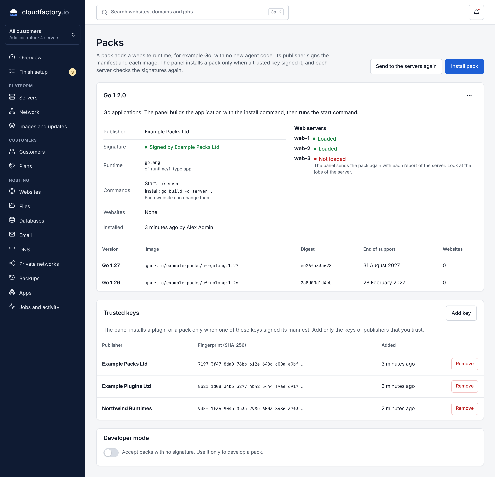
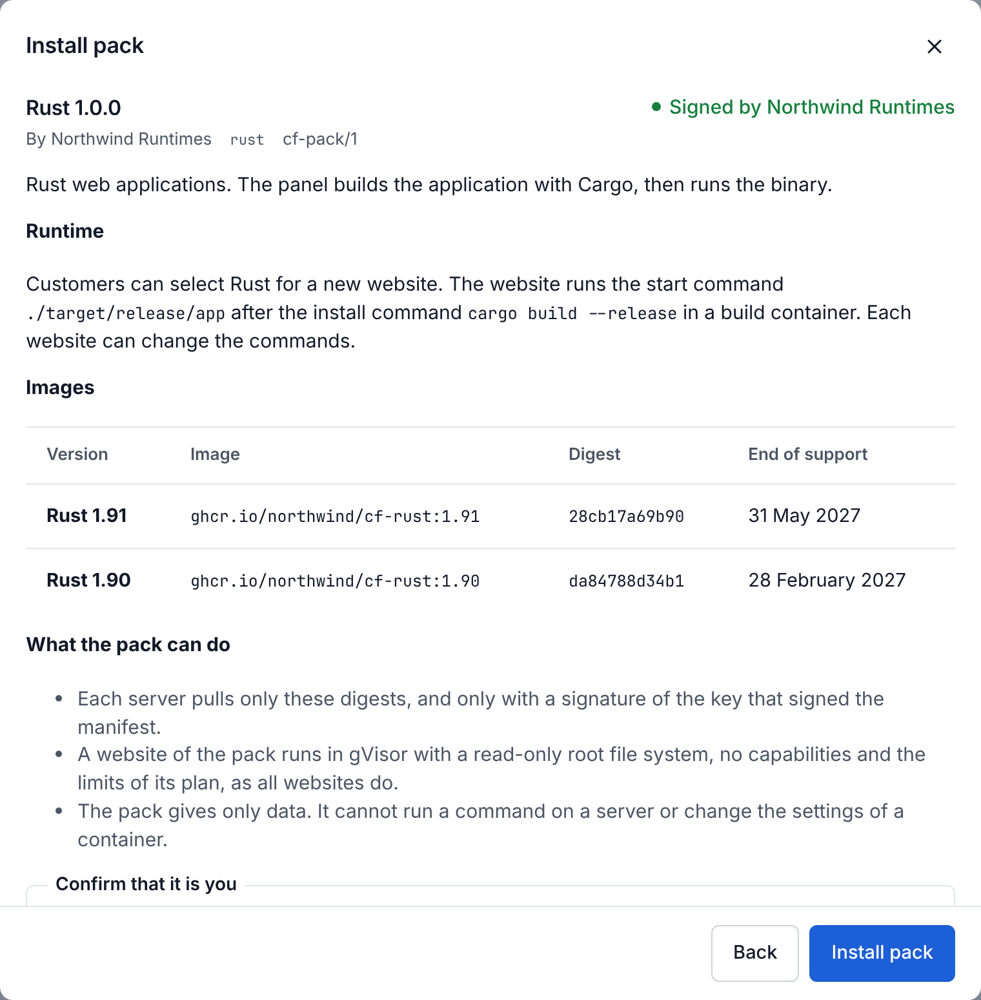
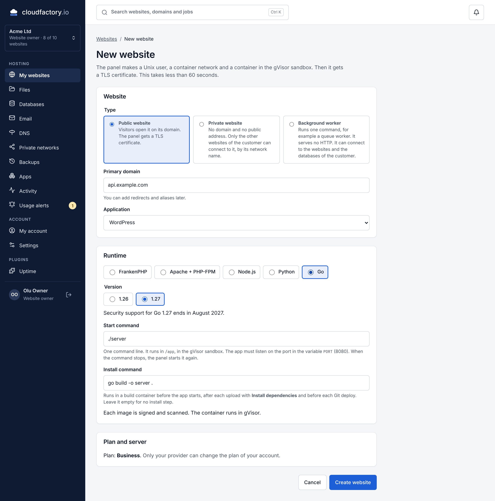

# Packs

A pack adds a website runtime to Cloudfactory, for example Go, with no new agent code. A
publisher makes the pack: a manifest (`pack.json`) and one image for each version of the
runtime. The publisher signs the manifest and the images with one key. An administrator
installs the pack in the panel. The panel then sends the pack to each web server, and
customers can select the runtime on the **New website** page.

This document is the contract between a publisher and Cloudfactory. The example pack is in
[plugins/packs/golang](../plugins/packs/golang/README.md).



## The stable contract

A pack has two contracts:

| Contract | What it covers |
| --- | --- |
| `cf-pack/1` | The format of the manifest: the keys, the values and the signature. |
| `cf-runtime/1` | What the image of the runtime must do, and what the agent gives to it. |

From this release, the two contracts are stable:

- The rules of `cf-pack/1` and `cf-runtime/1` do not change. A change that adds a key, adds
  a value or changes what a key does gets a new contract name, for example `cf-pack/2`.
- An agent refuses a contract name that it does not know. It also refuses a key that it does
  not know. Thus an agent never ignores a key of a later contract.
- A later release of Cloudfactory can read more than one contract.

While the version of Cloudfactory is 0.x, the panel and the agent keep no compatibility for
their own data (refer to [development.md](development.md#compatibility-while-the-version-is-0x)).
The pack contract is the exception, because publishers outside the project depend on it.

The test cases in [`schema/pack-vectors.json`](../schema/pack-vectors.json) are part of the
contract. Refer to [Test cases](#test-cases).

## The manifest

A manifest is one JSON object of 32 KB or less. For example:

```json
{
  "contract": "cf-pack/1",
  "kind": "runtime",
  "slug": "golang",
  "name": "Go",
  "version": "1.0.0",
  "publisher": "Example Packs Ltd",
  "description": "Go applications. The panel builds the application with the install command, then runs the start command.",
  "runtime": {
    "contract": "cf-runtime/1",
    "type": "app",
    "defaultCommand": "./server",
    "defaultInstall": "go build -o server ."
  },
  "images": [
    {
      "version": "1.27",
      "ref": "ghcr.io/example/cf-golang:1.27",
      "digest": "sha256:0000000000000000000000000000000000000000000000000000000000000127",
      "supportEndsAt": "2027-08-31"
    }
  ]
}
```

### Keys of the manifest

| Key | Necessary | Value |
| --- | --- | --- |
| `contract` | Yes | `cf-pack/1`. |
| `kind` | Yes | `runtime`. The kind `database` is for a later release. The panel refuses it. |
| `slug` | Yes | The name of the runtime: 2 to 31 characters. Use lower-case letters, digits and hyphens. The first character is a letter. The name cannot be a built-in name (refer to the next list). |
| `name` | Yes | The name for people, 1 to 60 characters. |
| `version` | Yes | The version of the pack: three numbers with a dot between them, for example `1.2.0`. A suffix with `-` or `+` is permitted, for example `2.0.0-rc.1`. |
| `publisher` | Yes | The name of the publisher, 1 to 100 characters. |
| `description` | No | Up to 500 characters. |
| `runtime` | Yes | An object. Refer to [Keys of the runtime](#keys-of-the-runtime). |
| `images` | Yes | A list of 1 to 10 objects. Refer to [Keys of an image](#keys-of-an-image). |
| `x-...` | No | A key that starts with `x-` is for the publisher. Cloudfactory ignores it. |

Each other key is an error. A text cannot have control characters. Each value is a string.

The built-in names are `frankenphp`, `apache-php-fpm`, `node`, `python`, `custom`, `static`,
`edge`, `mail`, `dns`, `database`, `mariadb`, `postgresql` and `valkey`
(`reservedRuntimeNames` in [`schema/input-rules.json`](../schema/input-rules.json)).

### Keys of the runtime

| Key | Necessary | Value |
| --- | --- | --- |
| `contract` | Yes | `cf-runtime/1`. |
| `type` | Yes | `app`. It is the only type of `cf-runtime/1`. |
| `defaultCommand` | Yes | The usual start command of a website, for example `./server`. One line. |
| `defaultInstall` | No | The usual install command of a website, for example `go build -o server .`. One line. |

The two commands fill the **New website** form. Each website can change them. The agent
does not run a command from the manifest: it runs only the commands of the website.

### Keys of an image

| Key | Necessary | Value |
| --- | --- | --- |
| `version` | Yes | The version of the runtime, for example `1.27`. Customers select it. 1 to 16 characters: letters, digits, `.`, `+`, `_` and `-`. Each version is in the pack one time only. |
| `ref` | Yes | The image with its registry and a tag, for example `ghcr.io/example/cf-golang:1.27`. No digest. |
| `digest` | Yes | The `sha256:` digest of the image. The agent pulls only this digest. |
| `supportEndsAt` | No | The last day of support, for example `2027-08-31`. The panel shows it with the image. |

An image repository can be in one pack only. The panel refuses a repository that a different
pack or an own image of the panel has.

## The runtime contract cf-runtime/1

The agent runs a runtime of the type `app` as it runs Node.js and Python. The image must
obey these rules:

- The image has the program `/usr/local/bin/cf-app`. The program goes to the directory in
  `CF_APP_DIR` and runs the start command of the website.
- The application listens on the port in `PORT` (8080), on the address in `HOST`
  (`0.0.0.0`).
- The install command and the build command run in a build container of the same image.

The agent gives each container the same isolation as each other website: gVisor, a read-only
root file system, no capabilities and its own network namespace. A pack cannot change the
unit of the container.

## Make and sign a pack

The publisher signs the exact bytes of `pack.json`, and each image, with one ECDSA P-256 key.
Use cosign 2 (the release pipeline of Cloudfactory uses 2.5.2).

1. Make a key pair one time:

   ```sh
   cosign generate-key-pair          # makes cosign.key and cosign.pub
   ```

2. Build each image and push it to your registry:

   ```sh
   podman build --build-arg GO_VERSION=1.27 -t ghcr.io/example/cf-golang:1.27 plugins/packs/golang
   podman push --digestfile digest ghcr.io/example/cf-golang:1.27
   ```

3. Sign each image by its digest:

   ```sh
   cosign sign --yes --key cosign.key ghcr.io/example/cf-golang@$(cat digest)
   ```

   Podman on each server reads this signature next to the image.

4. Write the digest of each image in `pack.json`.
5. Sign the manifest:

   ```sh
   cosign sign-blob --yes --key cosign.key --tlog-upload=false --output-signature pack.json.sig pack.json
   ```

6. Do not change `pack.json` after you sign it. A change of one byte makes the signature
   incorrect. This includes a new line at the end of the file.

The signature of the manifest covers the digests. Thus the manifest selects the images, and
the signature of each image proves that the publisher made it.

To sign the manifest with OpenSSL in place of cosign, use a key that OpenSSL made. The images
then need a signature from the same key, so import the key into cosign
(`cosign import-key-pair --key pack.key`):

```sh
openssl ecparam -name prime256v1 -genkey -noout -out pack.key    # one time
openssl ec -in pack.key -pubout -out pack.pub                     # one time
openssl dgst -sha256 -sign pack.key pack.json | base64 -w0 > pack.json.sig
```

## Publish a pack

Give these files to the administrators:

- `pack.json`
- `pack.json.sig`
- `cosign.pub`

Give the SHA-256 fingerprint of `cosign.pub` through a different channel, for example on your
website. The administrator compares it with the fingerprint that the panel shows.

For a new version, change `version` and the images, then sign the manifest again. Keep the
same `slug` and the same key.

## Install a pack

Only an administrator can install a pack. The install, a new version and the developer mode
need the password of the administrator, and the TOTP code when TOTP is on.

1. Add the public key of the publisher. Go to **Packs > Trusted keys > Add key**, or use
   `cf packs keys add --name NAME --file cosign.pub`. Plugins and packs use the same list of
   trusted keys. A pack that the Cloudfactory release key signed needs no trusted key.
2. Compare the fingerprint in the panel with the fingerprint from the publisher.
3. Go to **Packs** and select **Install pack**.
4. Select `pack.json` and `pack.json.sig`, or paste their text.
5. Select **Check the manifest**. The panel shows the key that signed the pack, the runtime,
   the images and what the pack can do. Nothing changes yet.
6. Type your password, and your TOTP code when TOTP is on.
7. Select **Install pack**.



With the CLI:

```sh
cf packs preview --manifest pack.json      # changes nothing
cf packs install --manifest pack.json      # reads pack.json.sig when it is there
```

The API requests are `POST /api/v1/packs/preview` and `POST /api/v1/packs`. A token needs the
scope `packs:write`. A plugin cannot get the scopes `packs:read` and `packs:write`.

## What the panel and the servers do

When the administrator installs a pack:

1. The panel checks the manifest with the rules of this document. It checks the signature
   with the trusted keys and the release key.
2. The panel keeps the exact bytes of the manifest and the signature.
3. The panel adds one runtime image for each version of the pack. The family of each image
   is the slug of the pack.
4. The panel sends all packs to each web server in the job **Send the packs**.

On each web server, the agent:

1. Checks each manifest and each signature again. The root helper also checks them before
   it writes a file.
2. Writes each pack to `/etc/cloudfactory/packs/SLUG/`: `pack.json`, `pack.json.sig` and
   `publisher.pub`.
3. Adds one rule to `/etc/containers/policy.json` for each image repository of a signed
   pack. With the rule, Podman pulls an image of the repository only with a signature of the
   key of the pack.
4. Writes `/etc/containers/registries.d/cloudfactory-packs.yaml`, so that Podman finds the
   signatures next to the images.
5. Removes the packs that are not in the job. It refuses to remove a pack whose runtime a
   website of the server uses.
6. Loads the runtimes, and reports the packs and the runtimes to the panel.

The agent never makes a rule of the installer weaker. When a rule of the installer already
covers a repository, the agent adds no rule for it. The image then needs the signature that
the installer asks for.

The **Packs** page shows the state of each pack on each web server:

| State | Meaning |
| --- | --- |
| Loaded | The server reports the version of the pack. |
| Waiting | The panel sent the pack, or will send it. |
| Not loaded | The job failed more than one time. The panel tries again. |

The panel compares the packs in each report of an agent with its own packs. When they are
different, the panel sends the packs again. After each failure, it waits longer: 1, 2, 4, 8,
16, 32 and then 60 minutes. A new web server gets the packs after its first report. To send
the packs at once, select **Send to the servers again**, or use `cf packs sync`.

The panel puts a website of the runtime only on a server that reports the runtime. When no
server has it, the panel refuses the website and tells the user why.

Customers see the runtime on the **Apps** page and on the **New website** page, with one
choice for each version:



## Install a new version

1. On the **Packs** page, open the menu of the pack.
2. Select **Install a new version**.
3. Select the new `pack.json` and `pack.json.sig`, then follow the steps of the install.

With the CLI: `cf packs upgrade golang --manifest pack.json`.

The slug must be the same, and the version must be different. Then:

- A new version of the runtime becomes a new image. Customers can then select it.
- A new digest for an image that no website uses replaces the old digest at once.
- A new digest for an image that websites use waits for a rollout. Start it on the **Images
  and updates** page, or with `cf rollouts start IMAGE_ID`.
- The panel refuses a manifest that removes a version that websites use. Move the websites
  to a different version first.

The panel does not check the registry for new tags of the images of a pack. The pack gives
the versions and the digests.

## Remove a pack

On the **Packs** page, open the menu of the pack and select **Remove pack**. With the CLI:
`cf packs remove golang`.

The panel refuses to remove a pack that websites use. Move or remove the websites first. The
panel then removes the images of the pack, and each web server removes the pack and its rules
in the image policy.

The panel also refuses to remove a trusted key that signed an installed pack, because each web
server checks the images of the pack with that key.

## The developer mode for packs

The developer mode accepts a pack with no signature. Use it only to test your own pack on a
panel that is not in production. To turn it on, go to **Packs > Developer mode**, or use
`cf packs developer-mode on`. It needs your password.

A pack with no signature gets no rule in the image policy. Its images must pass the policy of
the installer, for example from a registry that you gave with `--allow-unsigned`. The
developer mode for plugins is a different setting.

## Test cases

[`schema/pack-vectors.json`](../schema/pack-vectors.json) has valid and invalid changes to the
example manifest. The tests of the agent (`agent/internal/packs`) and of the panel
(`api/tests/Feature/PackTest.php`) run each case. The two must accept each valid case and refuse
each invalid case.

A publisher can run the cases against a tool of their own. Each case changes
`plugins/packs/golang/pack.json`:

- `set` gives a value to a path, for example `images.0.ref`.
- `delete` removes a path.
- `raw` replaces the whole manifest.

When you change a rule of the contract, add a valid case and an invalid case.

## Limits

- `cf-pack/1` has only the kind `runtime`, and `cf-runtime/1` has only the type `app`. The
  packs for database engines come later (refer to the trial contract `cf-database/1` in
  [plugins.md](plugins.md#the-management-contract-cf-database1-trial)).
- A panel can have up to 50 packs. A pack can have up to 10 images.
- A pack cannot add a page, a setting or a program to the panel or to the agent. To add such
  a feature, use a [plugin](plugins.md).
