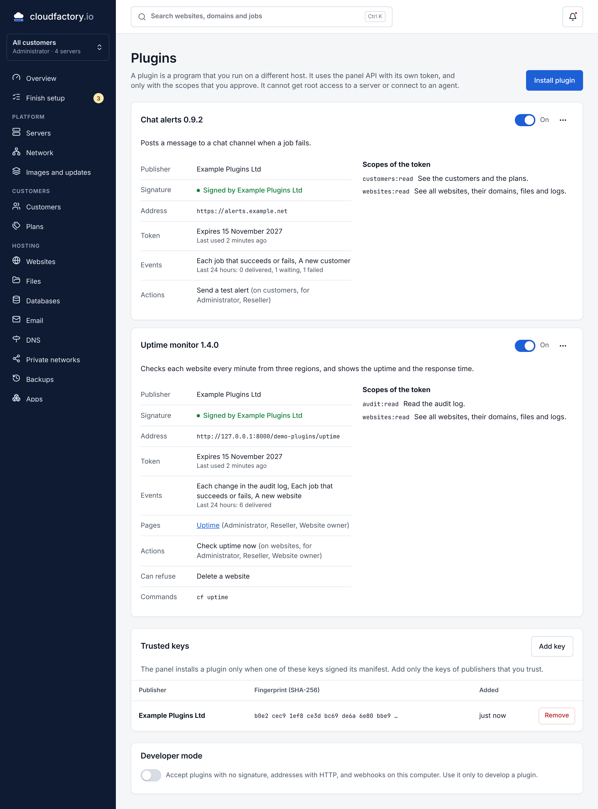
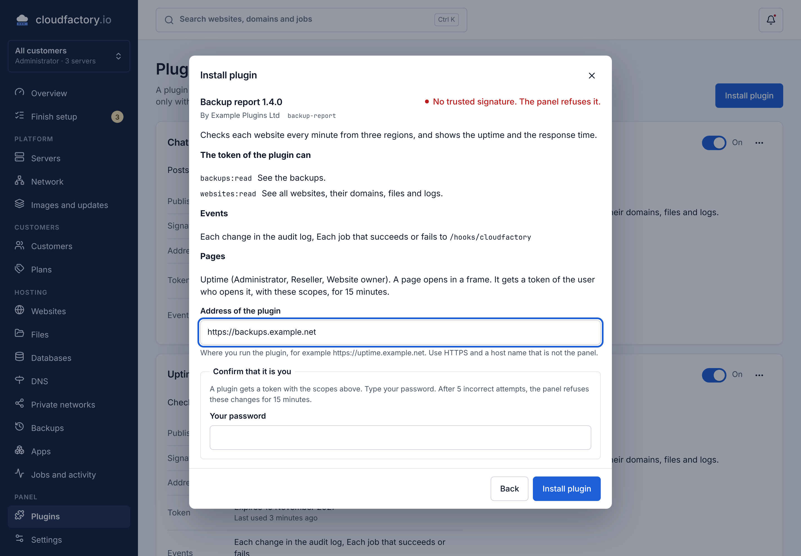
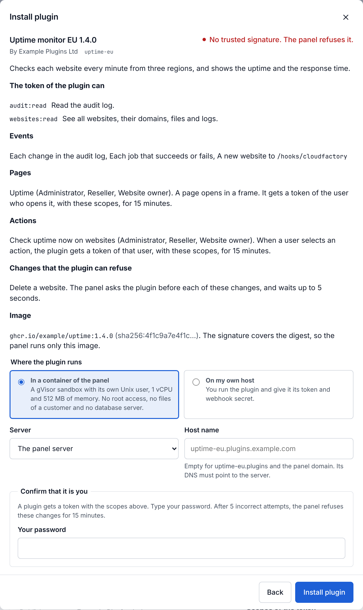
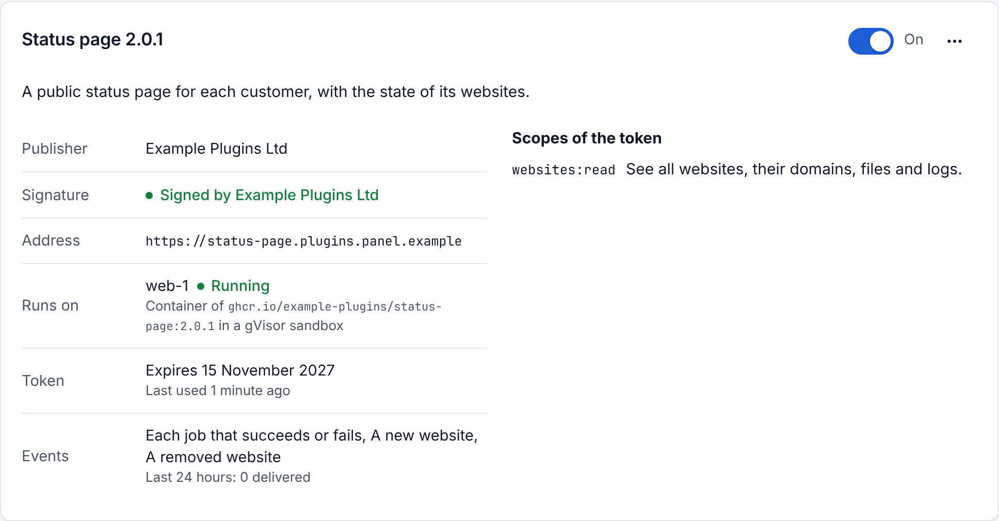
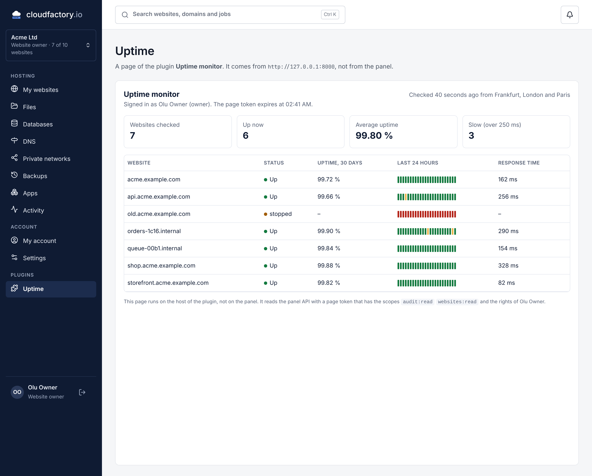
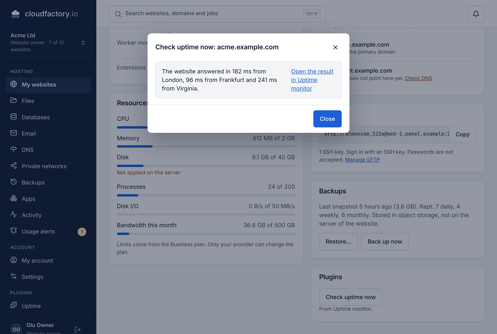

# Plugins

A plugin adds a function to the panel. A plugin is a program with its own token. You run it in
one of two places:

- On a host that you select, outside the panel.
- In a container that the panel runs, when the manifest gives a signed image. Refer to
  [Run a plugin in the panel](#run-a-plugin-in-the-panel).

The panel process never runs the code of a plugin. In the two cases, the plugin uses only the
public API.

A plugin can do these things:

- Use the public API with its own token. The token has only the scopes that the administrator
  approves.
- Receive the events of the panel with signed webhooks.
- Add pages to the web panel. A page opens in a frame, with the origin of the plugin.
- Add action buttons to the pages of websites, servers and customers. An action runs on the
  server of the plugin, with a short token of the user who selects it.
- Refuse some changes before the panel makes them, with before hooks.
- Add commands to the `cf` CLI. `cf NAME` runs the program `cf-NAME`.
- Send DNS zones to an external DNS provider, for example Cloudflare. Refer to
  [DNS providers](#dns-providers).

A plugin cannot do these things:

- Get root access to a server.
- Connect to an agent or to the root helper of an agent.
- Read the database of the panel, the secrets of the panel or the session of a user.
- Get the scopes `tokens:read`, `tokens:write`, `users:write`, `plugins:read` or
  `plugins:write`. With these scopes, a plugin could make tokens, take a user account or
  change its own access.
- Read the password of the backup repository or the private key of a mailbox, make a join
  token for a server, make a tunnel, or change the tunnel key of a server. The panel refuses
  these requests from the token of a plugin, with all scopes.
- Get an event or a before hook when it does not have the scope to read that data. See
  [Events](#events) and [Before hooks](#before-hooks).



## Parts of a plugin

| Part | What it is |
| ---- | ---------- |
| `plugin.json` | The manifest. It gives the name, the scopes, the events, the pages, the actions, the before hooks and the commands. |
| `plugin.json.sig` | The signature of the manifest. The publisher makes it with an ECDSA P-256 key. |
| A server | Your program. It receives the webhooks, serves the pages and calls the API. |
| A container image | Optional. The same program as an OCI image, so that the panel can run it. |
| `cf-NAME` | Optional. A program for each command of the plugin. |

[`plugins/example`](../plugins/example) has a complete example.

## The manifest

```json
{
  "schema": 1,
  "slug": "uptime",
  "name": "Uptime monitor",
  "version": "1.4.0",
  "publisher": "Example Plugins Ltd",
  "description": "Checks each website every minute.",
  "scopes": ["websites:read", "audit:read"],
  "events": ["audit.recorded", "job.finished", "website.created"],
  "webhook": "/hooks/cloudfactory",
  "pages": [
    { "id": "status", "title": "Uptime", "path": "/panel/status", "roles": ["administrator", "reseller", "owner"] }
  ],
  "actions": [
    { "id": "check", "title": "Check uptime now", "target": "website", "path": "/actions/check", "roles": ["administrator", "reseller", "owner"] }
  ],
  "hooks": [
    { "event": "website.removing", "path": "/hooks/before", "onError": "allow" }
  ],
  "commands": [
    { "name": "uptime", "description": "Shows the uptime of each website." }
  ],
  "image": {
    "ref": "ghcr.io/example/uptime:1.4.0",
    "digest": "sha256:4f1c…",
    "port": 8080
  }
}
```

| Key | Rule |
| --- | ---- |
| `schema` | Always `1`. |
| `slug` | Lower-case letters, digits and `-`. 1 to 40 characters. It must be unique on the panel. |
| `version` | For example `1.4.0`. |
| `scopes` | The scopes of the token. Use only the scopes that the plugin needs. |
| `events` | The events of the table in [Events](#events). Each event needs a scope. |
| `webhook` | The path of the webhook. Necessary when `events` is not empty. |
| `pages` | Up to 10 pages. `roles` gives the roles that see the page in the menu. |
| `actions` | Up to 20 actions. `target` is `website`, `server` or `customer`. `roles` gives the roles that see the button. `confirm` is optional: a question that the panel asks before it runs the action. |
| `hooks` | Up to 20 before hooks. `event` is a hook of the table in [Before hooks](#before-hooks). `onError` is `allow` (the default) or `refuse`. |
| `commands` | Up to 20 commands. The panel shows them only as information. |
| `dnsProviders` | Up to 10 external DNS providers. Refer to [DNS providers](#dns-providers). |
| `image` | Optional. `ref` is the image with a tag. `digest` is its `sha256:` digest, with 64 hexadecimal digits. `port` is the port of the program in the container, 1024 to 65535 (default 8080). |

Each path starts with `/`. A path cannot have `..`, a query or a fragment. The paths are
relative to the address of the plugin. The administrator gives the address at the install,
because the publisher does not know where you run the plugin.

The manifest can have up to 32 KB. The panel keeps only the keys of this table.

## Sign a manifest

The publisher signs the exact bytes of `plugin.json`. Do not change the file after you sign
it. A change of one byte makes the signature incorrect.

To sign with cosign:

```sh
cosign generate-key-pair          # one time: makes cosign.key and cosign.pub
cosign sign-blob --yes --key cosign.key --output-signature plugin.json.sig plugin.json
```

To sign with OpenSSL:

```sh
openssl ecparam -name prime256v1 -genkey -noout -out plugin.key    # one time
openssl ec -in plugin.key -pubout -out plugin.pub                   # one time
openssl dgst -sha256 -sign plugin.key plugin.json | base64 -w0 > plugin.json.sig
```

Give `plugin.pub` (or `cosign.pub`) to the administrators who install your plugins.

## Install a plugin

Only an administrator can install a plugin. Each step that gives access needs the password
of the administrator, and the TOTP code when TOTP is on.

1. Add the public key of the publisher: **Plugins > Trusted keys > Add key**, or
   `cf plugins keys add --name NAME --file cosign.pub`. Plugins and [packs](packs.md) use
   the same list of trusted keys (`/api/v1/trusted-keys`).
2. Start the server of the plugin on its own host name, for example
   `https://uptime.example.net`. Do not use the host name of the panel. The panel refuses it.
3. Select **Plugins > Install plugin**. Paste the manifest and the signature. Select
   **Check the manifest**.
4. Read the scopes, the events and the pages. Give the address of the plugin.
5. Type your password, and the TOTP code when TOTP is on. Select **Install plugin**.
6. Copy the token and the webhook secret. The panel shows them one time only. Give them to
   the plugin, for example as `CF_TOKEN` and `CF_WEBHOOK_SECRET`.

With the CLI:

```sh
cf plugins install --manifest plugin.json --address https://uptime.example.net
```

The CLI reads the signature from `plugin.json.sig`. It reads your password from `CF_PASSWORD`
or stdin.



## Run a plugin in the panel

When the manifest has an `image`, the panel can run the plugin. You do not need a host for it.

1. Do steps 1 and 3 of [Install a plugin](#install-a-plugin).
2. In **Where the plugin runs**, select **In a container of the panel**.
3. Optional: select a server with the role `web`. The default is the panel server.
4. Optional: give a host name. The default is `SLUG.plugins.` and the panel domain, for
   example `uptime.plugins.panel.example.com`. Set `CF_PLUGINS_DOMAIN` to use a different
   domain. The DNS record of the host name must point to the server.
5. Type your password, and the TOTP code when TOTP is on. Select **Install plugin**.

With the CLI:

```sh
cf plugins install --hosted --manifest plugin.json
cf plugins install --hosted --server SERVER_ID --host uptime.plugins.example.com --manifest plugin.json
```

The panel does not show the token and the webhook secret. It gives them to the container as
these environment variables:

| Variable | Value |
| -------- | ----- |
| `CF_PANEL` | The address of the panel. |
| `CF_TOKEN` | The token of the plugin. |
| `CF_WEBHOOK_SECRET` | The secret of the webhook signatures. |

The address of the plugin is `https://` and the host name. The edge proxy of the server gets a
certificate for it and sends the requests to the port of the image.

The agent runs the container in the same way as a website with the runtime `custom`:

- Its own Unix user (`plugin_<random>`), its own rootless Podman and a gVisor sandbox.
- 1 vCPU, 512 MB of memory, 1 GB of disk, 20 MB/s of disk I/O and 128 processes.
- No files of a customer, and no connection to a database server.
- The exact image of the digest. The signature of the manifest covers the digest, so the
  panel runs only the image that the publisher signed.



The card of the plugin shows the server and the state of the container: **Starting**,
**Running**, **Stopped**, **Failed** or **Removing**. When the state is **Failed**, select
**Start again**, or use `cf plugins restart PLUGIN`.



| Change | What the panel does |
| ------ | ------------------- |
| Turn off or on | Stops or starts the container. |
| Install a new version with a different image | Replaces the container with the new image. A new version of a plugin in the panel must have an image. |
| Make new credentials | Starts the container again with the new token and secret. |
| Remove | Removes the container, its Unix user and its route. |

### Manage a plugin

| Action | Web panel | CLI |
| ------ | --------- | --- |
| Turn off | The switch on the card of the plugin | `cf plugins disable PLUGIN` |
| Send a test event | **Send a test event** | `cf plugins test PLUGIN` |
| See the deliveries | **Show deliveries** | `cf plugins deliveries PLUGIN` |
| Install a new version | **Install a new version** | `cf plugins upgrade PLUGIN` |
| Make a new token and secret | **Make new credentials** | `cf plugins credentials PLUGIN` |
| Remove | **Remove plugin** | `cf plugins remove PLUGIN` |

A plugin that is off has no access. Its token, its page tokens and its action tokens get status
403. The panel sends it no events, shows none of its actions, and does not ask its before
hooks. A new version keeps the token, and the token gets the scopes of the
new manifest. The review shows the scopes that the new version adds.

The token of a plugin expires after one year. Make new credentials before that date.

### The developer mode

The developer mode is for the development of a plugin. Do not turn it on for a production
panel. In the developer mode, the panel accepts:

- a manifest with no signature,
- an address with `http://`,
- a webhook on the loopback interface (`127.0.0.1` or `::1`).

## The token of a plugin

The panel makes one user for each plugin. The user has the name `Plugin: NAME` and the role
"administrator". Nobody can sign in as this user. The user is not in the list of users.

The token belongs to this user. The scopes of the token are the only limit. Thus a plugin
with `websites:read` can read the websites of all customers.

The audit log shows each change of a plugin with the actor `Plugin: NAME (token Plugin)`.

## Events

The panel sends each event to the webhook of each plugin that is on and wants the event.

An event has data of all customers. Thus a plugin gets an event only when its manifest has
the scope to read that data. The panel refuses a manifest that does not have the scope.

| Event | Necessary scope |
| ----- | --------------- |
| `audit.recorded` | `audit:read` |
| `job.finished`, `website.*`, `domain.*`, `deploy.started` | `websites:read` |
| `database.*` | `databases:read` |
| `backup.started`, `restore.started` | `backups:read` |
| `customer.*` | `customers:read` |
| `user.created` | `users:read` |

The scope to change data (for example `websites:write`) is also sufficient.

| Event | When | Data |
| ----- | ---- | ---- |
| `audit.recorded` | Each change in the audit log | `action`, `target`, `actor`, `customerId`, `pluginId`, `at` |
| `job.finished` | A job of an agent succeeded or failed | `id`, `action`, `title`, `state`, `error`, `serverId`, `websiteId`, `customerId` |
| `plugin.test` | An administrator sends a test event | `message`, `by` |

The named events are changes of the audit log with one action. Use them when your plugin wants
only some changes. Their data is the same as the data of `audit.recorded`.

| Event | Audit action |
| ----- | ------------ |
| `website.created`, `website.changed`, `website.removed` | Created website, Made preview, Changed website, Removed website, Removed preview |
| `domain.added`, `domain.verified`, `domain.removed` | Added domain, Verified domain, Removed domain |
| `database.created`, `database.removed` | Created database, Removed database |
| `backup.started`, `restore.started` | Backed up website, Restored from backup |
| `deploy.started` | Started deploy, Started deploy from webhook, Started deploy from branch check |
| `customer.created`, `customer.changed` | Created customer, Changed customer |
| `user.created` | Created user |

`backup.started` and `restore.started` come when a user starts the work. To know when the
work is complete, use `job.finished`.

`pluginId` is the ID of the plugin that made the change, or `null`. Use it to ignore your own
changes. If you do not ignore them, a plugin that makes a change for each event can make a
loop.

### The request

The panel sends `POST` to the webhook with a JSON body:

```json
{
  "id": "01jd2m4w3h6ya8c0vvv1q8x0zr",
  "event": "job.finished",
  "createdAt": "2026-11-15T10:42:07+00:00",
  "data": { "title": "Create website shop.example.com", "state": "succeeded" }
}
```

The headers:

| Header | Value |
| ------ | ----- |
| `Cloudfactory-Event` | The name of the event |
| `Cloudfactory-Delivery` | The ID of the delivery. It is the same for each attempt. |
| `Cloudfactory-Signature` | `t=<Unix time>,v1=<HMAC-SHA256>` |

### Check the signature

Do these steps for each request. Refuse the request if a step fails.

1. Read `t` and `v1` from `Cloudfactory-Signature`.
2. Make sure that `t` is not older than 5 minutes.
3. Calculate HMAC-SHA256 of `<t>.<body>` with the webhook secret. Use the body as bytes,
   before you parse it.
4. Compare the result with `v1` in constant time.

```js
import { createHmac, timingSafeEqual } from "node:crypto";

function verify(secret, header, body) {
  const { t, v1 } = Object.fromEntries(header.split(",").map((p) => p.split("=")));
  if (Math.abs(Date.now() / 1000 - Number(t)) > 300) return false;
  const want = createHmac("sha256", secret).update(`${t}.${body}`).digest("hex");
  return want.length === v1.length && timingSafeEqual(Buffer.from(want), Buffer.from(v1));
}
```

### Answers and attempts

Answer with a status from 200 to 299 in 10 seconds. Do slow work after the answer.

The panel does not follow a redirect. When a delivery fails, the panel tries again after 1
minute, 5 minutes, 30 minutes, 2 hours and 6 hours. After 6 attempts, the delivery is
"failed". An administrator can send it again. Use `Cloudfactory-Delivery` to ignore an event
that you received before.

### Addresses that the panel refuses

These rules apply to each request to a plugin: the webhook, the actions and the before hooks.
The panel resolves the host name one time, and connects to the address that it checked. It refuses these addresses:

- the loopback interface, except in the developer mode,
- link-local addresses, which include the private service address `169.254.77.1` and the
  cloud metadata service,
- multicast and unspecified addresses.

Private addresses, for example `10.0.0.0/8`, are permitted. Thus you can run a plugin in a
private network.

## Pages

A page opens in a frame in the web panel. The frame has the origin of the plugin, so the
script of the page cannot read the panel, its storage or the session of the user. The frame
cannot open a different page in the top window.

The web panel gives the page a page token with `postMessage`:

1. The page sends `{ "type": "cloudfactory:ready", "version": 1 }` to `window.parent`.
2. The web panel asks the API for a page token
   (`POST /v1/plugin-pages/{id}/{pageId}/session`). It sends the token only to the origin of
   the page.
3. The page receives this message:

   ```json
   {
     "type": "cloudfactory:session",
     "version": 1,
     "token": "…",
     "expiresAt": "2026-11-15T10:57:07+00:00",
     "scopes": ["audit:read", "websites:read"],
     "user": { "id": 3, "name": "Olivia Owner", "role": "owner", "customerId": "…" },
     "page": { "pluginId": "…", "id": "status", "title": "Uptime", "url": "…", "origin": "…" },
     "apiBase": "https://panel.example.com/api/v1",
     "panelOrigin": "https://panel.example.com"
   }
   ```

4. The page calls the API with `Authorization: Bearer <token>`.



The page token:

- belongs to the user who opened the page, so the rights of that user apply. An owner sees
  only the websites of the owner.
- has the scopes of the plugin.
- expires after 15 minutes. The web panel sends a new one each 12 minutes.
- cannot make a different token or a second page token.

Check that a message comes from `window.parent`. Keep the page token in memory only.

To set the height of the frame, send `{ "type": "cloudfactory:resize", "height": N }`.

The API accepts calls from the browser (CORS) from the origin of each plugin that is on and
has pages. Your page can also send the page token to the server of the plugin, which then
calls the API.

## Actions

An action is a button on the page of a website, of a server or of a customer. The panel shows
the actions of the plugins that are on, for the roles of the manifest. Servers are only for
administrators.

When a user selects an action, the panel:

1. Asks the question of `confirm`, or "Run ... on ...?".
2. Makes sure that the user can see the target. An owner cannot run an action on the website
   of a different customer.
3. Makes a token of the user for 15 minutes, with the scopes of the plugin.
4. Sends `POST` to the path of the action, with the signed headers of a webhook
   (`Cloudfactory-Event: plugin.action`):

   ```json
   {
     "id": "01jd2m4w3h6ya8c0vvv1q8x0zr",
     "action": { "id": "check", "title": "Check uptime now" },
     "target": { "type": "website", "id": "01jd…", "name": "shop.example.com", "customerId": "01jc…" },
     "user": { "id": 3, "name": "Olivia Owner", "role": "owner", "customerId": "01jc…" },
     "token": "…",
     "expiresAt": "2026-11-15T10:57:07+00:00",
     "scopes": ["audit:read", "websites:read"],
     "apiBase": "https://panel.example.com/api/v1",
     "createdAt": "2026-11-15T10:42:07+00:00"
   }
   ```

5. Waits 10 seconds or less for the answer.

Check the signature as for a webhook. Then do the action with the token, so that the rights of
the user apply. Answer with status 200 and JSON:

```json
{ "message": "shop.example.com answered 200 in 182 ms.", "url": "https://uptime.example.net/report/42" }
```

The panel shows `message` (up to 500 characters). It shows a link to `url` only when the URL
starts with the address of the plugin. Both keys are optional. When the plugin does not answer
with a status from 200 to 299, the panel shows an error, and the token stops at once.



Only a sign-in session of the web panel runs an action. An API token cannot. The audit log
records each action as "Ran plugin action".

## Before hooks

A before hook lets a plugin refuse a change. The panel asks each plugin that is on and has the
hook, before it makes the change.

A before hook needs a scope, as an event does: `websites:read` for `website.*` and
`domain.adding`, `databases:read` for `database.creating`, and `customers:read` for
`customer.creating`.

| Hook | Before | Data |
| ---- | ------ | ---- |
| `website.creating` | A user makes a website | `name`, `kind`, `customerId`, `customerName`, `planId`, `imageId`, `serverId` |
| `website.removing` | A user deletes a website | `id`, `name`, `customerId` |
| `domain.adding` | A user adds a domain to a website | `name`, `kind`, `websiteId`, `websiteName`, `customerId` |
| `database.creating` | A user makes a database | `name`, `engine`, `websiteId`, `websiteName`, `customerId` |
| `customer.creating` | A user adds a customer | `name`, `email`, `role`, `planId`, `resellerId` |

The panel sends `POST` to the path of the hook, with the signed headers of a webhook. The header
`Cloudfactory-Event` has the name of the hook. The body has `id`, `hook`, `createdAt`, `data`
and `user`.

Answer in 5 seconds with status 200 and one of these:

```json
{ "allow": true }
```

```json
{ "allow": false, "message": "This website has an open invoice." }
```

When a plugin refuses, the panel does not make the change. The user sees "The plugin NAME
refused this change:" and the message (up to 300 characters).

When the plugin does not answer in 5 seconds, or answers with a different value, `onError`
applies. With `allow`, the panel makes the change. With `refuse`, the panel refuses it. Use
`refuse` only when the plugin must see each change, because a plugin that is down then stops
these changes.

A before hook cannot change the request. The panel does not ask a plugin about the changes
that the plugin makes with its own token. Each hook makes the change slower, so answer fast.

## Commands

`cf NAME ARG...` runs the program `cf-NAME` from the `PATH` when `cf` has no command `NAME`.
A plugin cannot replace a command of `cf`. The program gets the arguments and these
environment variables:

| Variable | Value |
| -------- | ----- |
| `CF_PANEL` | The address of the panel of your sign-in |
| `CF_TOKEN` | Your token |

The program runs as your user, with your token. Install only the programs of publishers that
you trust.

## DNS providers

A plugin can send DNS zones to an external DNS provider, for example Cloudflare. The panel
keeps the records of the zone. After each change, the panel sends the full zone to the
plugin, and the plugin makes the zone at the provider the same. Thus a customer uses the same
pages, API and CLI for a zone at the provider and for a zone on the DNS servers of the panel.

The project has plugins for [Cloudflare](../plugins/dns-cloudflare/README.md),
[Amazon Route 53](../plugins/dns-route53/README.md),
[PowerDNS](../plugins/dns-powerdns/README.md), [Hetzner](../plugins/dns-hetzner/README.md) and
[DigitalOcean](../plugins/dns-digitalocean/README.md). They have no dependencies. Use one of
them as a start for a different provider.

### The manifest of a DNS provider

```json
"dnsProviders": [
  {
    "id": "cloudflare",
    "name": "Cloudflare",
    "path": "/dns/cloudflare",
    "dnssec": true,
    "types": ["A", "AAAA", "CNAME", "MX", "TXT", "SRV", "CAA", "NS"],
    "credentials": [
      { "id": "apiToken", "label": "API token", "secret": true, "hint": "Give the token the permissions Zone: Read and DNS: Edit." },
      { "id": "accountId", "label": "Account ID", "optional": true }
    ]
  }
]
```

| Key | Rule |
| --- | ---- |
| `id` | Lower-case letters, digits and `-`. 1 to 40 characters. Unique in the manifest. |
| `name` | The name that users see. Up to 40 characters. |
| `path` | The path that gets the requests of the provider. |
| `dnssec` | `true` when the plugin can turn DNSSEC on at the provider. The default is `false`. |
| `types` | The record types that the provider takes. The default is all the types of the panel. The panel refuses a record of a different type in a zone at the provider. |
| `credentials` | Up to 10 fields that a user fills in to add an account. `id` has letters and digits, and starts with a letter. `label` has up to 60 characters. `hint` has up to 200 characters. |

A field with `"secret": true` is a secret, for example an API token. The panel keeps all the
credentials encrypted. It never shows a secret again, and it shows the other fields only to
the owner of the account. A field with `"optional": true` can be empty.

The panel refuses an upgrade that removes a provider that DNS accounts use. It also refuses to
remove a plugin while DNS accounts use it. Remove the accounts first.

A DNS provider needs no scope, because the panel sends the data in the request. The plugin
does not use the API of the panel.

### The contract cf-dns-provider/1 (trial)

The panel sends `POST` to the path of the provider, with the headers of an event (refer to
[The request](#the-request)). `Cloudfactory-Event` is `dns.provider`. Check the signature of
each request (refer to [Check the signature](#check-the-signature)).

```json
{
  "id": "01jd2m4w3h6ya8c0vvv1q8x0zr",
  "contract": "cf-dns-provider/1",
  "provider": "cloudflare",
  "operation": "sync",
  "credentials": { "apiToken": "...", "accountId": "..." },
  "zone": {
    "name": "example.com",
    "serial": 1794567600,
    "dnssec": false,
    "records": [
      { "name": "@", "type": "A", "ttl": 300, "value": "203.0.113.10", "priority": null },
      { "name": "@", "type": "MX", "ttl": 3600, "value": "mx1.example.net", "priority": 10 }
    ]
  },
  "createdAt": "2026-11-22T10:42:07+00:00"
}
```

The panel sends each request one time, with a new `id`. Refuse a request with an `id` that you
received before. The panel does not try again in the same request. For a zone, the panel tries
again later (refer to [The attempts of the panel](#the-attempts-of-the-panel)).

| Operation | `zone` | Time | Answer |
| --------- | ------ | ---- | ------ |
| `verify` | `null` | 15 s | `{"account": "Example Ltd"}`. `account` is a name for the account at the provider, or `null`. |
| `records` | `{"name"}` | 30 s | `{"exists": true, "records": [...], "nameServers": [...]}`. The records that the provider has for the zone now. |
| `sync` | `{"name", "serial", "dnssec", "records"}` | 60 s | Refer to the next table. |
| `remove` | `{"name"}` | 30 s | `{}`. The zone is not at the provider now. |

The answer to `sync`:

| Key | Value |
| --- | ----- |
| `nameServers` | The name servers of the zone at the provider. The user gives them to the registrar. |
| `active` | `true` when the provider answers for the zone. |
| `dnssec` | `{"state": "off" \| "pending" \| "active", "ds": [{"keyTag", "algorithm", "digestType", "digest"}]}`. The DS records for the registrar. |
| `changes` | `{"added", "changed", "removed"}`: the number of records that the plugin changed. |

Rules for `sync`:

- Make the records at the provider the same as `records`, for the types of `types`. Do not
  change records of other types.
- Do not change the NS records of the zone itself (`@`). The provider keeps them. The panel
  does not send them.
- `records` has a TXT record `_cloudfactory-challenge` with a token of the panel. Send it as the
  other records. The panel looks for the token in the public DNS. Only the token proves that
  the public DNS uses this zone, because a different account at the provider can have the same
  name servers.
- Add the zone at the provider when it is not there, if the credentials permit it.
- Turn DNSSEC on or off at the provider, as `dnssec` gives.
- `sync` must be idempotent. The panel can send the same zone again.

The records have the form of the panel. `name` is `@` or a name relative to the zone. `value`
of an MX, CNAME or NS record is a host name with no dot at the end. `value` of an SRV record is
`<weight> <port> <target>`, and `priority` has its priority. `value` of a CAA record is
`<flags> <tag> "<value>"`. `value` of a TXT record has no quotation marks.

The answer to `records` uses the same form. The panel copies these records to a zone that moves
to the provider. It does not copy the NS records of the zone itself, a record of a type that the
panel does not have, or a record that is not valid. The user sees the records that the panel did
not copy.

### Errors

To refuse an operation, answer with a status from 400 to 599 and a JSON body:

```json
{ "error": "Cloudflare refused the API token. Make a token with the permissions Zone: Read and DNS: Edit." }
```

The panel shows `error` to the user, with up to 300 characters. Write it for the user, and do
not put a secret in it. When the answer has no `error`, the panel shows a general message. The
panel writes the details to its log, and never shows the address of the plugin.

### The attempts of the panel

A queue worker of the panel sends `sync` after each change of the zone. When `sync` fails, the
zone has the status **Failed**, and the provider continues to answer with the records that it
had before. The panel tries again after 1 minute, 5 minutes, 30 minutes and 2 hours. After
that, the hourly command `cloudfactory:check-dns` tries again each hour. A change of the credentials of the
account also sends the zones again.

### A zone that moves to a provider

When a zone moves from the DNS servers of the panel to a provider, the DNS servers of the panel
continue to answer for the zone. This is the handover. The handover stops two days after the
public DNS stops showing the name servers of the panel for the domain. Thus the domain
continues to work while the new name servers go through the DNS.

## Security

Refer to [security.md](security.md#plugins).

## Runtimes and database engines

A [pack](packs.md) adds a website runtime, for example Go, or a database engine, for example
MySQL, with no new agent code. A publisher signs the pack, and an administrator installs it on
the **Packs** page. The panel sends the pack to each web server. Refer to
[packs.md](packs.md). A database pack obeys the database contract `cf-database/1`
([packs.md](packs.md#the-database-contract-cf-database1)).

The built-in engines have two switches for a trial. The two switches are off by default. With
no switch, the agent operates as in the previous release.

| Setting in `/etc/cloudfactory/agent.json` | Effect |
| --- | --- |
| `"valkeyBackups": true` | The backups of the websites include their Valkey databases. |
| `"manageTrial": true` | The agent asks the MariaDB image for the sizes of its databases with `/cf/manage`. |

After you change a setting, restart the agent: `systemctl restart cf-agent`. The agent
reports its runtimes, its packs and the switches that are on (`runtimes`, `packs` and
`features` in the report).

### Valkey backups

With `valkeyBackups`, root dumps each Valkey database of a website with `SCAN`, `DUMP` and
`PEXPIRETIME`. A restore empties the database number, then loads each key with
`RESTORE ... ABSTTL`. The other database numbers do not change. The panel puts a Valkey
database in a backup only when the agent of its server reports `valkey-backups`.

`SCAN` is not one point in time. A key that the website changes during the dump has the
value from before or after the change. This is correct for caches, sessions and queues.

### The management contract cf-database/1 (trial)

The image of a database pack has the program `/cf/manage` with all operations of
`cf-database/1` (refer to [packs.md](packs.md#the-database-contract-cf-database1)). The image
of the built-in MariaDB engine has the program too, with three operations only. The agent
runs:

```sh
podman exec -i <container> /cf/manage <operation>
```

The operation reads one JSON object on stdin and writes one JSON object on stdout. An exit
code that is not 0 is an error. The MariaDB image has these operations:

| Operation | Answer |
| --- | --- |
| `describe` | `{"contract":"cf-database/1","engine":"mariadb","version":"...","operations":[...]}` |
| `ready` | `{"ready":true}` when the server accepts TCP connections |
| `sizes` | `{"sizes":[{"name":"...","bytes":N}]}` |

In the trial, the agent uses only `sizes` of the MariaDB image. When the answer is not valid,
the agent uses its own query. The agent always uses its own commands for the other tasks of
the built-in engines.
