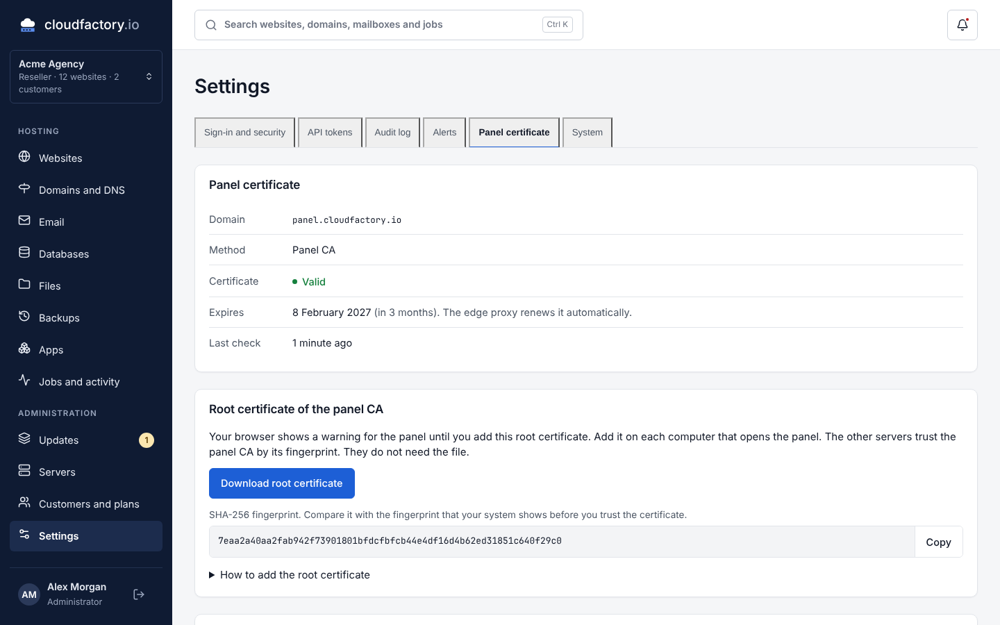
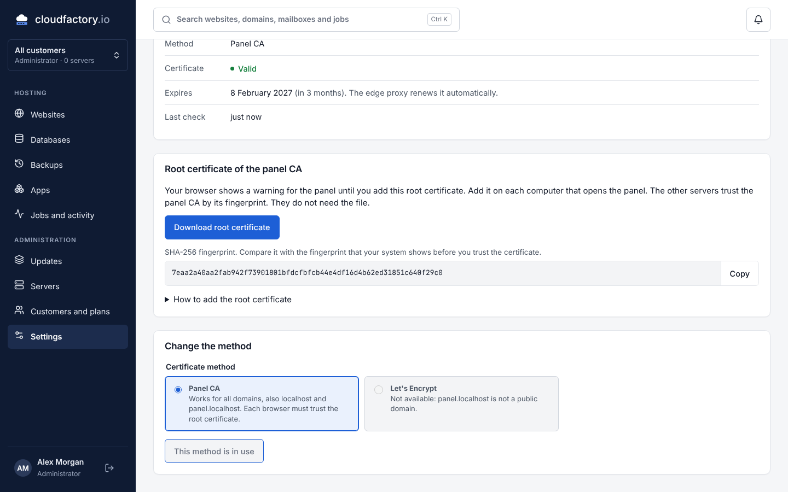
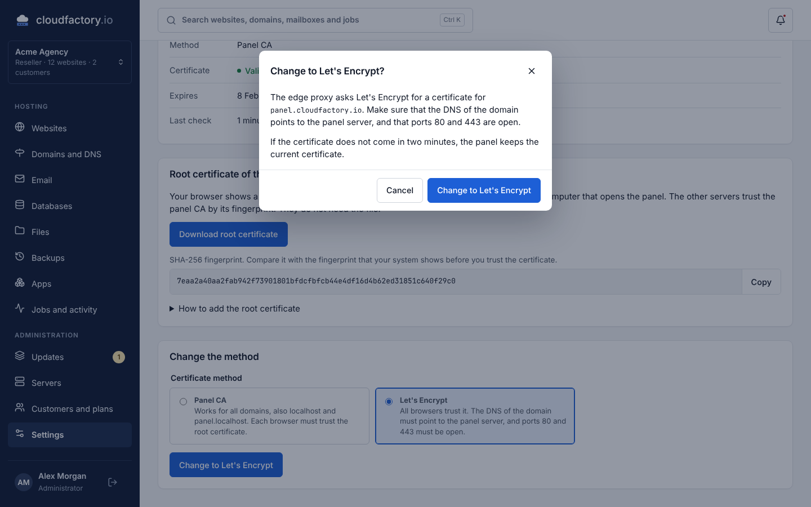
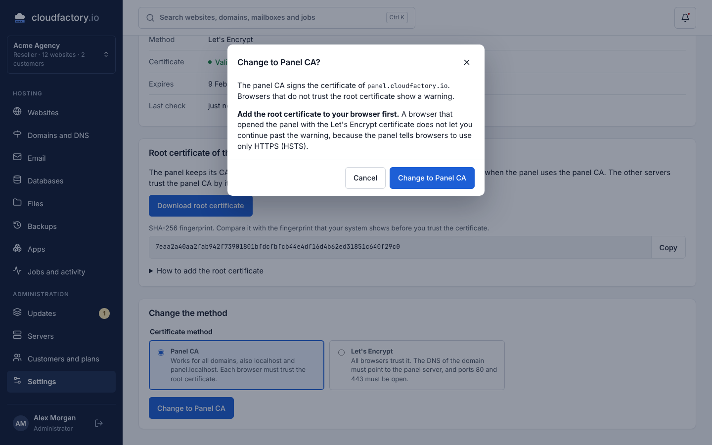
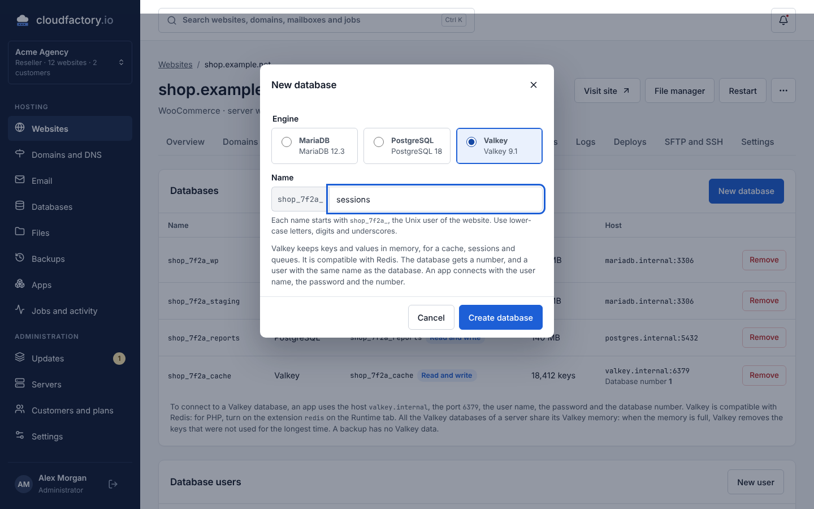
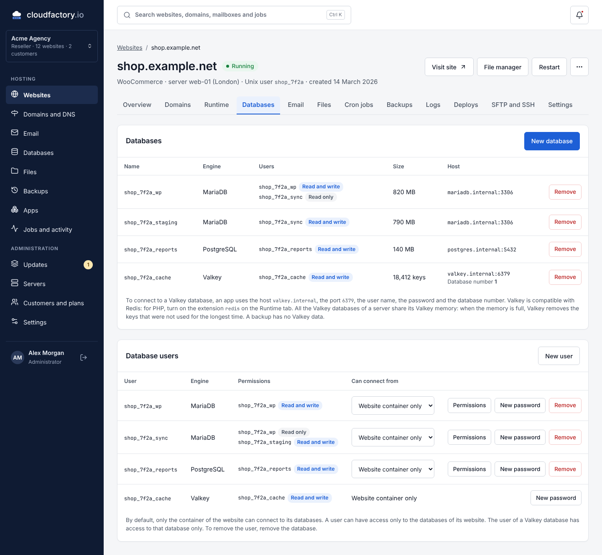

# Screenshots

These screenshots show the web panel of release 0.1 with the mock API. For the panel on the
real API, refer to [live/README.md](live/README.md).

The mock API shows areas that the API of release 0.1 does not have, for example DNS, email and
files. Refer to [status.md](../status.md).

The [main README](../../README.md) uses the screenshots in [readme/](readme). They show the
production build of the web panel on the panel API, with the sample data of `php artisan db:seed`
and sample reports for resource use, jobs and backups.

## 01-websites

## 02-new-website

## 03-website-overview

## 04-website-runtime

## 05-website-domains

## 06-website-databases

## 07-website-backups

## 08-website-access

## 09-website-logs

## 10-website-settings

## 11-updates

## 12-servers

## 13-server-detail

## 14-jobs

## 15-databases

## 16-backups

## 17-files

## 18-dns

## 19-email

## 20-apps

## 21-customers

## 22-settings

## 23-login

## 24-websites-phone

## 25-database-user-permissions

The permissions of one database user on each database of the website (CF-01).

## 26-new-database-user

A new database user: the name starts with the Unix user of the website, and each database has its own permission.

## 27-database-user-password

The panel shows the password of a new database user one time only.

## 28-new-database

A new database, with the prefix of the website.

## 29-domain-not-verified

A domain that is not verified. The edge proxy serves it only after the TXT record is correct (CF-03).

## 30-new-token

A new API token needs the password and the TOTP code of the user (CF-02).

## 31-panel-certificate

The certificate of the panel domain from the panel CA, and the root certificate to download.

## 32-panel-certificate-localhost

A panel on `panel.localhost`. Let's Encrypt is not available for this domain. This screenshot
shows live mode with the answers of the API from a test.

## 33-change-to-lets-encrypt

The change to Let's Encrypt. If the certificate does not come, the panel keeps the current
certificate.

## 34-change-back-to-panel-ca

The change back to the panel CA. Add the root certificate to the browser first (HSTS).

## 35-new-valkey-database

A new Valkey database. It always gets a user with the same name, so the form has no option
for the user.

## 36-valkey-database

The databases of a website with a Valkey database: the host, the database number and the
number of keys. The user of a Valkey database can only get a new password.

