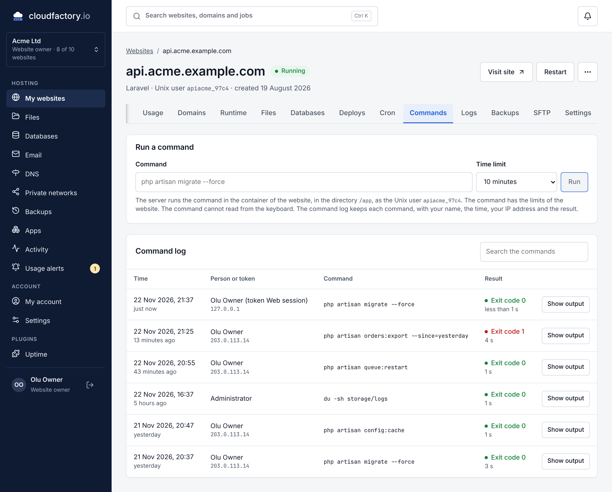
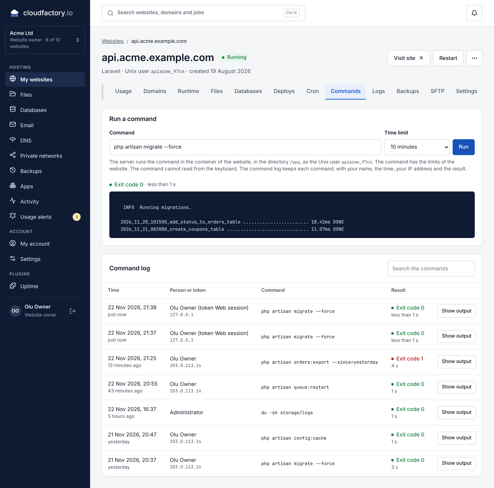
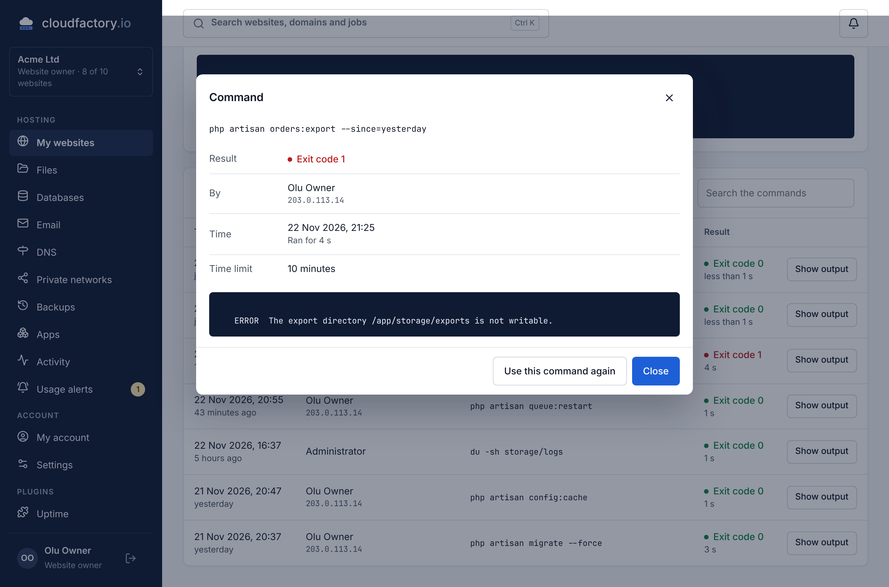
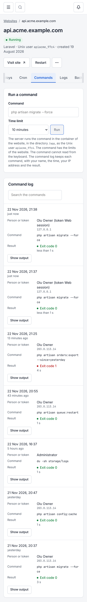
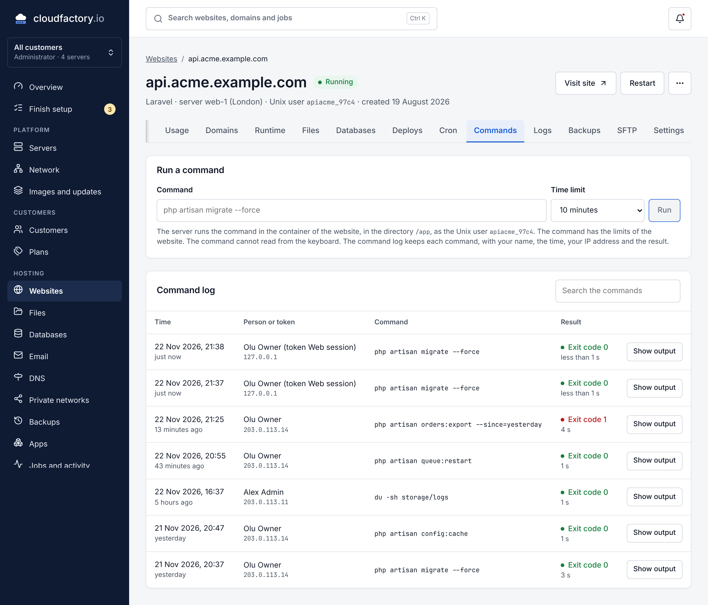

# Screenshots of Run a command and the command log

These screenshots show the tab **Commands** of a website (FR-802). They are from the
demonstration mode (`CF_DEMO=true`) with the sample data of
`api/database/seeders/DemoSeeder.php`.

## 01-command-log

An owner opens the tab **Commands** of a website. The command log shows each command, who ran
it, from which IP address, and the result. The owner sees "Administrator" in place of the name
of a person of the operator, and no IP address.

## 02-run-a-command

The owner runs `php artisan migrate --force`. The panel shows the exit code and the output
when the command ends. The new command is at the top of the command log.

## 03-command-output

**Show output** shows one entry of the command log with the end of its output. **Use this
command again** puts the command in the form.

## 04-command-log-phone

The same tab on a phone.

## 05-command-log-administrator

An administrator sees the name and the IP address of each person.

