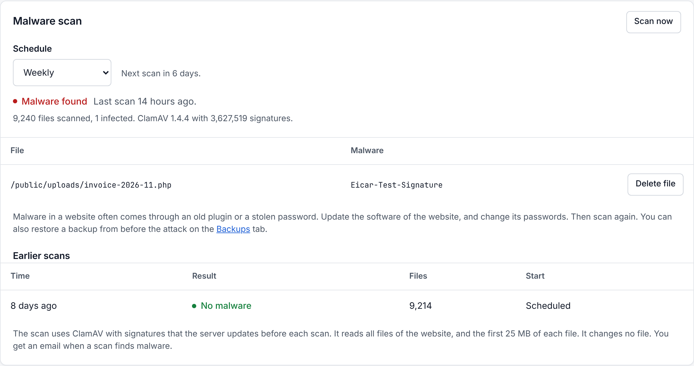
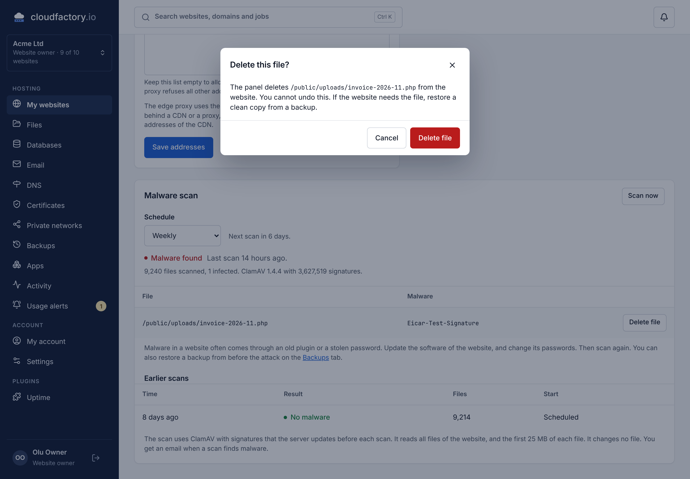
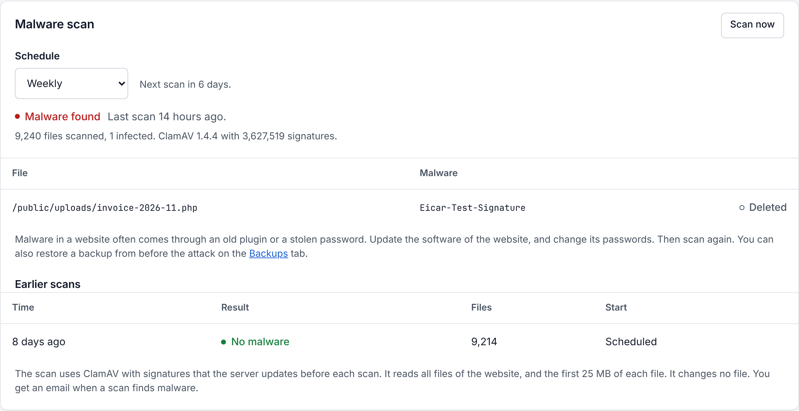
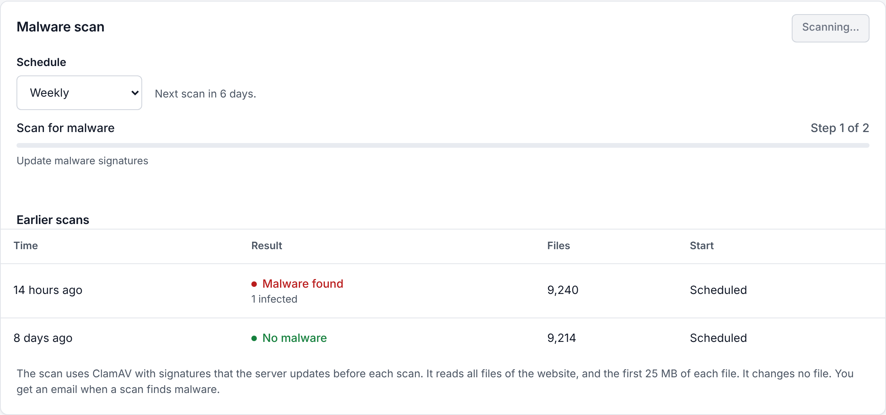
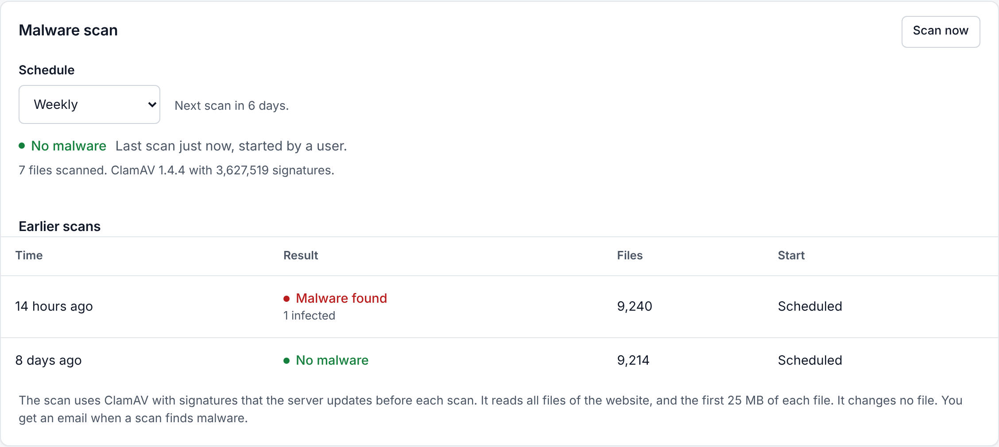
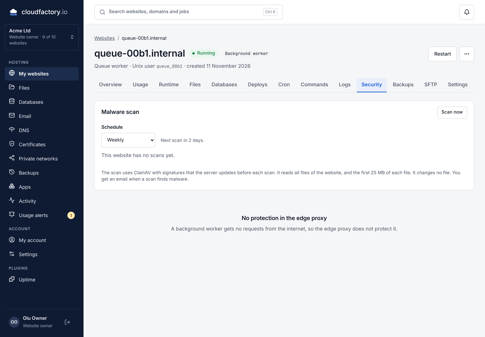
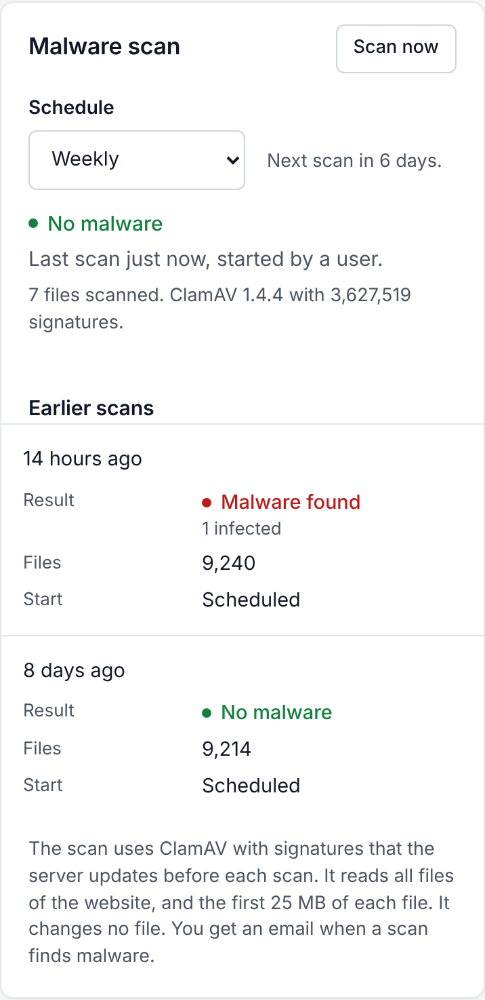

# Screenshots of the malware scan

These screenshots show the card **Malware scan** on the tab **Security** of a website. They
are from the demonstration mode (`CF_DEMO=true`) with the sample data of
`api/database/seeders/DemoSeeder.php`.

## 01-malware-found

The weekly scan of `shop.acme.example.com` found one infected file. The card shows the file,
the name of the malware, and what to do. The table below shows the earlier scans.

## 02-delete-a-file

The owner selects **Delete file**. The panel asks for a confirmation, because you cannot undo
the delete.

## 03-file-deleted

The panel deleted the file. The table shows "Deleted" for the file.

## 04-scan-runs

The owner selects **Scan now**. The job updates the signatures of the server, then scans the
files.

## 05-no-malware

The new scan found no malware. The infected scan is now in the table of the earlier scans.

## 06-background-worker

A background worker gets no requests from the internet, so the tab **Security** has no
protection in the edge proxy. The malware scan is available for all websites.

## 07-phone

The card on a phone. Each earlier scan is a block of rows.

