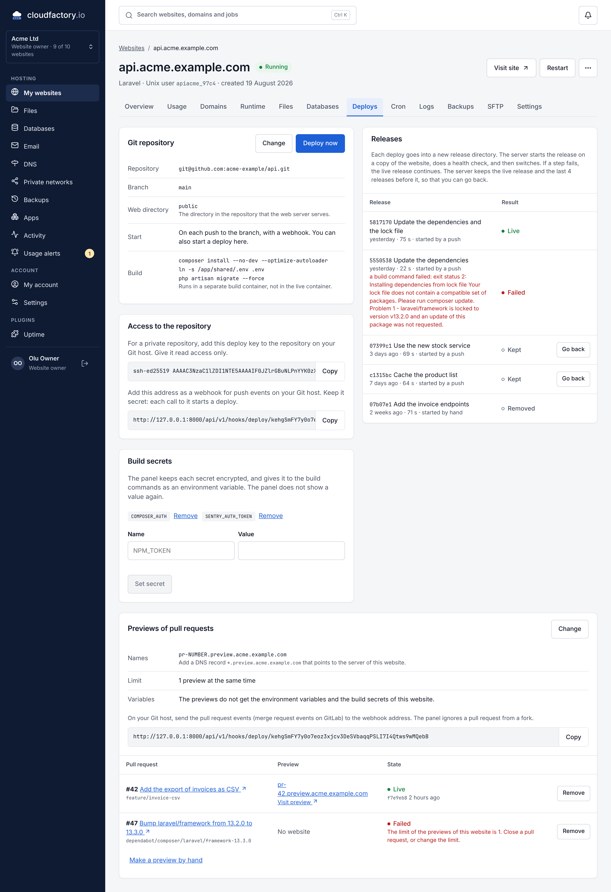
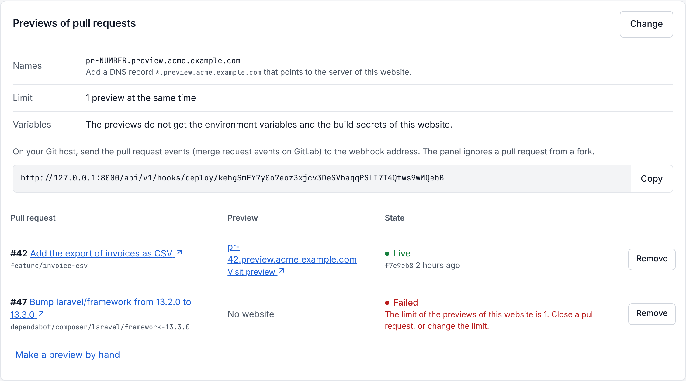
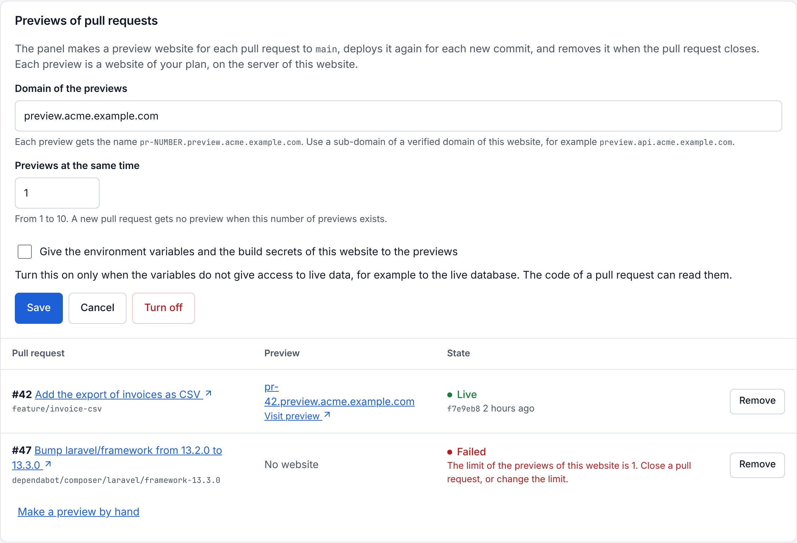
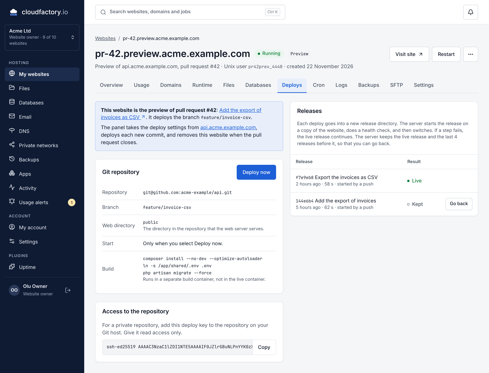

# Screenshots: previews of pull requests

These screenshots show the previews of pull requests in the owner console, in demonstration
mode. The sample data is in `api/database/seeders/DemoSeeder.php`. Refer to
[architecture.md](../../architecture.md#previews-of-pull-requests).

## 01-deploys-tab-previews

The Deploys tab of `api.acme.example.com`. The card **Previews of pull requests** is below the
releases. It shows the settings, the webhook address and one row for each pull request.

## 02-previews-card

The previews. Pull request #42 has a live preview. The panel did not make the preview of pull
request #47, because the limit is 1. The row shows the cause.

## 03-previews-settings

The settings: the domain of the previews, the number of previews at the same time, and the
setting that gives the environment variables and the build secrets to the previews.

## 04-preview-website

The Deploys tab of the preview website `pr-42.preview.acme.example.com`. The notice shows the
pull request and the website that gives the deploy settings. The preview has no **Change**
button and no build secrets.

