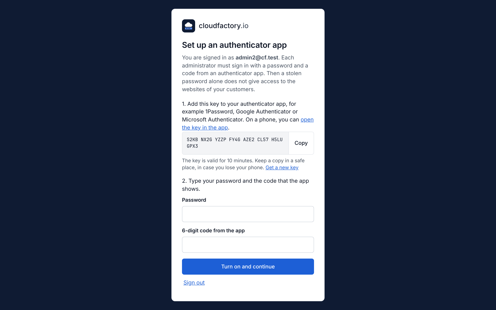
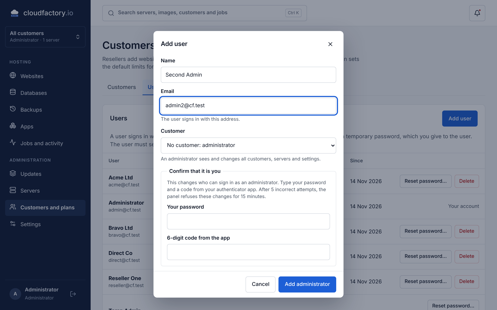
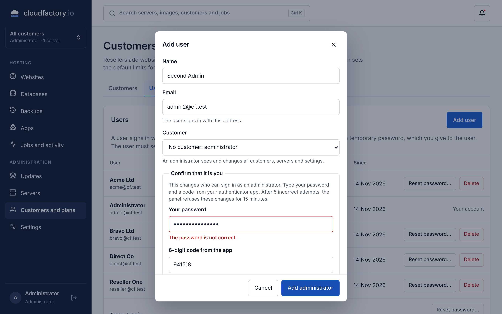
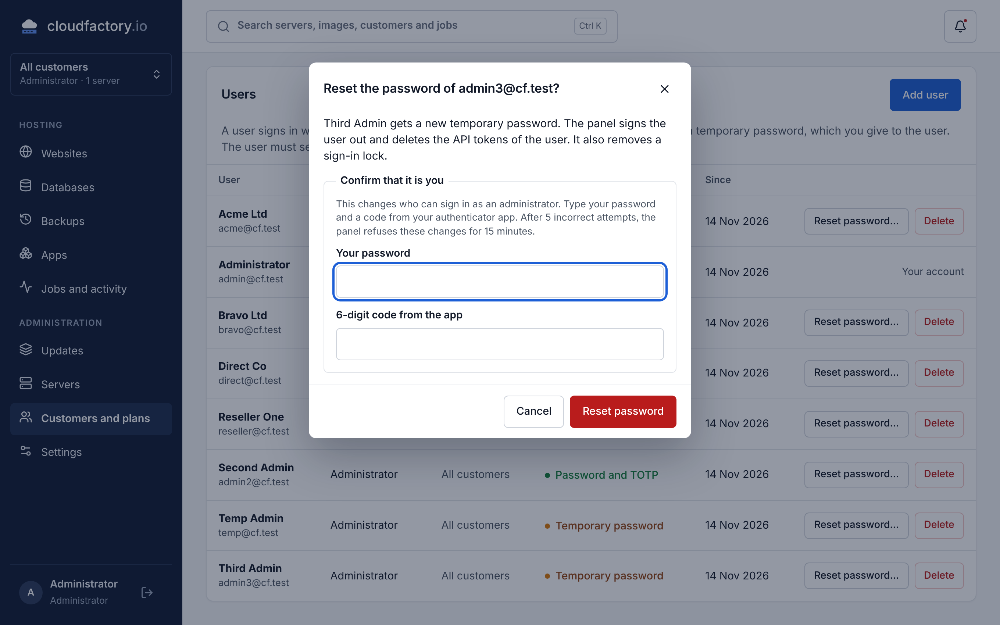
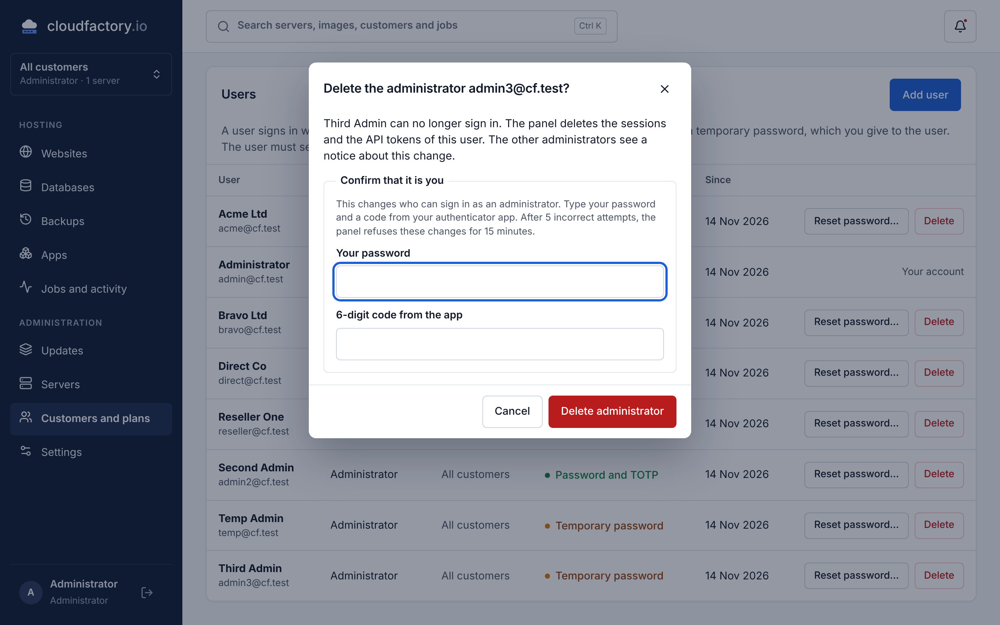
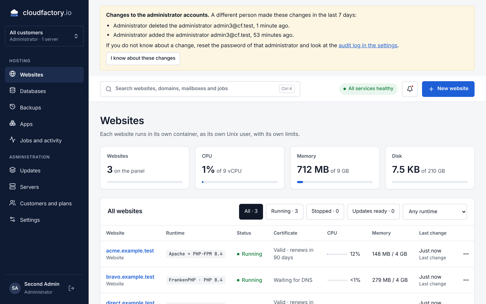
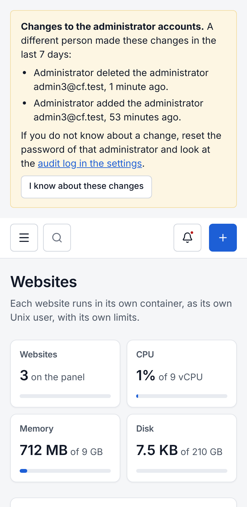
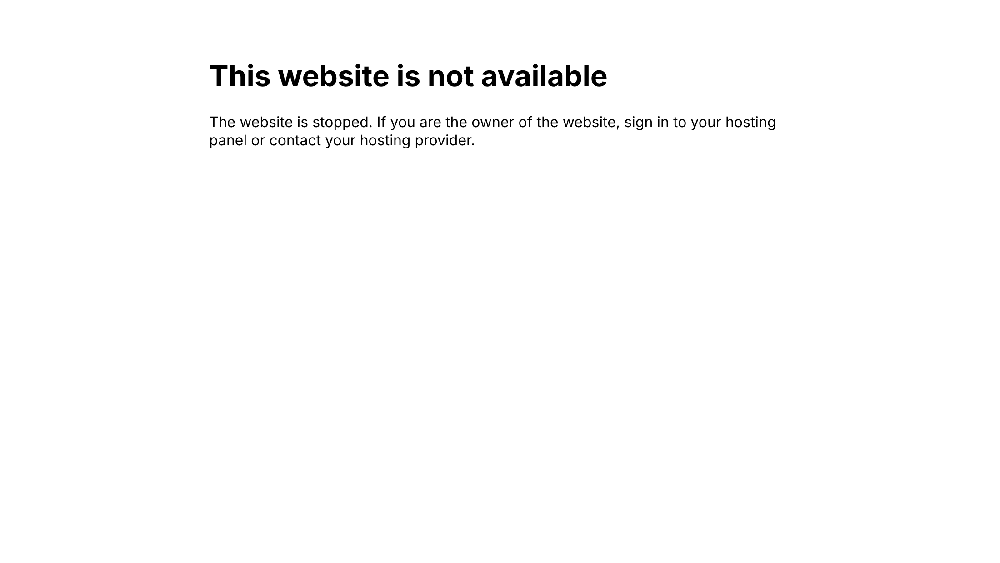

# Screenshots of the security changes

These screenshots show the changes for the second audit (findings F09 and U10). They are from
a test server with Debian 13, release 0.1.9 and the code of the pull request.

## 01-set-up-totp

An administrator or a reseller with no TOTP sees only this page after the sign-in. The panel
shows the other pages after TOTP is on.

## 02-add-administrator

To add an administrator, the signed-in administrator types the password and a code.

## 03-wrong-password

The panel refuses the change when the password or the code is not correct.

## 04-reset-administrator

A password reset for an administrator needs the same confirmation.

## 05-delete-administrator

To delete an administrator, the signed-in administrator types the password and a code.

## 06-notice

For 7 days, each other administrator sees which administrator accounts a different person
made, reset or deleted.

## 07-notice-phone

The notice at a width of 390 pixels.

## 08-stopped-website

A visitor of a stopped website gets this page with the status 503.

