# Screenshots of the sign-in pages

These screenshots show the web panel on the panel API in demonstration mode (`CF_DEMO=true`).
To see the same pages on your computer, refer to [development.md](../../development.md).

## Password reset by email

### reset-1-sign-in

The sign-in page shows **Forgot your password?** when an SMTP server can send the email.

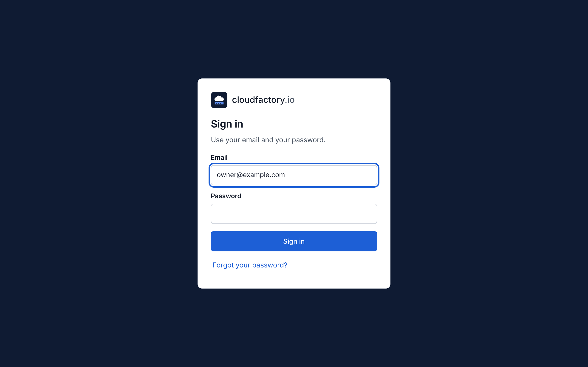

### reset-2-ask-for-link

The user types the email of the user. The form keeps the email from the sign-in page.

### reset-3-link-sent

The answer is the same for each email, also for an email with no user.

### reset-4-new-password

The link in the email opens this page. The code of the link is after `#`, so the browser does
not send it to a server.

### reset-5-changed

The new password stops all sessions and API tokens of the user. TOTP stays on.

### reset-6-old-link

A link works one time only, for 60 minutes.

### reset-7-sent-email-copy

An administrator or the reseller of the user can read the copy of the email in **Sent emails**.
The copy has a placeholder in the place of the link, and nobody can send it again.

### reset-8-phone

The form on a phone.

## Passkeys

A virtual authenticator of Chromium made the passkeys of these screenshots. The demonstration
panel runs on `localhost`, so the new passkey has the domain `localhost`.

### passkey-1-sign-in

The sign-in page shows **Sign in with a passkey** on a panel domain, in a browser that can use
passkeys.

### passkey-2-settings

**Settings** shows the passkeys of the user, with the domain of each passkey. **Synced** shows
that the passkey is in a password manager or a cloud account.

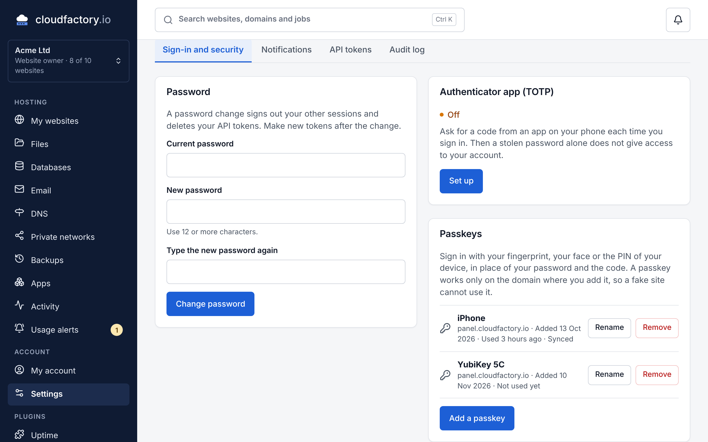

### passkey-3-add

To add a passkey, the user gives a name and the password. When TOTP is on, the user also gives
a code. Then the browser asks the user to make the passkey.

### passkey-4-added

The new passkey is in the list.

### passkey-5-signed-in-with-passkey

After a sign-in with the new passkey, the list shows when the user used it.

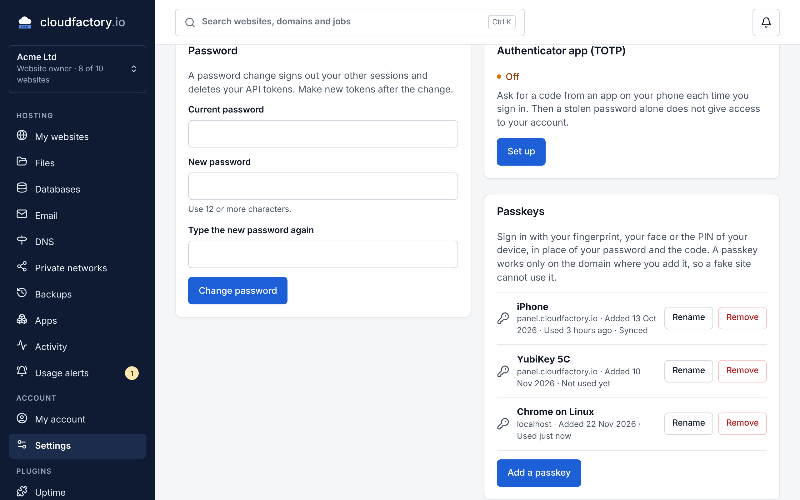

### passkey-6-remove

To remove a passkey, the user gives the password. The dialog tells the user to remove the
passkey from the device also.

### passkey-7-cancelled

The device did not verify the user. The sign-in page tells the user to try again.

### passkey-8-phone

The passkeys on a phone.

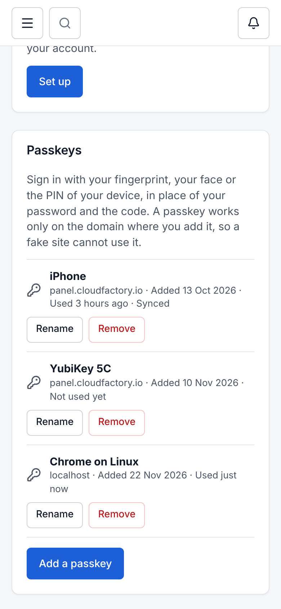

## Single sign-on

A test provider "Example ID" on `http://localhost:9100` made the sign-ins of these screenshots.
It is a small OpenID Connect provider that signs real ID tokens. The demonstration mode
accepts an HTTP provider on `localhost`. A real panel accepts only HTTPS.

### sso-1-providers

An administrator adds the providers in **Settings > Single sign-on**. The table shows the
protocol, the status, the email domains for the connection by email, and the number of
connected users.

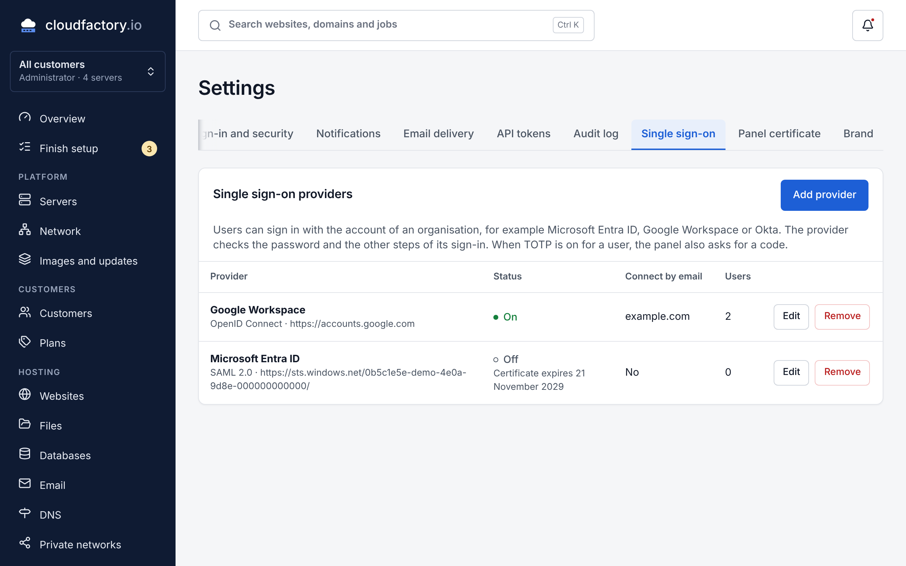

### sso-2-add-oidc

The dialog shows the redirect URI before the provider is in the panel. The redirect URI is the
same for all providers.

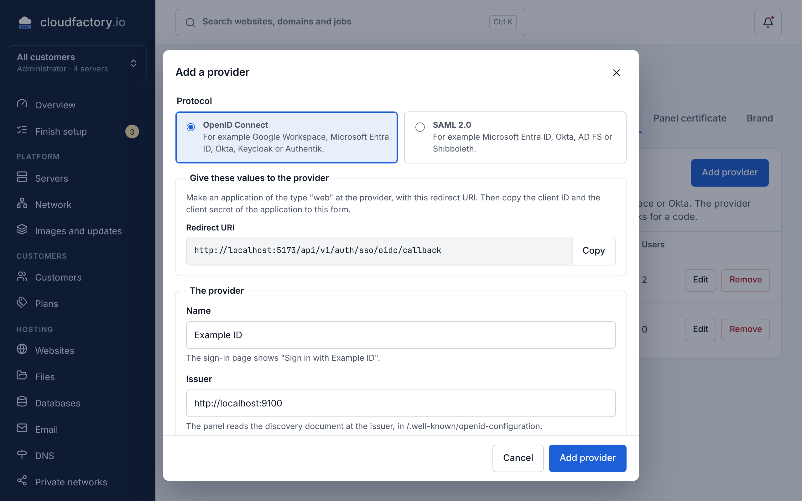

### sso-3-add-saml

For SAML, the dialog shows the entity ID of the panel, which is also the address of its
metadata, and the assertion consumer service (ACS) URL.

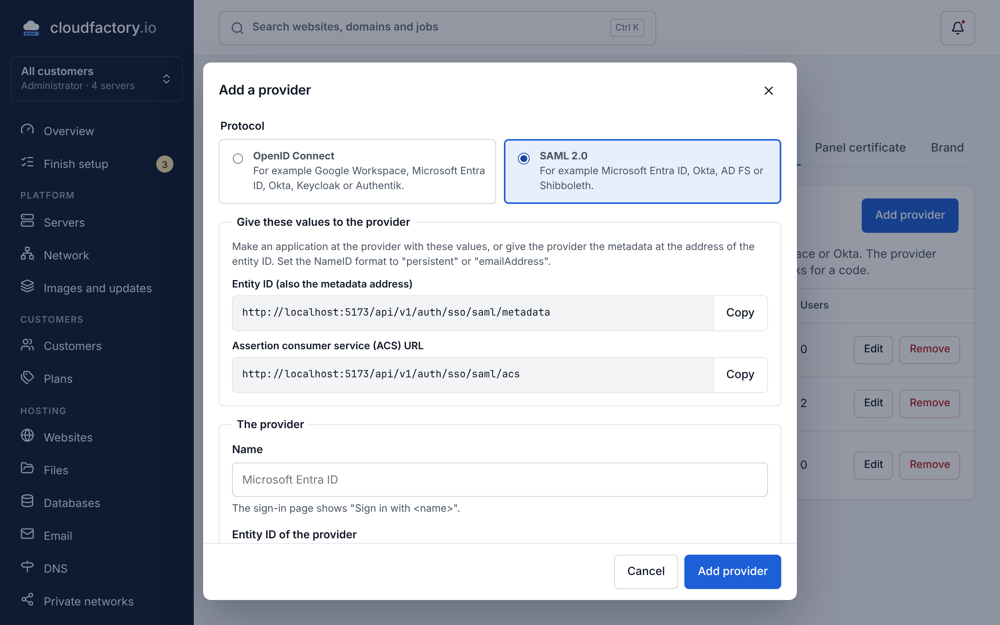

### sso-4-sign-in

The sign-in page shows a button for each provider that is on.

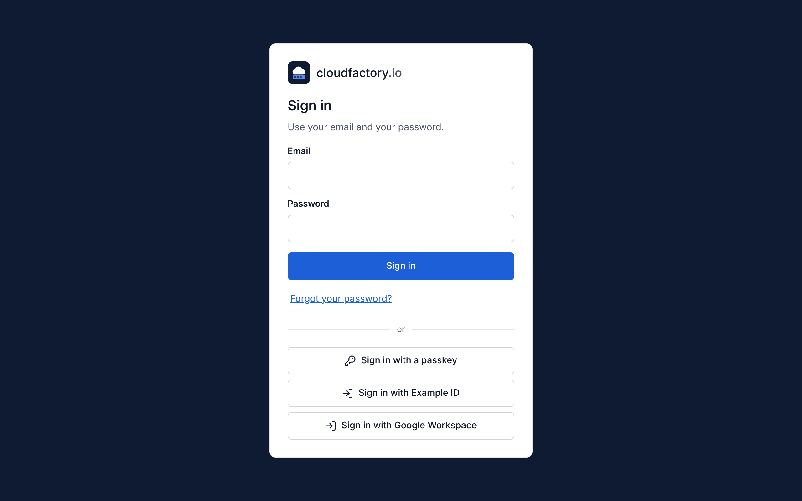

### sso-5-provider

The browser goes to the provider. The person signs in there.

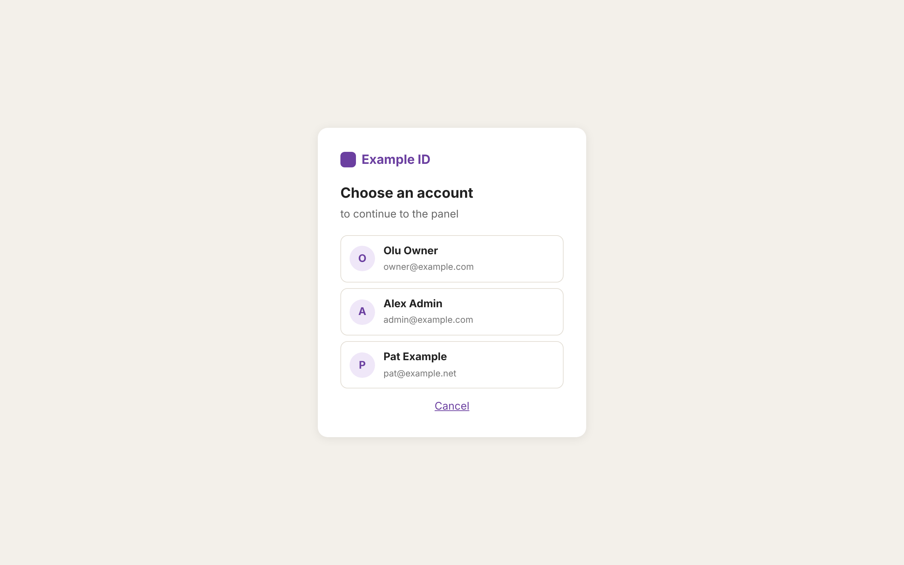

### sso-6-settings

The provider gave the verified email `owner@example.com`. The domain `example.com` is in the
list of the provider, so the panel connected the account to the user at the first sign-in.

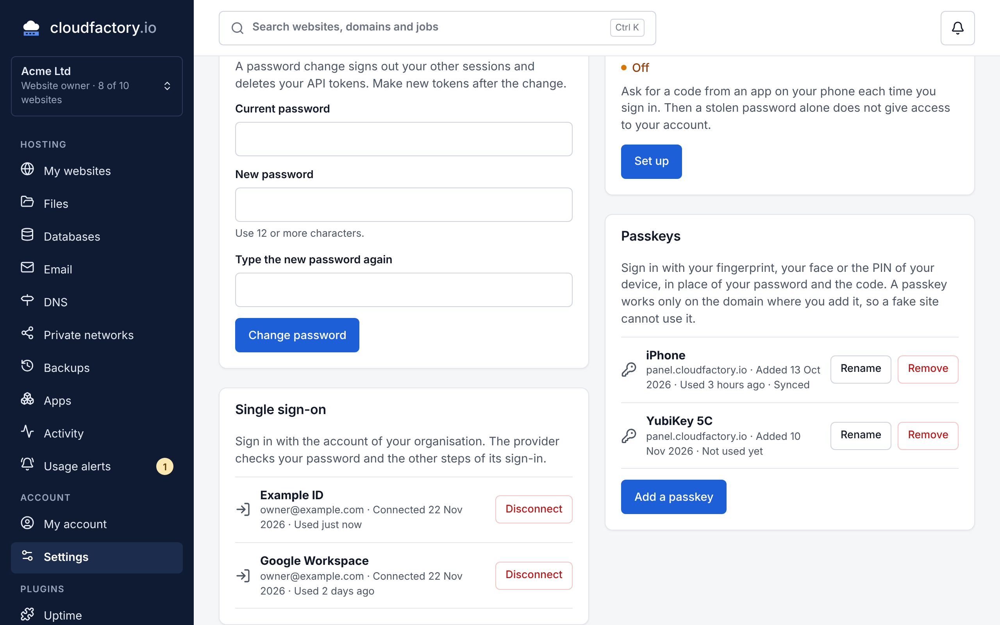

### sso-7-disconnect

To disconnect an account, the user types the password.

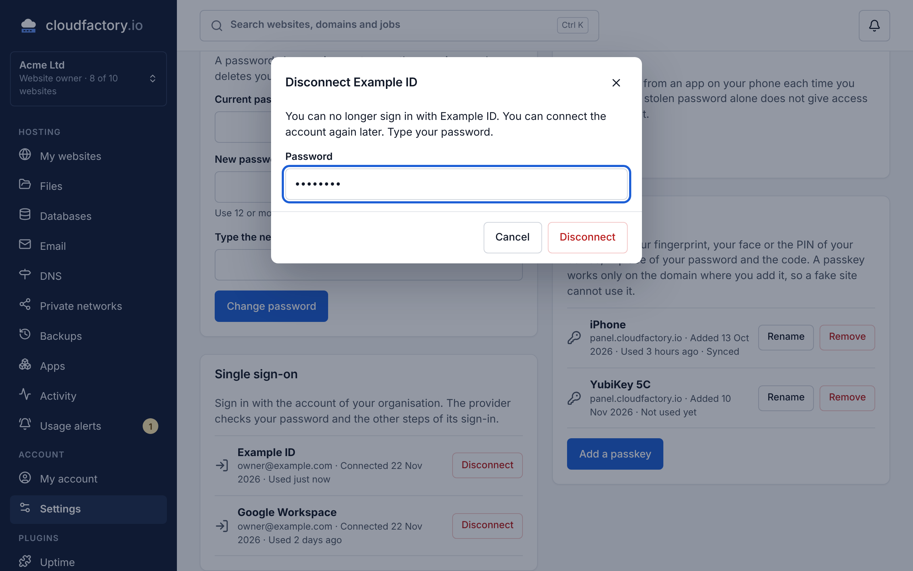

### sso-8-no-account

The person `pat@example.net` has no user in the panel, so the panel does not sign the person
in.

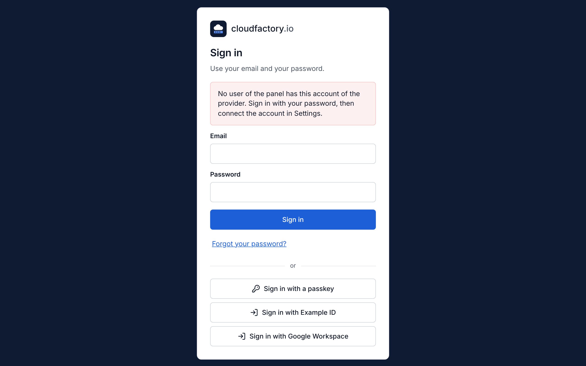

### sso-9-totp

TOTP is on for this user. The panel asks for a code after the sign-in at the provider.

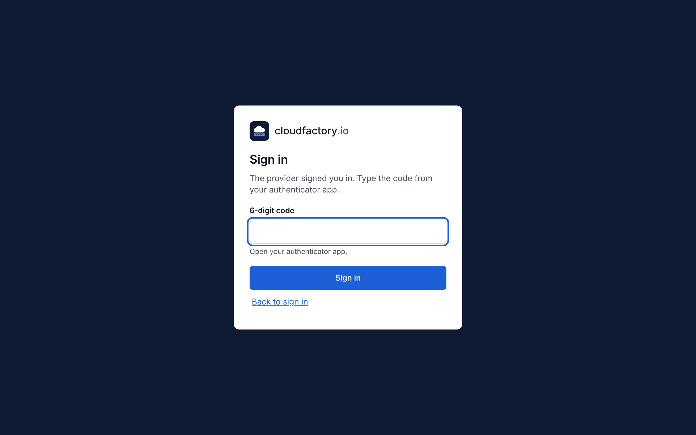

### sso-10-phone

The sign-in page on a phone.

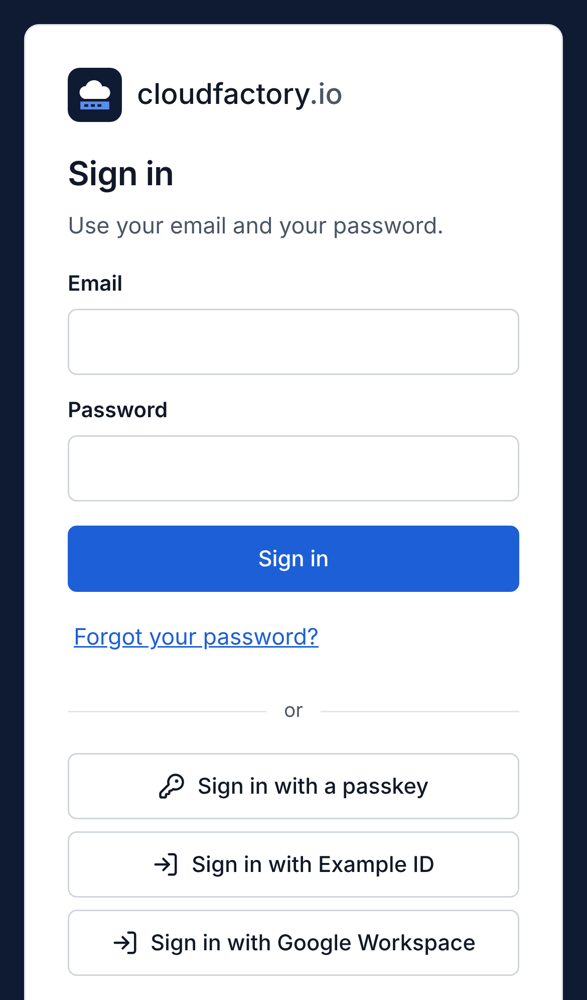

### sso-11-connected

A reseller connected an account in **Settings**: **Connect**, the password, and then the
sign-in at the provider. The provider sends the browser back to **Settings**. The email of
the account can be different from the email of the user.

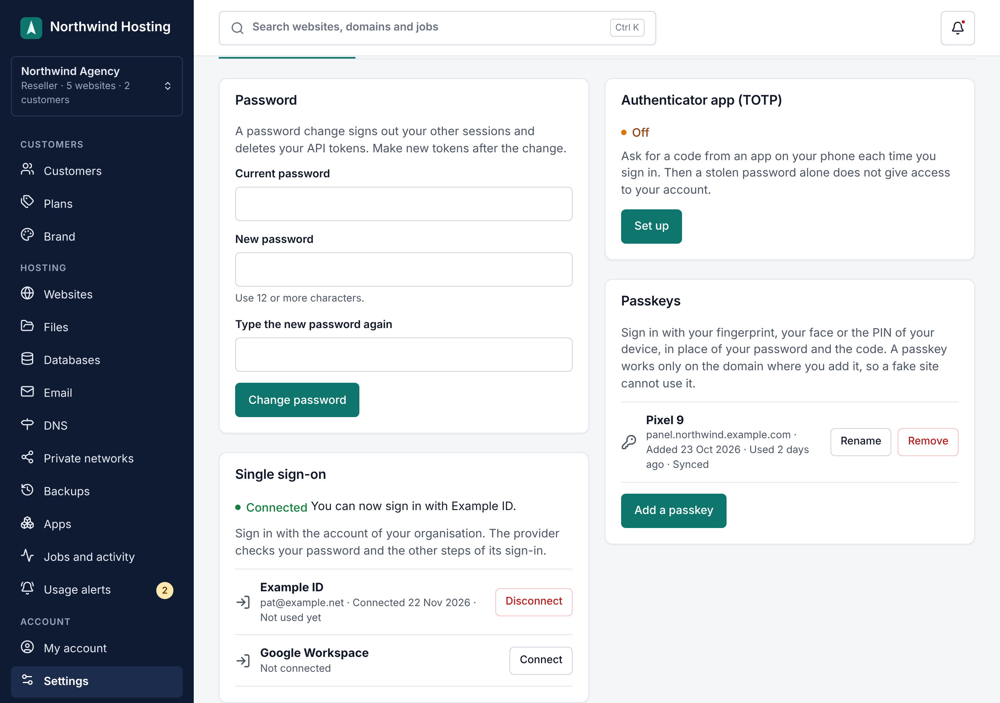
