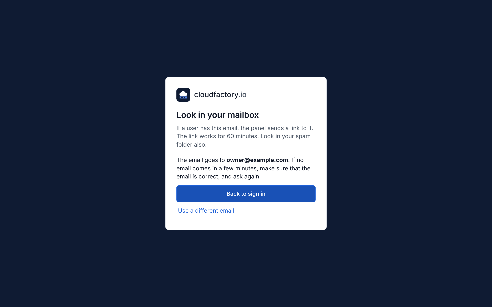
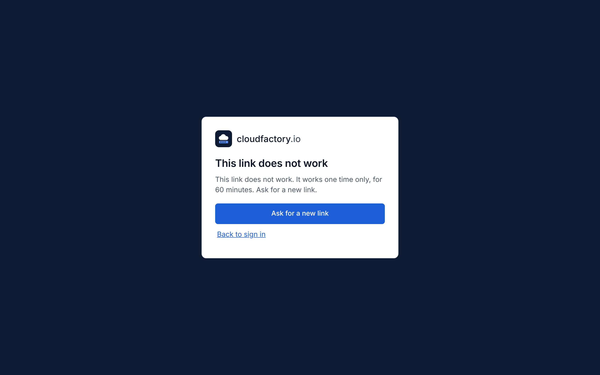
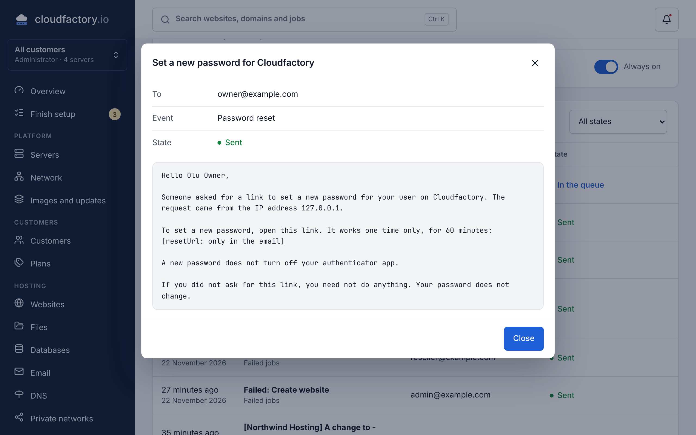
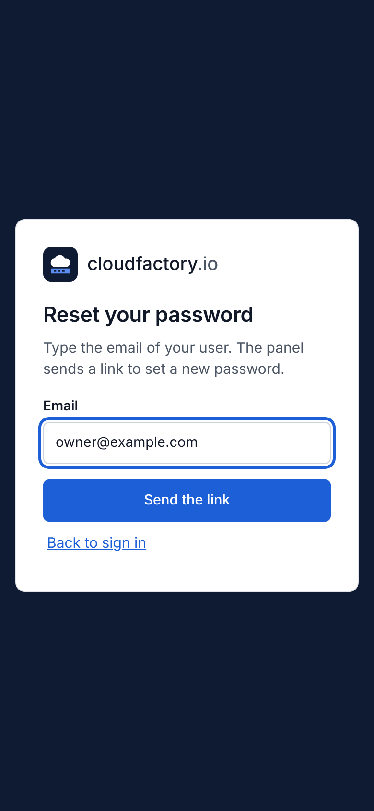

# Screenshots of the sign-in pages

These screenshots show the web panel on the panel API in demonstration mode (`CF_DEMO=true`).
To see the same pages on your computer, refer to [development.md](../../development.md).

## Password reset by email

### reset-1-sign-in

The sign-in page shows **Forgot your password?** when an SMTP server can send the email.

### reset-2-ask-for-link

The user types the email of the user. The form keeps the email from the sign-in page.

### reset-3-link-sent

The answer is the same for each email, also for an email with no user.

### reset-4-new-password

The link in the email opens this page. The code of the link is after `#`, so the browser does
not send it to a server.

### reset-5-changed

The new password stops all sessions and API tokens of the user. TOTP stays on.

### reset-6-old-link

A link works one time only, for 60 minutes.

### reset-7-sent-email-copy

An administrator or the reseller of the user can read the copy of the email in **Sent emails**.
The copy has a placeholder in the place of the link, and nobody can send it again.

### reset-8-phone

The form on a phone.

