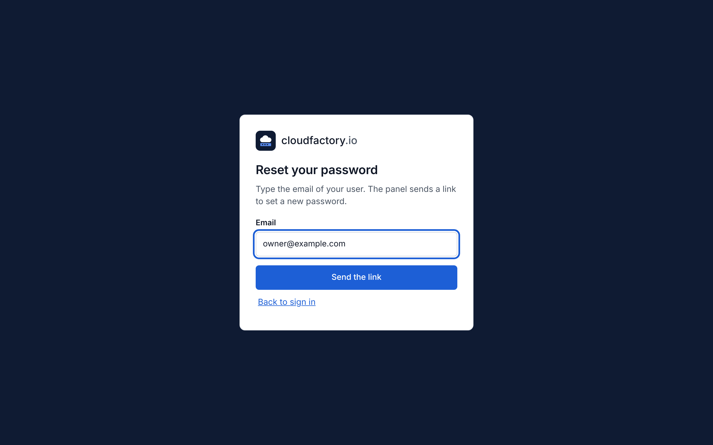
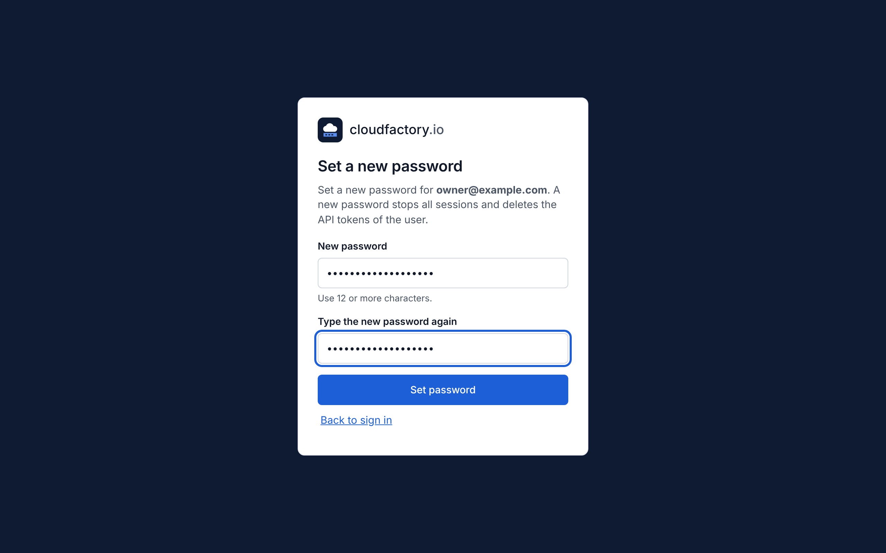
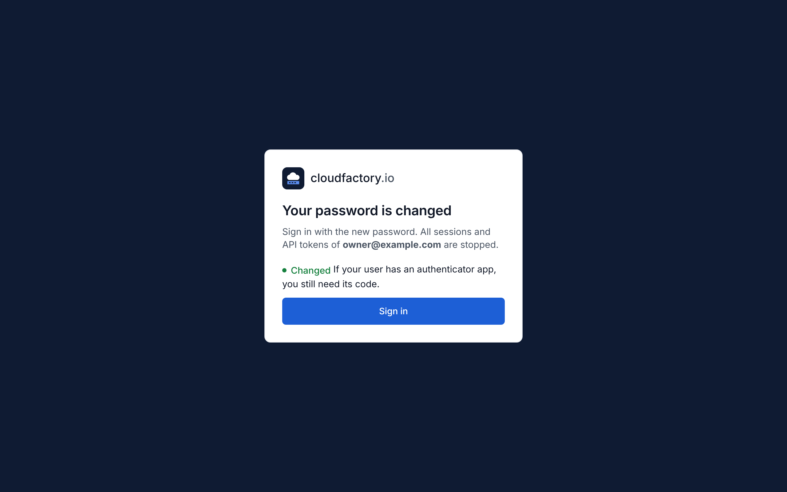
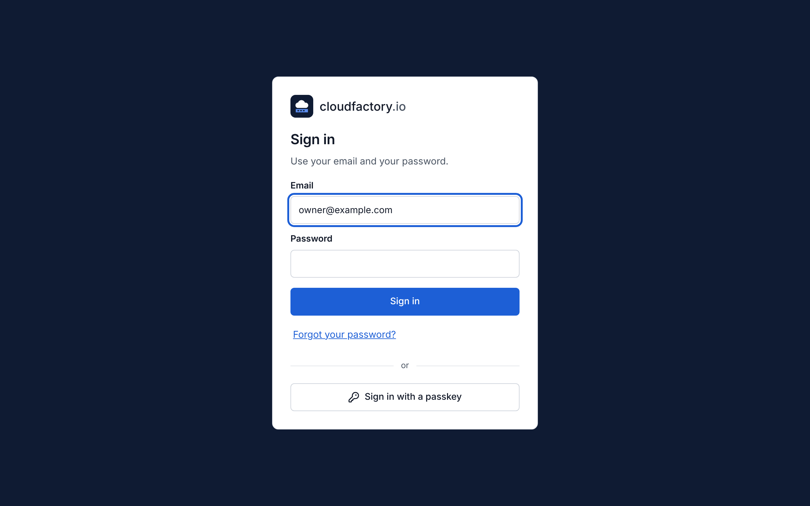
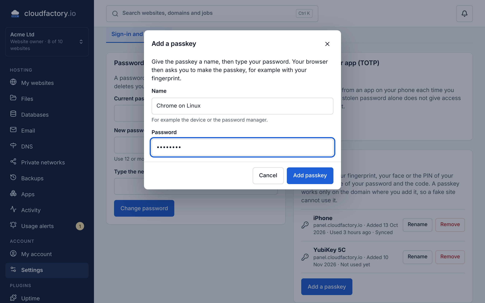
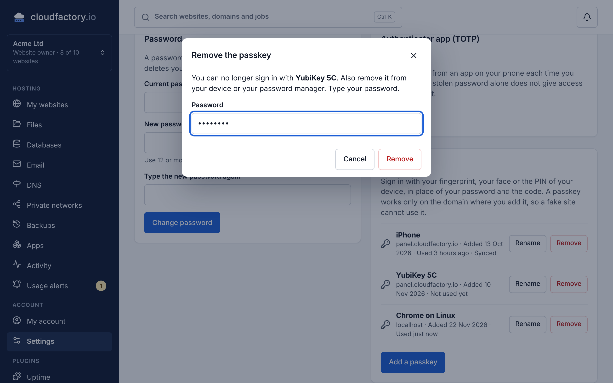
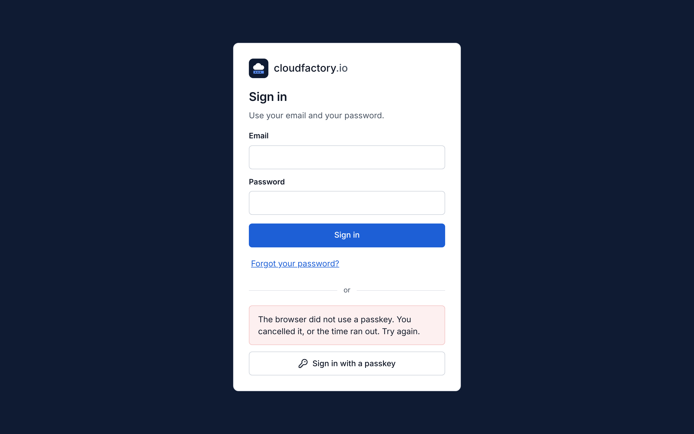

# Screenshots of the sign-in pages

These screenshots show the web panel on the panel API in demonstration mode (`CF_DEMO=true`).
To see the same pages on your computer, refer to [development.md](../../development.md).

## Password reset by email

### reset-1-sign-in

The sign-in page shows **Forgot your password?** when an SMTP server can send the email.

### reset-2-ask-for-link

The user types the email of the user. The form keeps the email from the sign-in page.

### reset-3-link-sent

The answer is the same for each email, also for an email with no user.

### reset-4-new-password

The link in the email opens this page. The code of the link is after `#`, so the browser does
not send it to a server.

### reset-5-changed

The new password stops all sessions and API tokens of the user. TOTP stays on.

### reset-6-old-link

A link works one time only, for 60 minutes.

### reset-7-sent-email-copy

An administrator or the reseller of the user can read the copy of the email in **Sent emails**.
The copy has a placeholder in the place of the link, and nobody can send it again.

### reset-8-phone

The form on a phone.

## Passkeys

A virtual authenticator of Chromium made the passkeys of these screenshots. The demonstration
panel runs on `localhost`, so the new passkey has the domain `localhost`.

### passkey-1-sign-in

The sign-in page shows **Sign in with a passkey** on a panel domain, in a browser that can use
passkeys.

### passkey-2-settings

**Settings** shows the passkeys of the user, with the domain of each passkey. **Synced** shows
that the passkey is in a password manager or a cloud account.

### passkey-3-add

To add a passkey, the user gives a name and the password. When TOTP is on, the user also gives
a code. Then the browser asks the user to make the passkey.

### passkey-4-added

The new passkey is in the list.

### passkey-5-signed-in-with-passkey

After a sign-in with the new passkey, the list shows when the user used it.

### passkey-6-remove

To remove a passkey, the user gives the password. The dialog tells the user to remove the
passkey from the device also.

### passkey-7-cancelled

The device did not verify the user. The sign-in page tells the user to try again.

### passkey-8-phone

The passkeys on a phone.

