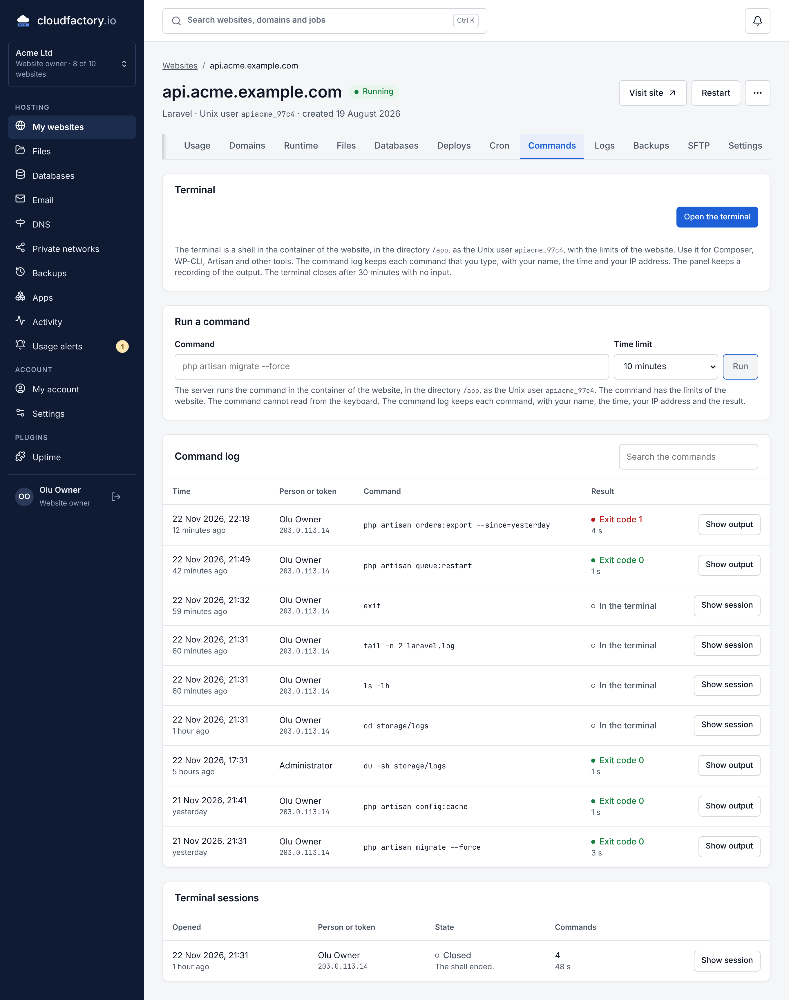
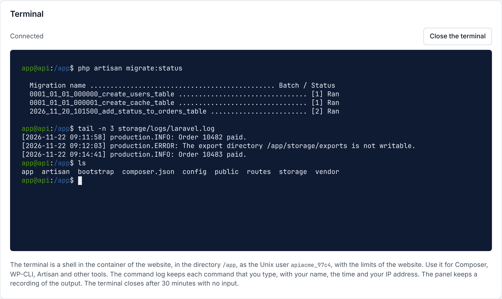
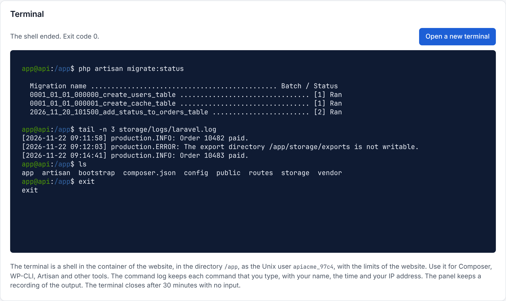
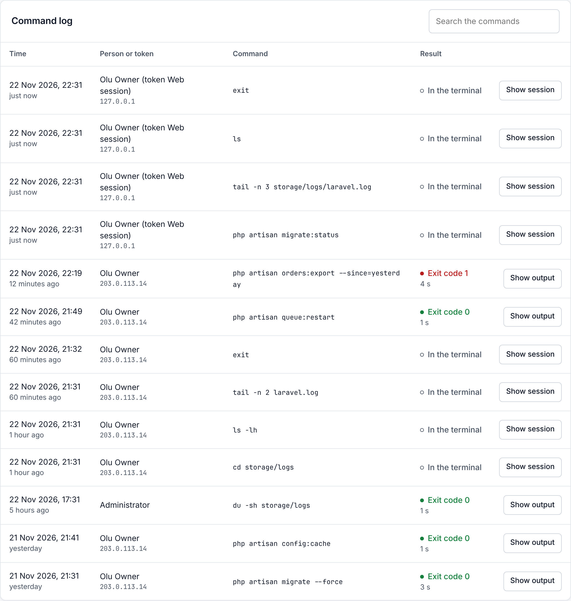
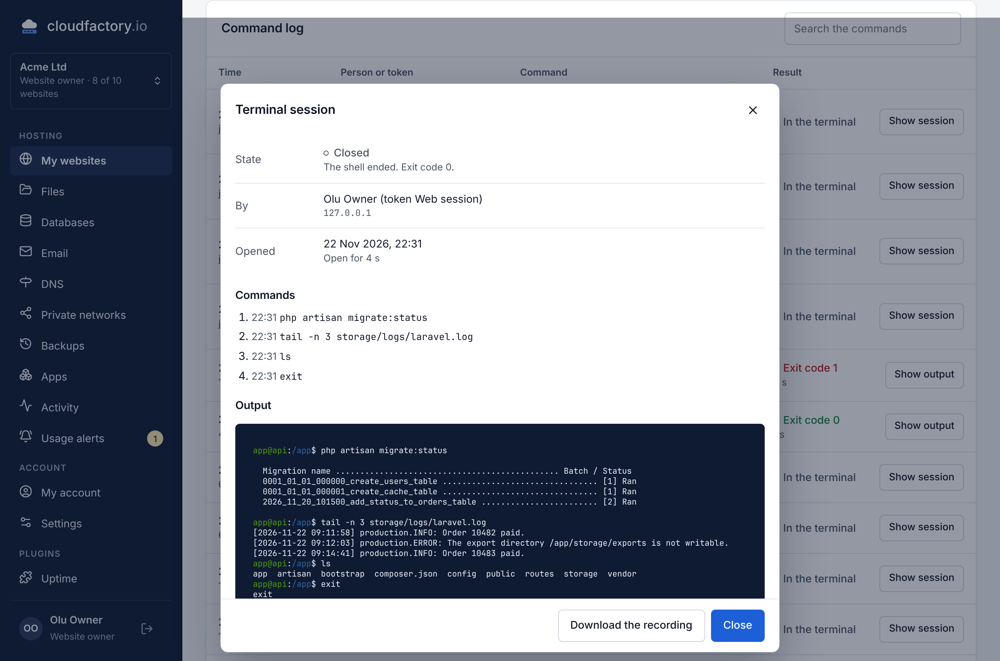
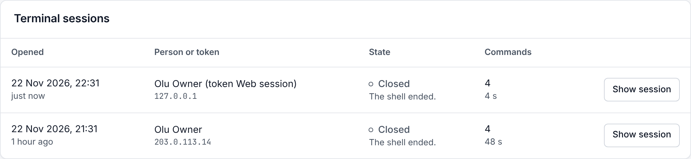
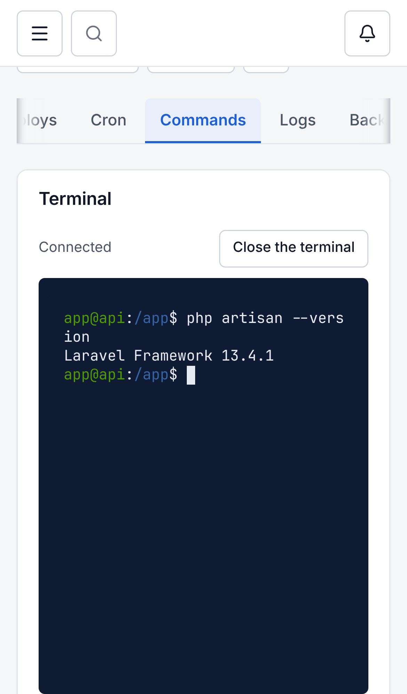

# Screenshots of the web terminal

These screenshots show the web terminal on the tab **Commands** of a website (FR-802). They are
from the demonstration mode with `CF_DEMO_TERMINAL=true`, the terminal relay
(`cf-terminal-relay`) and the sample data of `api/database/seeders/DemoSeeder.php`. A test
program played the agent: it connected a local shell to the relay in a sample Laravel
directory, and it sent the commands and the recording to the panel at the end.

## 01-commands-tab

The tab **Commands** has three parts: **Terminal**, **Run a command** and the **Command log**.
Below them, **Terminal sessions** shows each session of the website. The commands of the sample
session show "In the terminal" in the command log.

## 02-terminal

The owner opens the terminal and types three commands. The shell is in the directory `/app` of
the website.

## 03-terminal-ended

The owner types `exit`. The panel shows the reason and the exit code. **Open a new terminal**
opens a new session.

## 04-command-log

The command log shows each command of the session, with the person, the time and the IP
address.

## 05-terminal-session

**Show session** shows the session: the state, the person, the time, the commands and the
recording of the output. **Download the recording** gives the recording as an asciicast file.

## 06-terminal-sessions

**Terminal sessions** shows each session, its state, the number of commands and how long it was
open.

## 07-terminal-phone

The terminal on a phone.

