# WordPress (FR-206)

These screenshots show the WordPress functions in the demonstration mode, with the sample data
of `api/database/seeders/DemoSeeder.php`. To see the same pages on your computer, refer to
[development.md](../../development.md).

### 1-wordpress-tab

The **WordPress** tab of a site with updates: the version, the updates of WordPress, the
plugins and the themes, the result of the last automatic update, the restore point, the
settings of the automatic updates and the WP-CLI commands.

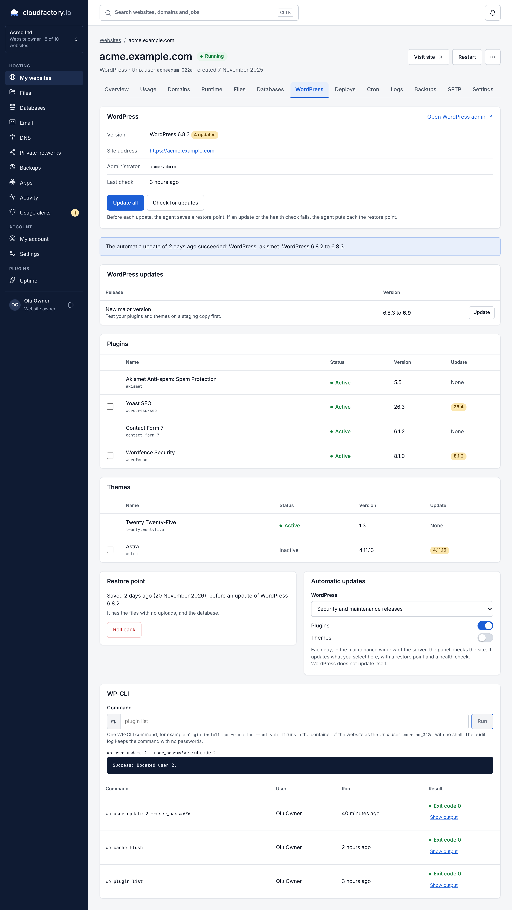

### 2-select-updates

Two updates are selected. **Update selected** updates them with one restore point.

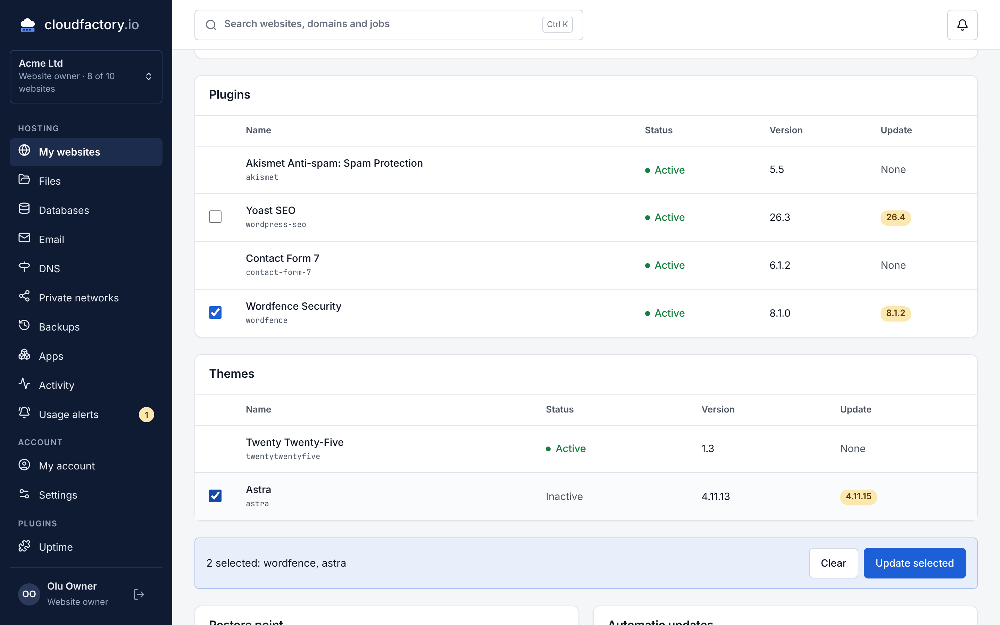

### 3-roll-back

**Roll back** puts back the restore point. The dialog says that the database also goes back.

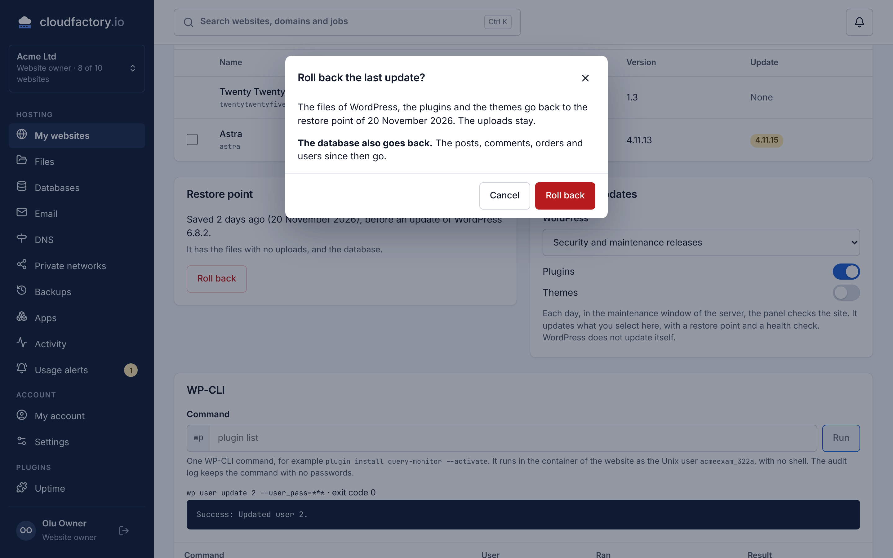

### 4-wp-cli

A WP-CLI command and its output. The history has the commands with no passwords.

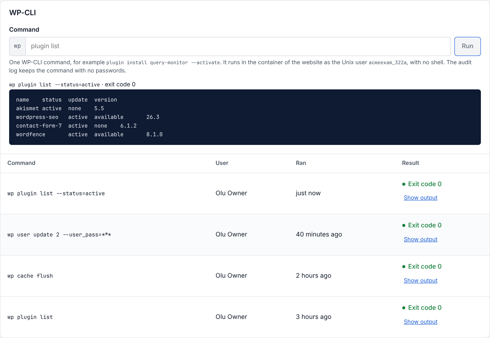

### 5-install-wordpress

**Install WordPress** on a running PHP website with no WordPress, and **Find WordPress** for a
site that the user uploaded with SFTP.

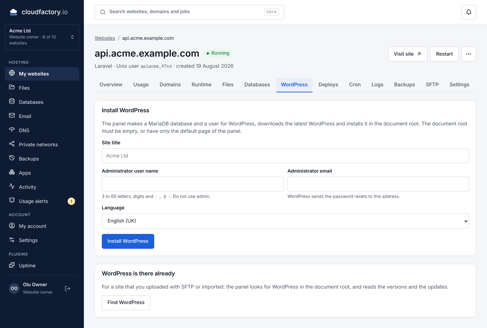

### 6-new-wordpress-website

The **New website** page with the application WordPress: the panel installs WordPress after it
makes the website.

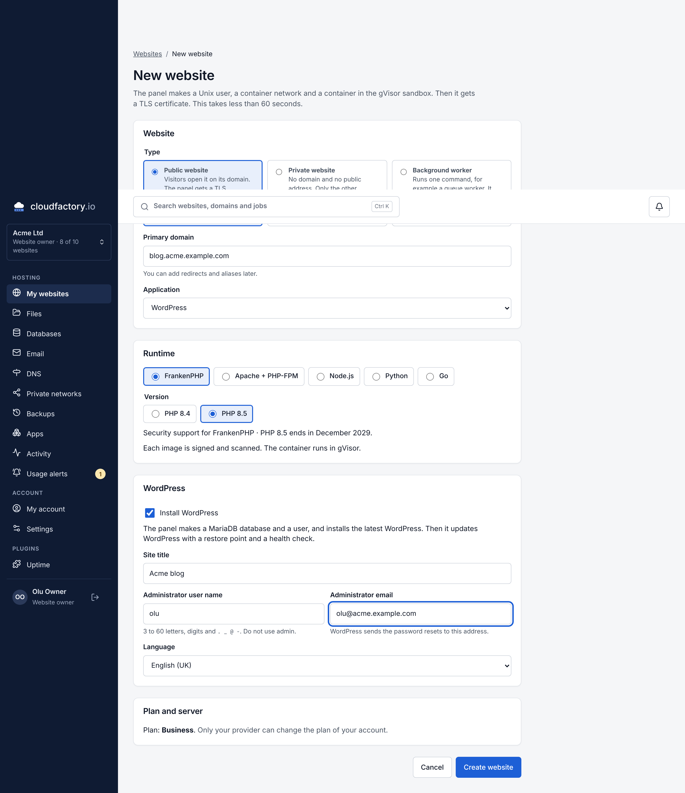

### 7-administrator-password

The panel shows the password of the first administrator one time.

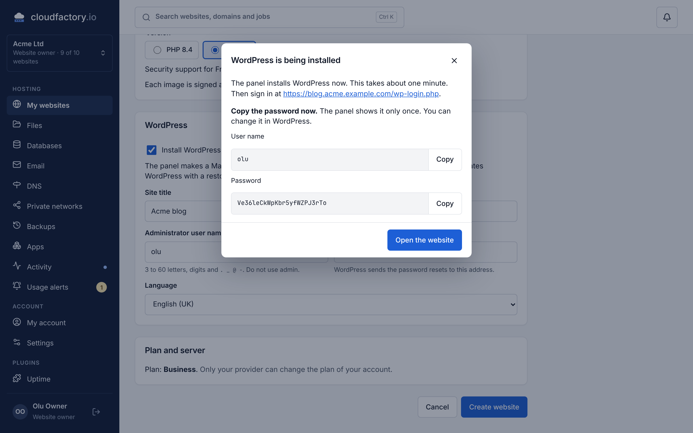

### 8-new-site-installed

The new site after the install.

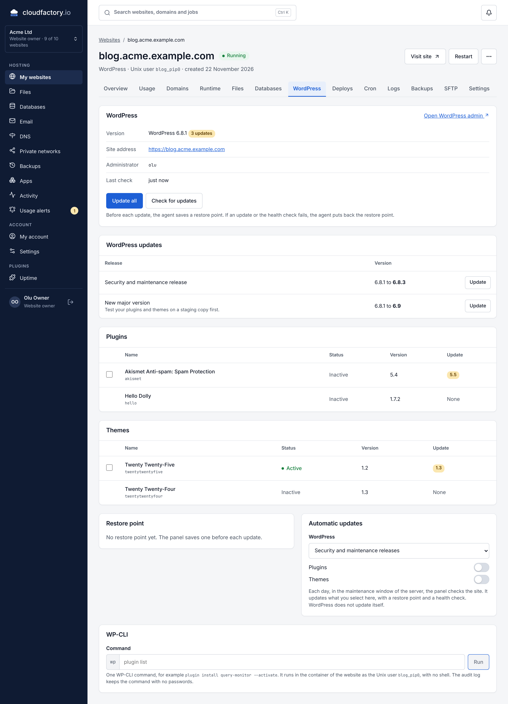

### 9-rolled-back-update

A reseller sees an update that failed the health check. The agent put back the restore point.

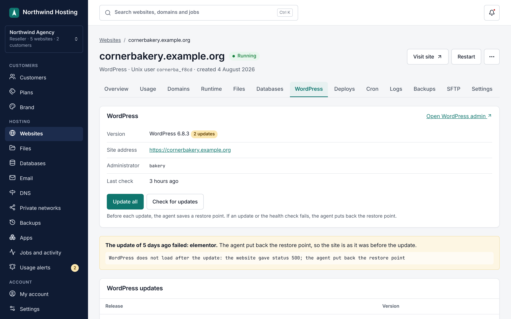

### 10-phone-wordpress-tab

The **WordPress** tab at phone width (390 px).

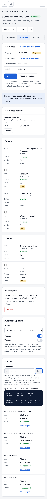

### 11-staging-copy-dialog

**Make staging copy** of a WordPress site. The agent writes the database copy and its user to
`wp-config.php` of the copy, so the copy never uses the live database.

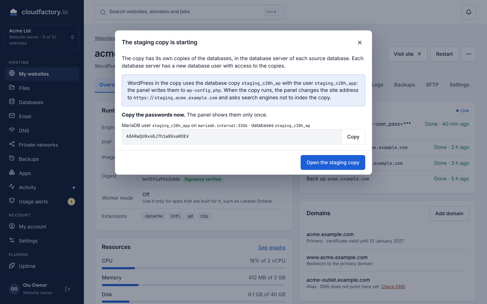

### 12-staging-copy-in-progress

The **WordPress** tab of the copy while the panel changes the site address and asks search
engines not to index the copy.

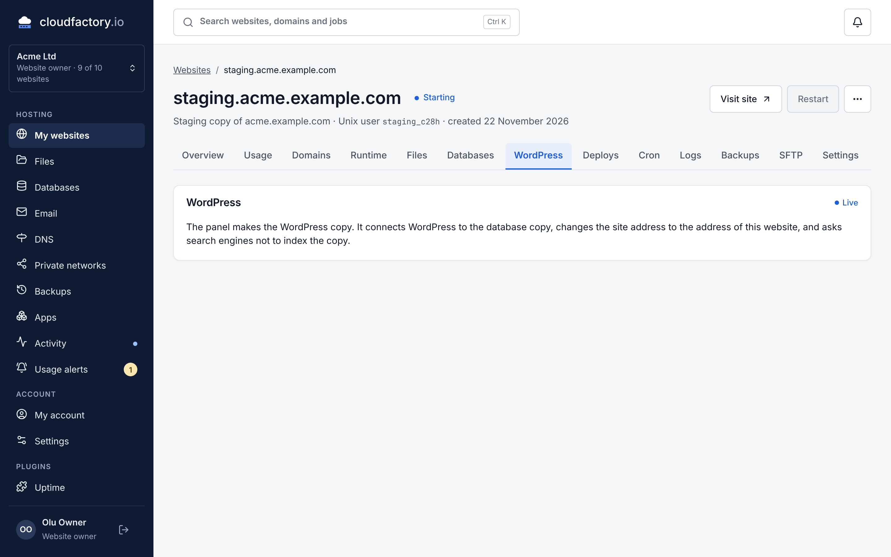

### 13-staging-copy-ready

The WordPress copy at its own address. Its automatic updates are off.

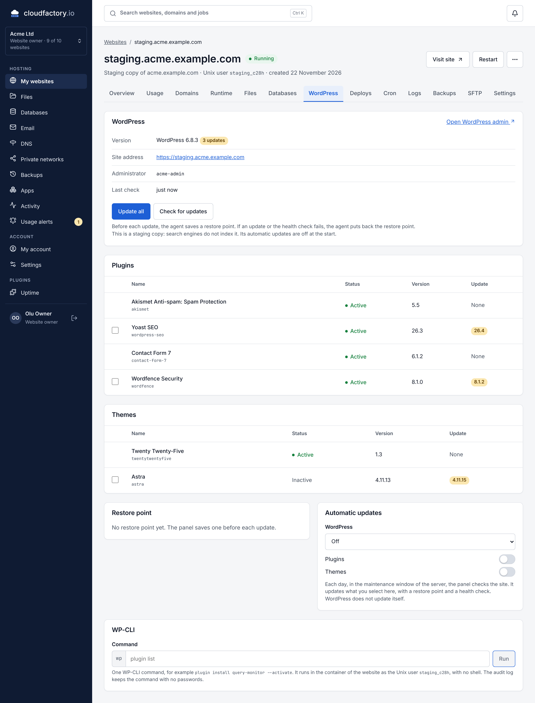
